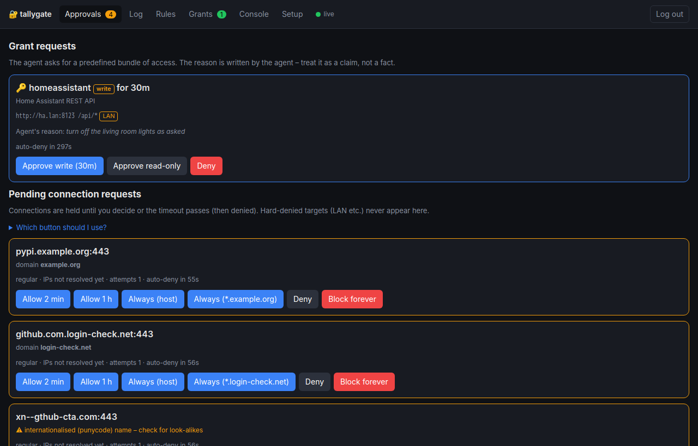
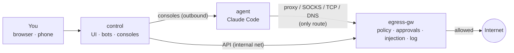

<p align="center">
  <picture>
    <source media="(prefers-color-scheme: dark)" srcset="docs/images/logo-dark.svg">
    
  </picture>
</p>

# tallygate

**Run Claude Code unattended behind a policy-enforcing egress gateway, with you in the loop.**

[](https://github.com/PhilippMundhenk/tallygate/actions/workflows/ci.yml)
[](LICENSE)


tallygate puts an AI coding agent (Claude Code with [Remote Control](https://code.claude.com/docs/en/remote-control))
into a container that has **no route to anything** except a gateway. The gateway decides every outbound
connection against your policy, **holds unknown connections until you approve them** (in the web UI, on
Telegram or in Matrix), keeps your GitHub token out of the agent, and logs everything. A control plane gives
you a web UI with live log, rule editor, browser consoles and a setup wizard.

**Why "tallygate"?** On a livestock farm, the tally gate is the narrow gate where animals pass one at a time
to be counted and inspected before they are let through or sorted out. tallygate does the same with your
agent's network traffic: every connection passes the gate singly, is checked against your rules, logged, and
only then let through, turned back, or held for you to decide.



## Features

- **Fail-closed isolation by topology.** The agent sits on an `internal` Docker network: no default route, no
  iptables, no capabilities. Anything that bypasses the proxy simply can't connect.
- **One policy for every protocol.** HTTP(S) proxy, SOCKS5 and TCP service ports all pass through a single
  enforcement hook. Rules work on domains, globs, CIDRs and ports, with TTLs and presets.
- **Human in the loop.** `ask` holds the connection while you decide: allow 2 min / 1 h / always / whole
  domain, deny, or block forever. Concurrent attempts share one prompt.
- **LAN protection.** A hard deny on resolved IPs (RFC1918, loopback, link-local/metadata, CGNAT, ULA …) that
  can't be approved away, plus DNS-rebinding protection by pinning to the checked IP.
- **Grants for your home network.** Named, time-limited bundles of access, such as "Home Assistant API,
  read-only" or "SSH to the NAS for 30 min". You define them in the config or the UI. The agent asks for one
  with a reason, and you approve, downgrade to read-only, or deny with one tap. The gateway enforces Host,
  paths and methods on every request, injects the service's credentials, and pins self-signed certificates.
  [More](docs/grants.md)
- **No DNS exfiltration.** The agent's DNS always answers NXDOMAIN, and every attempt is logged. The gateway
  only resolves a name after the policy or a human allowed it.
- **Secrets stay out of the agent.** The GitHub token lives in the gateway and is injected in flight, only when
  the CONNECT target and Host match. The agent's own credentials for those hosts are stripped, and
  read-only hosts (e.g. the npm registry) refuse uploads.
- **Operator UI.** Approvals, live log, rules editor with dry-run test, presets, browser consoles (Remote
  Control, bash, claude), and a setup wizard for GitHub, Claude login, git and Remote Control.
- **Phone approvals** via Telegram buttons or Matrix reactions (outbound polling only, no webhooks).
- **Hardened by default.** Non-root everywhere, `cap_drop: ALL`, `no-new-privileges`, read-only root
  filesystems, no `docker.sock`, pinned dependencies and checksum-verified downloads.
- **Tested.** Unit tests, end-to-end tests of every enforcement path (including SNI spoofing and upstream
  certificate verification), and a Docker-based isolation test in CI.

## How it works



Details: [docs/architecture.md](docs/architecture.md) · Security: [docs/threat-model.md](docs/threat-model.md) ·
[security review](docs/security-review.md) · Grants: [docs/grants.md](docs/grants.md)

## Quick start

Requirements: Linux (amd64 or arm64) with Docker Engine ≥ 25 and the Compose plugin, a claude.ai
subscription.

### With Docker Compose (recommended)

tallygate runs as three containers from prebuilt images: the gateway, the control plane and the agent with
Claude Code. All you need is [`compose.yaml`](compose.yaml):

```bash
mkdir tallygate && cd tallygate
curl -fsSLO https://github.com/PhilippMundhenk/tallygate/releases/latest/download/compose.yaml
docker compose up -d
docker compose logs control | grep -A1 password    # generated UI password (change it after login)
```

Open `http://<host>:8080` from any machine on your network. Plain HTTP is fine for a first look on a
trusted LAN (the UI says so); for real use put a TLS reverse proxy in front
([details](docs/operations.md#reaching-the-ui)). The agent cannot reach the UI either way. Then follow **Setup**: GitHub token → `claude auth login` → git
identity → confirm Remote Control → self-test. Your session then appears in the Claude app under **Code**.

No configuration is needed to start: secrets are created on first start and kept in Docker volumes. Optional
settings go into a `.env` file next to `compose.yaml`, for example:

```bash
# .env
PUBLIC_URL=https://tallygate.example.org   # behind your TLS reverse proxy
TRUST_FORWARDED_FOR=1
TRUSTED_PROXIES=172.31.12.1/32
RC_NAME=my-agent                           # session name in the Claude app
TELEGRAM_BOT_TOKEN=...                     # approvals on your phone
TELEGRAM_CHAT_ID=...
TELEGRAM_ALLOWED_USER_IDS=...
```

All settings: [`.env.example`](.env.example) and [docs/configuration.md](docs/configuration.md). Reverse
proxy, host directories, your own agent image, upgrades and backups:
[docs/operations.md](docs/operations.md).

### From source

To build the images yourself, for development or to change the code:

```bash
git clone https://github.com/PhilippMundhenk/tallygate.git && cd tallygate
make up                    # build and start (docker compose with compose.build.yaml)
make bypass-test           # isolation test: must end with "ALL CHECKS PASSED"
```

Details: [docs/operations.md#from-source](docs/operations.md#from-source)

## Documentation

| | |
|---|---|
| [Architecture](docs/architecture.md) | Components, topology, flows, policy model |
| [Decisions (ADRs)](docs/adr/README.md) | Why it's built this way |
| [Threat model](docs/threat-model.md) | What's protected, how, and what isn't |
| [Operations](docs/operations.md) | Install, upgrade, backup, troubleshooting |
| [User guide](docs/user-guide.md) | UI, approvals, Telegram/Matrix, rule cookbook |
| [Rules by example](docs/rules.md) | How a connection is decided, with worked examples |
| [Configuration](docs/configuration.md) | All settings, with examples |
| [API](docs/api.md) | Gateway and control interfaces |
| [Development](docs/development.md) | Layout, tests, contributing |
| [Related work](docs/related-work.md) | Comparison with other sandboxes |

## Limitations

tallygate is container isolation on a shared kernel, not a microVM. Allowed destinations can still be used
to move data out, and the agent can *use* (not read) the injected token. See
[residual risks](docs/threat-model.md#residual-risks).

## Contributing and security

Contributions are welcome. See [CONTRIBUTING.md](CONTRIBUTING.md). Please report vulnerabilities privately
as described in [SECURITY.md](SECURITY.md).

## License

[MIT License](LICENSE). Claude Code is installed from npm under Anthropic's terms and is not part of
this project.
