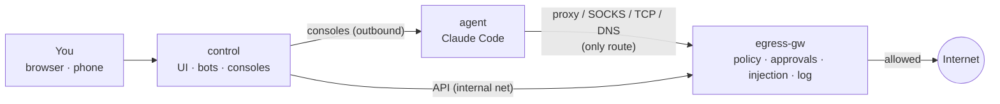

# sluicegate

**Run Claude Code unattended behind a policy-enforcing egress gateway, with you in the loop.**

[](https://github.com/PhilippMundhenk/sluicegate/actions/workflows/ci.yml)
[](LICENSE)


sluicegate puts an AI coding agent (Claude Code with [Remote Control](https://code.claude.com/docs/en/remote-control))
into a container that has **no route to anything** except a gateway. The gateway decides every outbound
connection against your policy, **holds unknown connections until you approve them** (in the web UI, on
Telegram or in Matrix), keeps your GitHub token out of the agent, and logs everything. A control plane gives
you a web UI with live log, rule editor, browser consoles and a setup wizard.

Like a sluice gate on a canal, nothing flows unless the gate is open, and you decide when it opens.


## Features

- **Fail-closed isolation by topology.** The agent sits on an `internal` Docker network: no default route, no
  iptables, no capabilities. Anything that bypasses the proxy simply can't connect.
- **One policy for every protocol.** HTTP(S) proxy, SOCKS5 and TCP service ports all pass through a single
  enforcement hook. Rules work on domains, globs, CIDRs and ports, with TTLs and presets.
- **Human in the loop.** `ask` holds the connection while you decide: allow 2 min / 1 h / always / whole
  domain, deny, or block forever. Concurrent attempts share one prompt.
- **LAN protection.** A hard deny on resolved IPs (RFC1918, loopback, link-local/metadata, CGNAT, ULA …) that
  can't be approved away, plus DNS-rebinding protection by pinning to the checked IP.
- **No DNS exfiltration.** The agent's DNS always answers NXDOMAIN, and every attempt is logged.
- **Secrets stay out of the agent.** The GitHub token lives in the gateway and is injected in flight, only when
  the CONNECT target, SNI and Host all match.
- **Operator UI.** Approvals, live log, rules editor with dry-run test, presets, browser consoles (Remote
  Control, bash, claude), and a setup wizard for GitHub, Claude login, git and Remote Control.
- **Phone approvals** via Telegram buttons or Matrix reactions (outbound polling only, no webhooks).
- **Hardened by default.** Non-root everywhere, `cap_drop: ALL`, `no-new-privileges`, read-only root
  filesystems, no `docker.sock`, pinned and checksum-verified dependencies.
- **Tested.** Unit tests, end-to-end tests of every enforcement path (including SNI spoofing and upstream
  certificate verification), and a Docker-based isolation test in CI.

## How it works



Details: [docs/architecture.md](docs/architecture.md) · Security: [docs/threat-model.md](docs/threat-model.md)

## Quick start

Requirements: Linux with Docker Engine ≥ 25 and the Compose plugin, a claude.ai subscription.

```bash
git clone https://github.com/PhilippMundhenk/sluicegate.git && cd sluicegate
sudo ./setup.sh            # random secrets, UI password, state directories
$EDITOR .env               # RC_NAME, CONTROL_PUBLISH, PUBLIC_URL, optional Telegram/Matrix
make up                    # build and start
make bypass-test           # isolation test: must end with "ALL CHECKS PASSED"
```

Put a TLS reverse proxy in front of `CONTROL_PUBLISH` (default `127.0.0.1:8080`), open the UI and follow
**Setup**: GitHub token → `claude auth login` → git identity → confirm Remote Control → self-test. Your
session then appears in the Claude app under **Code**.

Full guide: [docs/operations.md](docs/operations.md)

## Documentation

| | |
|---|---|
| [Architecture](docs/architecture.md) | Components, topology, flows, policy model |
| [Decisions (ADRs)](docs/adr/README.md) | Why it's built this way |
| [Threat model](docs/threat-model.md) | What's protected, how, and what isn't |
| [Operations](docs/operations.md) | Install, upgrade, backup, troubleshooting |
| [User guide](docs/user-guide.md) | UI, approvals, Telegram/Matrix, rule cookbook |
| [Configuration](docs/configuration.md) | All settings |
| [API](docs/api.md) | Gateway and control interfaces |
| [Development](docs/development.md) | Layout, tests, contributing |
| [Related work](docs/related-work.md) | Comparison with other sandboxes |

## Limitations

sluicegate is container isolation on a shared kernel, not a microVM. Allowed destinations can still be used
to move data out, and the agent can *use* (not read) the injected token. See
[residual risks](docs/threat-model.md#residual-risks).

## Contributing and security

Contributions are welcome. See [CONTRIBUTING.md](CONTRIBUTING.md). Please report vulnerabilities privately
as described in [SECURITY.md](SECURITY.md).

## License

[Apache License 2.0](LICENSE). Claude Code is installed from npm under Anthropic's terms and is not part of
this project.
