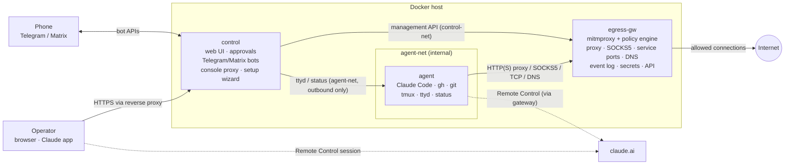
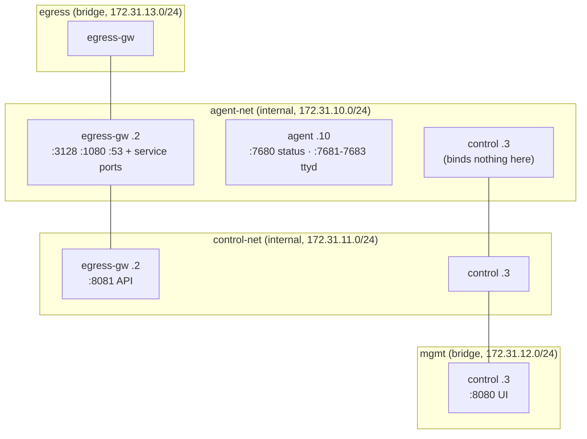
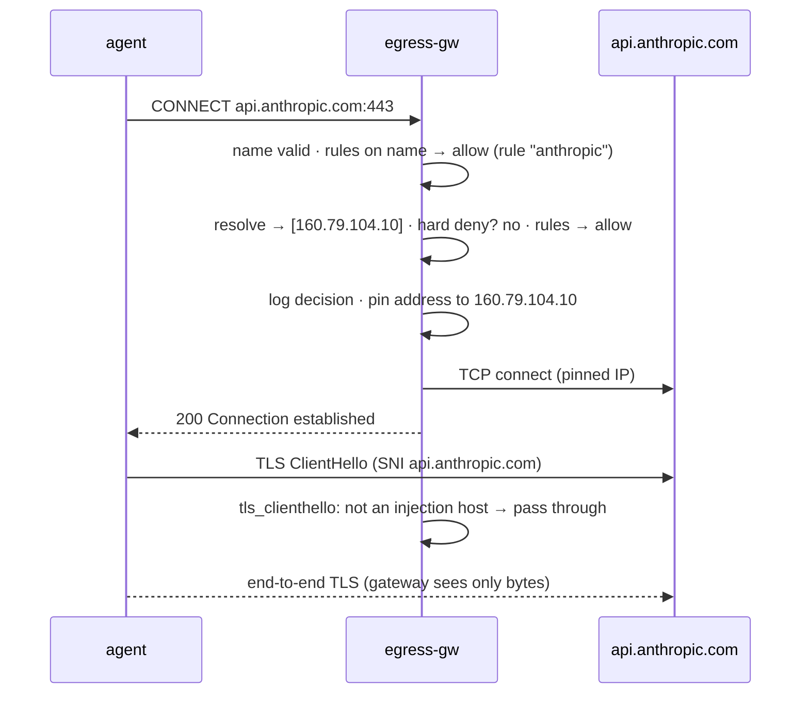
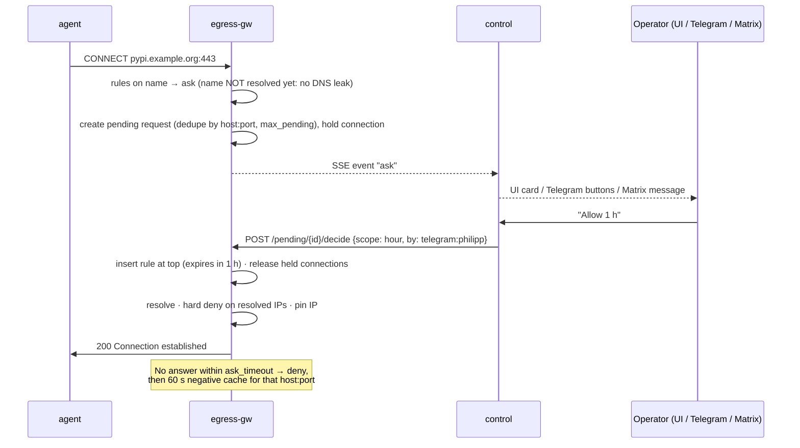
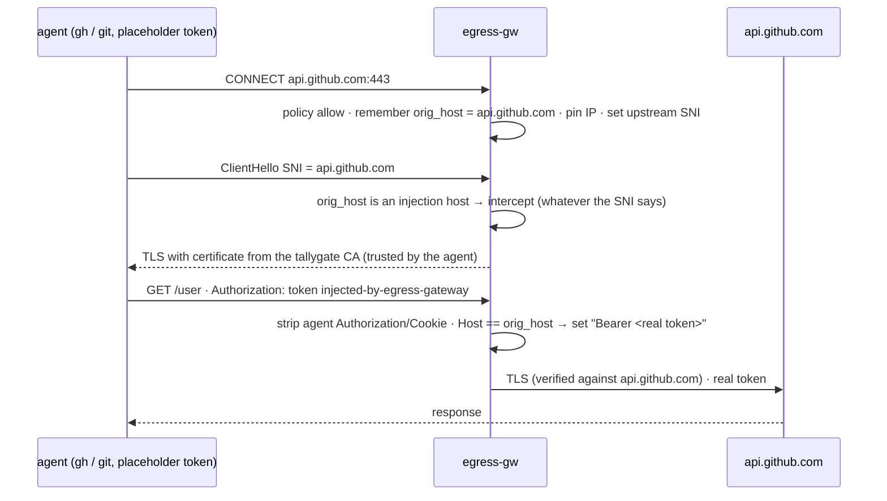
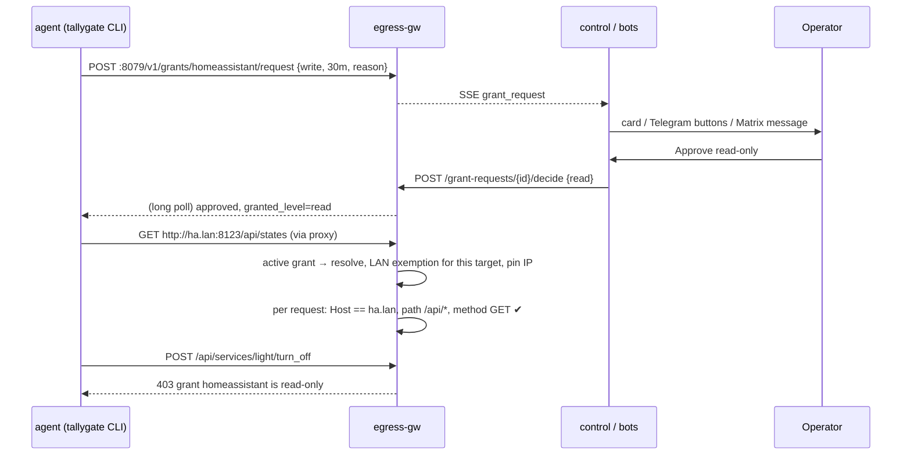

# Architecture

tallygate runs an AI coding agent (Claude Code with Remote Control) in a container that has **no
route to anything** except one gateway. The gateway decides every outbound connection against a policy,
can hold a connection while a human decides, and injects credentials the agent never sees. A separate
control plane provides the UI, notifications and web consoles.

- [Goals and non-goals](#goals-and-non-goals)
- [Components](#components)
- [Network topology](#network-topology)
- [Request flows](#request-flows)
- [Policy model](#policy-model)
- [State and persistence](#state-and-persistence)
- [Process model](#process-model)
- [Ports and addresses](#ports-and-addresses)
- [Design decisions](#design-decisions)

## Goals and non-goals

**Goals**

1. Let an agent run unattended (`bypassPermissions`) while keeping **network egress** under policy and,
   where wanted, under explicit human approval.
2. Enforce isolation through **topology** (Docker networks), not through firewall rules the agent's
   container could influence.
3. Keep **secrets out of the agent**: credentials are added in flight by the gateway.
4. Provide a complete **operator experience**: web UI, phone approvals (Telegram/Matrix), web consoles,
   guided setup, an audit log.
5. Stay **small and auditable**: three containers, ~2k lines of application code, pinned dependencies.

**Non-goals**

- Kernel-level isolation (microVMs). The design runs on a shared kernel; see the
  [threat model](threat-model.md#residual-risks).
- Content inspection/DLP of allowed traffic. Allowed destinations remain possible exfiltration channels.
- Multi-tenant operation. One stack serves one operator (optionally multiple agent sessions).

## Components

| Component | Responsibility | Trust |
|---|---|---|
| **agent** | Runs `claude remote-control` (server mode) in tmux plus interactive consoles; holds the workspace and Claude's own login. | **Untrusted.** Assume it can be fully controlled by a prompt injection. |
| **egress-gw** | The **only** enforcement point. Evaluates every upstream connection, holds `ask` connections, injects credentials, answers DNS with NXDOMAIN, logs everything, stores secrets. | Trusted, minimal. No UI, no outbound integrations except the forwarded traffic. |
| **control** | Operator surface: UI, approvals, notifications, web console proxy, setup wizard. Relays a restricted set of gateway API calls. | Trusted. Has the gateway API token; cannot be reached from the agent. |

The split between gateway and control is deliberate ([ADR-0004](adr/0004-separate-gateway-and-control-plane.md)):
a bug in the UI, the bots or their dependencies cannot weaken enforcement, because the gateway only accepts
policy changes through its authenticated API and contains no UI code.

## Network topology

Key properties:

| Property | Mechanism |
|---|---|
| Agent has no route out | `agent-net` is `internal: true`: Docker creates no default gateway for it. The agent is attached to this network only. |
| Agent can only talk to the gateway's enforcement ports | The gateway binds proxy/SOCKS/DNS/service ports to its `agent-net` address and the API to its `control-net` address only. |
| Agent cannot reach the UI | Control is on `agent-net` (to reach ttyd/status) but binds its HTTP server to its `mgmt` address only (`CONTROL_BIND_HOST` is mandatory). |
| Agent cannot run code in the UI | Control serves the console page and its xterm.js client itself and relays only the ttyd WebSocket, filtered (browser → input/resize, agent → terminal output). No agent-supplied HTML/JS is ever served on the UI origin; strict CSP everywhere. |
| Agent cannot reach the LAN or host via the gateway | `hard_deny` covers RFC1918, loopback, link-local, CGNAT, ULA etc. and is checked on **resolved** IPs; Docker's own subnets (172.16/12) are included. |
| No DNS exfiltration | The agent's resolver is the gateway, which answers NXDOMAIN to everything. The gateway resolves a name only **after** the policy (or a human) allowed it, so denied or pending names never reach a resolver. |
| No IPv6 side door | `enable_ipv6: false` on all networks and IPv6 disabled by sysctl in every container (no link-local `fe80::`); IPv6 targets are subject to the same hard deny/policy checks. |

Why topology instead of iptables: [ADR-0001](adr/0001-network-topology-instead-of-iptables.md).

## Request flows

### Allowed HTTPS (end-to-end TLS, untouched)

### Unknown destination with human in the loop

### Credential injection (GitHub)

The double check (CONNECT target **and** Host header must both match the configured host) means an agent
cannot obtain the token by connecting to another server while claiming to be GitHub
([ADR-0005](adr/0005-credential-injection-by-tls-interception.md)). TLS to injection and read-only hosts is
always intercepted: a missing, trailing-dot or different SNI must not turn it into an untouched passthrough
that skips credential stripping and the read-only check. Both directions are covered by e2e tests.

### DNS

The agent's `/etc/resolv.conf` points at Docker's embedded resolver, which forwards non-container names to
the gateway's DNS listener. The gateway answers every query with NXDOMAIN and logs it
([ADR-0006](adr/0006-dns-nxdomain-for-the-agent.md)). Tools work because proxy-aware clients let the proxy
resolve names (`HTTPS_PROXY`, `socks5h://`).

### Non-HTTP traffic

| Path | How the agent uses it | Policy granularity |
|---|---|---|
| CONNECT tunnel | Any TCP protocol via the HTTP proxy (e.g. SSH `ProxyCommand`) | host:port |
| SOCKS5 | `ALL_PROXY=socks5h://…` or `proxychains` | host:port |
| Service port | Connect to `egress-gw:<listen>`; forwarded to a fixed `target` | target host:port |
| UDP / ICMP | Not available (no route) | – |

All four paths go through the same `server_connect` hook ([ADR-0003](adr/0003-single-enforcement-hook.md)).

## Policy model

Evaluation for a connection attempt to `host:port`:

1. **Validate** the name (strict DNS syntax, ASCII/punycode only, ≤ 253 chars) — otherwise deny.
2. **Name-first decision** (no DNS yet): rules matched on the name, then the default. `deny` → deny
   without resolving; `ask` → hold and ask the human first. Only a CIDR `allow`/`ask` rule that comes
   before the deciding host rule forces a lookup at this stage ([ADR-0011](adr/0011-decide-on-names-before-resolving.md)).
3. **Resolve** the allowed name (IP literals skip 1–3).
4. **Hard deny** = immutable floor + policy extras: if any literal/resolved address is inside → **deny**,
   never ask, cannot be approved (except a service-port target with `allow_private`, on that port only).
5. **Rules**, first match wins. Approvals and presets are inserted at the top. Expired rules are ignored and
   pruned every 15 s.
6. **default** action: `allow` (blocklist mode), `deny` (allowlist mode) or `ask` (human in the loop).

At most `max_pending` approvals are open at once; identical log events are coalesced.

Rule matching:

| Field | Semantics |
|---|---|
| `host` | Case-insensitive glob. `*.example.com` matches `example.com` **and** all subdomains. `*` matches everything. |
| `cidr` | For `allow`: **all** resolved IPs must be inside. For `deny`/`ask`: **any** resolved IP inside matches. |
| `port` | `443`, `[80, 443]`, `"8000-8100"` or `*` (default). |
| `expires` | Unix timestamp; omitted = permanent. |

Approval scopes map to rules:

| Scope | Rule |
|---|---|
| `once` | allow exact host:port for 2 min (covers follow-up connections of the same operation) |
| `hour` | allow exact host:port for 1 h |
| `always` | allow exact host:port permanently |
| `domain` | allow `*.<registrable domain>`:port permanently. The registrable domain comes from the Public Suffix List **including its private section**, so `foo.github.io` widens to `*.foo.github.io`, never `*.github.io`; not offered for public suffixes or IPs. |
| `deny` | deny exact host:port for 2 min |
| `deny_always` | deny exact host:port permanently |

Concurrent connections to the same `host:port` share one pending request (one notification).

## State and persistence

| Data | Location | Owner | Notes |
|---|---|---|---|
| Policy | `state/gateway/policy.yaml` | egress-gw (uid 10001) | Written atomically; seeded from the `baseline` preset on first start. |
| Event log | `state/gateway/events.db` | egress-gw | SQLite/WAL, pruned after `log_keep_days`. |
| Secrets | `state/gateway/secrets.json` | egress-gw | Mode 0600, never returned by the API. |
| Gateway CA | `state/gateway/mitmproxy/` | egress-gw | Public cert exported to the `ca` volume for the agent. |
| Static gateway config | `config/gateway.yaml` | operator | Mounted read-only: injection hosts, service ports, hard-deny floor, config grants. |
| UI-defined grants | `state/gateway/grants.yaml` | egress-gw | Active grants and pending requests live in memory (a restart ends them: fail closed). |
| Agent home | `state/agent-home/` | agent (uid 1000) | Claude login, settings, skills, `.gitconfig`, tmux/shell history. |
| Workspace | `state/workspace/` | agent | Repositories. |
| Control | – | – | Sessions in memory (a restart logs everyone out). |

## Process model

| Container | PID 1 | Processes |
|---|---|---|
| egress-gw | `python run.py` → `exec mitmdump` | mitmproxy event loop with the tallygate addon and the aiohttp API server on the same loop |
| control | `python -m app.main` | aiohttp server, gateway SSE subscriber, Telegram long-poll, Matrix `/sync` loop |
| agent | `tini` → `entrypoint.sh` | supervisor loop (5 s) restarting: tmux session `rc` (`claude remote-control` in a restart loop), ttyd × 3, `status.py` |

## Grants

Grants are named, time-limited bundles of access to destinations the policy would otherwise refuse, such as
LAN services ([user documentation](grants.md), [ADR-0012](adr/0012-grants-for-scoped-temporary-access.md)).

An active grant is consulted **before** the rules, but only when the rules would not already allow the
name: grants add access, they never narrow it. HTTP(S) grant targets are always intercepted, so method,
path and Host can be enforced on every request. Non-HTTP bytes on such targets are cut, and `tcp`
targets are passed through.

## Ports and addresses

| Service | Address | Port | Reachable from |
|---|---|---|---|
| HTTP(S) proxy | 172.31.10.2 | 3128 | agent-net |
| SOCKS5 | 172.31.10.2 | 1080 | agent-net |
| DNS (NXDOMAIN) | 172.31.10.2 | 53/udp | agent-net |
| Service ports | 172.31.10.2 | per config | agent-net |
| Gateway API | 172.31.11.2 | 8081 | control-net (control only) |
| Grant request API | 172.31.10.2 | 8079 | agent-net (list / request / poll only) |
| Control UI | 172.31.12.3 | 8080 | mgmt / published to `CONTROL_PUBLISH` |
| Agent status | 172.31.10.10 | 7680 | agent-net (control) |
| ttyd rc/bash/claude | 172.31.10.10 | 7681–7683 | agent-net (control) |

## Design decisions

See [docs/adr/](adr/README.md) for the architecture decision records.
