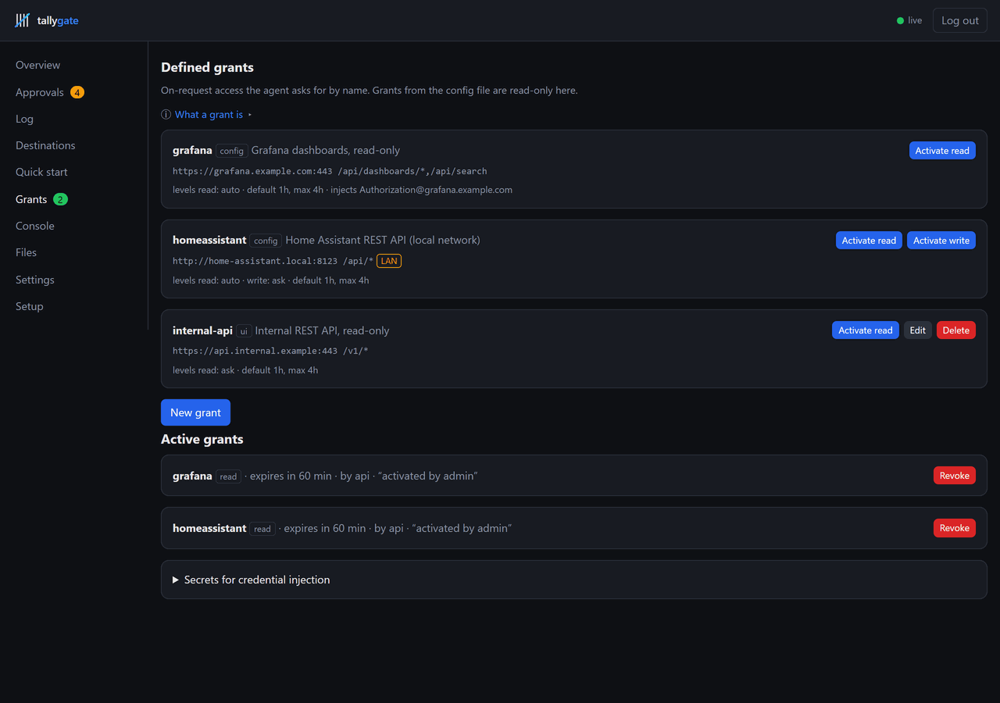
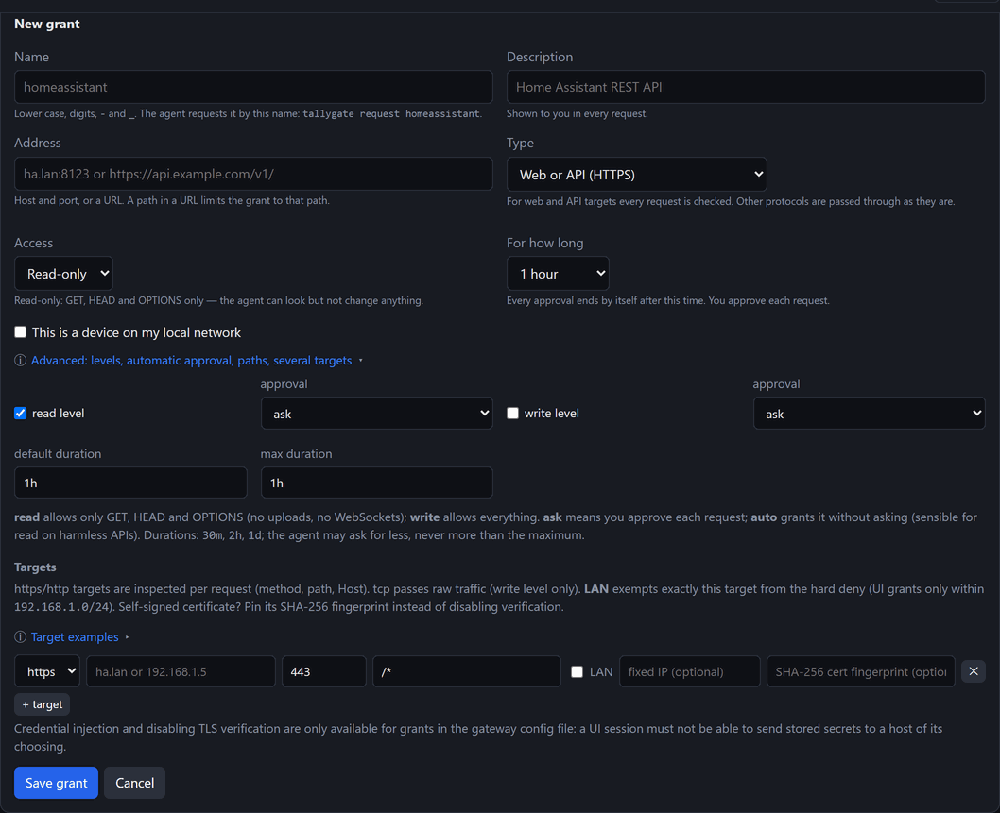

# Grants: controlled access to your home network and other sensitive services

Approving single connections works for the open internet. It is the wrong unit for "let the agent check
Home Assistant" or "let it SSH into the NAS for ten minutes". A **grant** is a named, scoped,
time-limited bundle of access that you define once. The agent requests it with a reason, and you approve
it with one tap. When the time runs out, the rule list alone decides again.

A grant is a **bundle of destinations under the same rules as everything else**: while it is active, its
targets behave like rules at the top of the [one ordered rule list](rules.md#how-a-destination-is-decided),
with paths, access levels and a time limit on top. It is not a way around the list.
[How access works](access.md) shows where grants sit next to rules.

```text
agent:  tallygate request homeassistant --write --ttl 30m --reason "turn off the living room lights"
you:    grant homeassistant (write) for 30m   [Allow write for 30m]  [Allow read-only]  [Deny]
agent:  granted: homeassistant (read) for 30 min
        note: you asked for write but were granted read only
```


## What a grant contains

| Part | Meaning |
|---|---|
| **targets** | `host:port` plus `scheme`. `https`/`http` targets are inspected per request (method, path, Host). `tcp` passes raw traffic through (SSH, databases, MQTT …). Hosts can be exact, `*.lan` wildcards or IPs. A wildcard covers subdomains only: unlike in rules, `*.example.lan` does not include `example.lan`. |
| **paths** | HTTP path patterns (`/api/*`): globs in which `*` also matches `/`, compared case-sensitively with the path without its query. Paths are matched after rejecting traversal tricks: `.` and `..` segments, `//`, backslashes, spaces and control characters, an encoded `.`, `/`, `\` or NUL (`%2e`, `%2f`, `%5c`, `%00`), any of these hidden by repeated encoding, more than three layers of encoding, and a `%` that is left after decoding. |
| **levels** | `read` = `GET`/`HEAD`/`OPTIONS` only, no WebSocket upgrades. `write` = every method. A grant can offer one or both. `tcp` targets are only usable at `write`. |
| **approval** | Per level: `ask` (a human decides) or `auto` (granted at once, still logged and shown). A common choice is `read: auto, write: ask`. |
| **address** | Fixed IP for the target (*Fixed IP* in the UI): the gateway connects to this address instead of resolving the name. It is what lets a target with a name be a device on the local network, see [Local targets and name-only targets](#local-targets-and-name-only-targets). |
| **tls_fingerprint** | SHA-256 of the service's certificate: lets the gateway trust a self-signed cert (Proxmox, a NAS, a router) **without** turning verification off. `tls_verify: false` exists (config-file grants only), but avoid it. |
| **inject** | Header templates such as `Authorization: Bearer ${ha_token}`. The secret lives in the gateway, and the agent never sees it. On a host with an inject rule, the agent's own `Authorization`/`Cookie` (`inject_strip_headers`) are stripped. Only for exact-host `https` targets; while a referenced secret is missing, the request goes out without the header. **Config-file grants only.** |
| **default_ttl / max_ttl** | How long an approval lasts (1 min … 7 days). The agent may ask for less or more; the duration is capped at `max_ttl`. |

Defaults and limits:

- The name matches `[a-z0-9][a-z0-9_-]{0,47}`; the description is cut at 300 characters. Unknown fields are
  rejected. A grant needs at least one target.
- `scheme` defaults to `https`, `paths` to `["/*"]`. A path pattern starts with `/` and has at most 200
  characters.
- `levels` defaults to `[read]`. `approval` defaults to `ask`; one word (`approval: auto`) applies to every
  level.
- `default_ttl` defaults to `1h`, `max_ttl` to `4h`. Durations are written `90s`, `30m`, `4h`, `2d` or as
  seconds. A requested duration below one minute is raised to one minute.
- `tcp` targets take no `paths` and no TLS options, `http` targets no TLS options. A grant with only `tcp`
  targets cannot be `[read]`.
- `address` must be an IP and needs an exact host (no wildcard).
- An `inject` entry is `{host, header, value}`; `header` defaults to `Authorization`, and `host` must be an
  exact `https` target of the grant.
- A grant in the config file wins over a UI grant with the same name.

## Defining grants

### In the config file (`config/gateway.yaml`)

```yaml
grants:
  homeassistant:
    description: Home Assistant REST API
    targets:
      # a local device by name: the fixed address is what opens it
      - {host: ha.lan, address: 192.168.1.20, port: 8123, scheme: http, paths: ["/api/*"]}
    levels: [read, write]
    approval: {read: auto, write: ask}
    default_ttl: 1h
    max_ttl: 4h
    # for https:  inject: [{host: ha.lan, header: Authorization, value: "Bearer ${ha_token}"}]

  proxmox:
    description: Proxmox VE API, read-only
    targets:
      - host: pve.lan
        address: 192.168.1.30
        port: 8006
        paths: ["/api2/json/*"]
        tls_fingerprint: "AB:CD:…"       # openssl s_client -connect pve.lan:8006 </dev/null | openssl x509 -noout -fingerprint -sha256
    levels: [read]
    inject:
      - {host: pve.lan, header: Authorization, value: "PVEAPIToken=${pve_token}"}

  nas-ssh:
    description: SSH to the NAS
    targets: [{host: 192.168.1.40, port: 22, scheme: tcp}]    # an IP as host names the address too
    levels: [write]
    default_ttl: 30m
    max_ttl: 1h
```

Store the referenced secrets (`ha_token`, `pve_token`) in the UI under **Grants → Secrets**. They are
write-only.

### In the UI

**Grants → Create grant…** asks for five things: a name, the address (`192.168.1.20:8123`, or a URL such as
`https://api.example.com/v1/`, whose path then limits the grant), the type (HTTPS, HTTP, or TCP for SSH and
databases), read-only or full access, and for how long each approval lasts. Everything else (automatic
approval, separate default and maximum durations, paths, several targets, a fixed IP, a pinned certificate)
is under **Advanced options** and keeps its defaults until you change it; a grant that uses those settings
says so in the simple form. Grants from the config file are shown read-only. UI grants are stored in
`grants.yaml` in the `gateway-data` volume. The *Grants* tab holds the defined grants with the editor, the
active grants and the secrets.





**Quick settings → Local network** is the short form for the most common case, one device on your network:
name, IP address, port, type (HTTP, HTTPS or TCP), read-only or full access, and the duration. *Create grant*
defines a grant for exactly that address and port, with every use approved by you; edit or delete it on the
*Grants* tab. The form is always available. Enter the device's IP address: if you enter a name that resolves
into a blocked range, the gateway refuses the grant and the message under the form names the address to
enter instead.

`inject` and `tls_verify: false` are only accepted in grants from the config file. Otherwise whoever holds
a UI session or the API token could define a grant that sends a stored secret (e.g. the GitHub token) to a
host of their choosing. The UI and API reject such grants with a validation error; a UI grant saved by an
older version with either setting is ignored at startup (and logged). Define such grants in
`config/gateway.yaml`.

## Local targets and name-only targets

Whether a target may be a device on your local network follows from **what the target names**, exactly as
for rules ([name rules and address rules](rules.md#name-rules-and-address-rules)):

| Target | Counts as | May it be inside a blocked range? |
|---|---|---|
| an IP address as host (`192.168.1.40`) | an address rule at the top of the list | yes |
| a name with a fixed `address` (`ha.lan` at `192.168.1.20`) | an address rule at the top of the list; the name is not looked up | yes |
| only a name (`api.example.com`, `ha.lan`, `*.lan`) | a name rule at the top of the list | **not by itself**: every address the name resolves to is checked like for a name rule. If the first address rule with `allow` or `deny` that contains it is a `deny`, the connection is refused |

The reason is the one given for rules: a name points wherever its DNS says, so only a target that names the
address opens a blocked range ([why](rules.md#why-a-name-rule-cannot-open-a-blocked-range)). A name-only
target is checked like a name rule: set the fixed address on the target, or add an allow rule for the
address above the block on *Destinations*, which opens the address for the target too.

**A fixed address opens the name, not the address.** With `ha.lan` at `192.168.1.20`, the agent reaches
`http://ha.lan:8123/…`, where the grant's paths and level apply. `http://192.168.1.20:8123/…` is not part of
the grant: it is decided by the rule list like any IP, and refused without a prompt unless a rule allows the
address (`… is the address of ha.lan (grant …): reach a grant target by its name`). Only a target whose host
is the IP itself is reached by IP.

**A target that names an address is not subject to the blocked ranges or to your `deny` rules at all**, only
to the locked ranges. That includes addresses you may not think of as "a device": loopback (`127.0.0.1`, the
gateway container itself, on ports that are not its own listeners), the cloud metadata address
`169.254.169.254`, and the `never` entries of the gateway config. Earlier releases closed those to every
grant. A grant is still defined by you and, with `approval: ask`, approved per use; read the address of a
target before you save or approve it ([threat model](threat-model.md#residual-risks)).

What you see:

- **Saving in the UI or through the API** a target that is only a name and resolves into a blocked range now
  is refused: `grant ha: ha.lan resolves to 192.168.1.20, inside blocked range 192.168.0.0/16 (rule
  block-192.168.0.0_16). A target that is only a name cannot open a blocked range: set the fixed address
  192.168.1.20 on this target (or use the IP as its host)`. A name that does not resolve at that moment, and
  a wildcard, are accepted; every connection is checked again when it is made.
- **At connection time** (also for grants from the config file, which are not checked when the gateway
  starts): `grant ha: name allowed by the grant, but it resolves to 192.168.1.20, inside blocked range
  192.168.0.0/16 (rule block-192.168.0.0_16): set a fixed address on the grant target`.
- The [locked ranges](rules.md#locked-ranges) (the tallygate stack itself) apply to every grant. A UI grant
  whose target names a locked address is refused when it is saved.

A grant target on the local network is tagged *local* in the list of defined grants.

### Removed options

Earlier releases had a separate switch for local targets. It is gone; old files are still read:

| Option | What happens to it now |
|---|---|
| `lan: true` on a target | Ignored, logged once per target. A target with an IP or a fixed `address` keeps working. A target that is only a name no longer reaches a blocked range: add its `address`. |
| a target with an IP or a fixed `address` inside a blocked range that did **not** have `lan: true`, or - with or without it - inside the old never list (loopback, link-local/metadata, multicast, the `never` entries of `gateway.yaml`) | It could be saved before, but was always refused. Now it is reachable while its grant is active. The upgrade names each one in the log (`NOTE grant …: target … names the address … inside blocked range …`, and whether a level is approved automatically); delete the target if that is not wanted. |
| `grants_lan_allow` in `gateway.yaml` | Ignored, logged once at start. UI grants are no longer limited to listed ranges; delete the key. |
| `grants_never`, and the `never` scope `all+lan` | Read as plain `never` entries: blocked ranges seeded as rules. |
| *This is a device on my local network* in the grant editor | Removed. Nothing to tick: enter the IP, or set *Fixed IP*. |

Every removed key in one table: [configuration](configuration.md#removed-and-ignored-keys). What the upgrade
does to `grants.yaml`: [operations](operations.md#upgrade-to-the-ordered-rule-list).

## Using grants

| Who | How |
|---|---|
| Agent | `tallygate grants` lists what exists. `tallygate request <name> [--write] [--ttl 30m] --reason "…"` asks and waits for the decision, up to `--timeout` seconds (default 300); `--no-wait` returns at once, and `tallygate status <id>` shows the state later. Exit codes: 0 granted, 1 denied or expired, 2 usage or connection error. `tallygate note "…"` tells you what the agent is about to do. The agent image tells Claude about this in its managed `CLAUDE.md`, and a refused connection mentions the grant (`available via grant homeassistant`). |
| You | Approve, approve read-only, or deny on the Approvals page, in Telegram (buttons) or in Matrix (👍 approve, 📖 read-only, 👎 deny, or reply `approve 3` / `read 3` / `deny 3`; `allow` and `block` work too). A Web Push notification offers read access and *Deny* only: write access needs the UI or a chat. Revoke at any time: **Grants → Revoke**, Telegram's *Revoke* button, or `revoke 3` in Matrix. You can also activate a grant yourself (**Activate read/write**). |

Only one instance of a grant is active at a time; a new approval replaces the old one (level and end time
change in place, so open connections continue under the new level). Pending requests
time out after `grant_request_timeout` (300 s). At most `grant_max_pending` (3) can be open at once.

## How it is enforced

1. A connection to a target of an **active** grant is handled by the grant, as if its targets were rules at
   the top of the list. The fixed `address` is used, or the name is resolved. The
   [locked ranges](rules.md#locked-ranges) are refused for every grant. A target that names an address is
   then allowed; for a target that is only a name, the address rules of the list still apply to what it
   resolves to, as for a name rule ([above](#local-targets-and-name-only-targets)). The connection is pinned to the
   checked IP.
2. `https`/`http` targets are **always intercepted**, so every request is checked:
   - plain HTTP to an `https` target is refused;
   - the `Host` header must equal the granted host;
   - the path must be canonical and match;
   - on `read`, only safe methods are allowed and upgrades are refused;
   - credentials are injected (`https` targets);
   - on GitHub hosts, `github_repos` still applies: a grant does not widen it;
   - anything that is not HTTP on such a target is cut.
3. Upstream TLS is verified normally, or against the pinned fingerprint, or not at all with
   `tls_verify: false`.
4. When the grant expires or is revoked, new connections and new requests on open HTTP connections are
   refused. Established `tcp` sessions (e.g. an open SSH session) are not cut; keep `max_ttl` short for those.

Grants **add** access. A name that your rules already allow is unaffected by a grant that also covers it: the
rules decide, without the grant's limits. A target with a fixed `address` and a destination given as an IP
address always go through the active grant and its checks. A destination that a grant is defined for, but
that is not allowed while the grant is inactive, is refused with a hint (`available via grant <name>`)
instead of a connection prompt.

## Choosing levels well

- `read` relies on HTTP semantics. Most APIs (Home Assistant, Proxmox, Synology) do not change anything on
  `GET`. Check yours before setting `read: auto`.
- Narrow paths are the strongest control: `/api/states*` is better than `/api/*` if that is all you need.
- Prefer `https` with injection over handing the agent credentials. The agent then never has a token it
  could misuse outside the grant.
- For `tcp` grants (SSH), use a dedicated key with a restricted account on the target. The gateway can only
  decide *whether* the connection exists, not what happens inside it.
