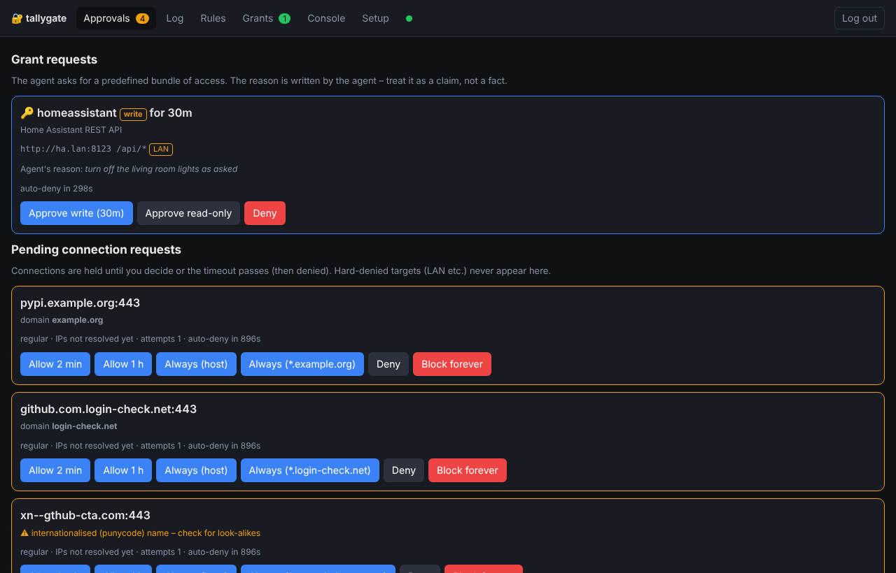
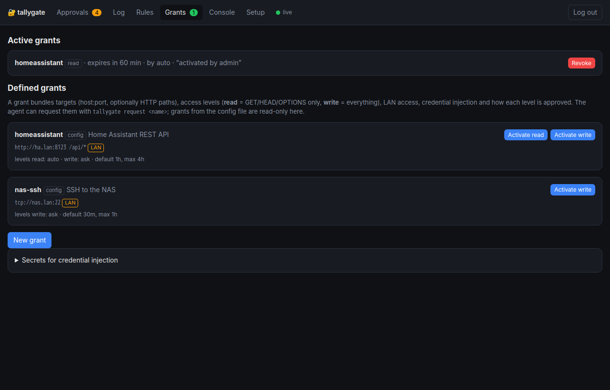
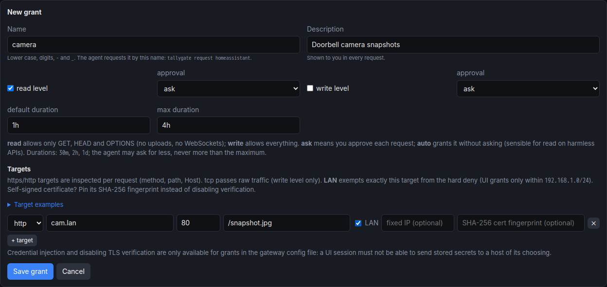

# Grants: controlled access to your home network and other sensitive services

Approving single connections works for the open internet. It is the wrong unit for "let the agent check
Home Assistant" or "let it SSH into the NAS for ten minutes". A **grant** is a named, scoped,
time-limited bundle of access that you define once. The agent requests it with a reason, and you approve
it with one tap. When the time runs out, everything falls back to the normal policy and hard deny.

```text
agent:  tallygate request homeassistant --write --ttl 30m --reason "turn off the living room lights"
you:    🔑 homeassistant (write) for 30m   [Approve write]  [Approve read-only]  [Deny]
agent:  granted: homeassistant (read) for 30 min
        note: you asked for write but were granted read only
```



## What a grant contains

| Part | Meaning |
|---|---|
| **targets** | `host:port` plus `scheme`. `https`/`http` targets are inspected per request (method, path, Host). `tcp` passes raw traffic through (SSH, databases, MQTT …). Hosts can be exact, `*.lan` wildcards or IPs. |
| **paths** | HTTP path patterns (`/api/*`). Paths are matched after rejecting traversal tricks (`..`, `//`, `%2e`, `%2f`, backslashes, NUL). |
| **levels** | `read` = `GET`/`HEAD`/`OPTIONS` only, no WebSocket upgrades. `write` = every method. A grant can offer one or both. `tcp` targets are only usable at `write`. |
| **approval** | Per level: `ask` (a human decides) or `auto` (granted at once, still logged and shown). A common choice is `read: auto, write: ask`. |
| **lan** | Exempts **exactly this target** from the hard deny, so it may resolve to a private address. Loopback, link-local/metadata and multicast stay unreachable (`grants_never`). |
| **address** | Fixed IP for the target (no DNS lookup), handy when the gateway cannot resolve your local names. |
| **tls_fingerprint** | SHA-256 of the service's certificate: lets the gateway trust a self-signed cert (Proxmox, a NAS, a router) **without** turning verification off. `tls_verify: false` exists (config-file grants only), but avoid it. |
| **inject** | Header templates such as `Authorization: Bearer ${ha_token}`. The secret lives in the gateway, and the agent never sees it. The agent's own `Authorization`/`Cookie` are stripped. **Config-file grants only.** |
| **default_ttl / max_ttl** | How long an approval lasts (1 min … 7 days). The agent may ask for less or more; the duration is capped at `max_ttl`. |

## Defining grants

### In the config file (`config/gateway.yaml`)

```yaml
grants_lan_allow: [192.168.1.0/24]     # LAN ranges that UI-defined grants may reach (config grants: any)

grants:
  homeassistant:
    description: Home Assistant REST API
    targets:
      - {host: ha.lan, port: 8123, scheme: http, paths: ["/api/*"], lan: true}
    levels: [read, write]
    approval: {read: auto, write: ask}
    default_ttl: 1h
    max_ttl: 4h
    # for https:  inject: [{host: ha.lan, header: Authorization, value: "Bearer ${ha_token}"}]

  proxmox:
    description: Proxmox VE API, read-only
    targets:
      - host: pve.lan
        port: 8006
        paths: ["/api2/json/*"]
        lan: true
        tls_fingerprint: "AB:CD:…"       # openssl s_client -connect pve.lan:8006 </dev/null | openssl x509 -noout -fingerprint -sha256
    levels: [read]
    inject:
      - {host: pve.lan, header: Authorization, value: "PVEAPIToken=${pve_token}"}

  nas-ssh:
    description: SSH to the NAS
    targets: [{host: nas.lan, port: 22, scheme: tcp, lan: true}]
    levels: [write]
    default_ttl: 30m
    max_ttl: 1h
```

Store the referenced secrets (`ha_token`, `pve_token`) in the UI under **Grants → Secrets**. They are
write-only.

### In the UI

**Grants → New grant** offers the same fields as a form. Grants from the config file are shown read-only;
UI grants are stored in `state/gateway/grants.yaml`.





A UI-defined grant can only use `lan: true` for addresses inside `grants_lan_allow`, which only the
config file can set. That way a compromised UI session cannot open arbitrary parts of your network.

`inject` and `tls_verify: false` are only accepted in grants from the config file. Otherwise whoever holds
a UI session or the API token could define a grant that sends a stored secret (e.g. the GitHub token) to a
host of their choosing. The UI and API reject such grants with a validation error; a UI grant saved by an
older version with either setting is ignored at startup (and logged). Define such grants in
`config/gateway.yaml`.

## Using grants

| Who | How |
|---|---|
| Agent | `tallygate grants` lists what exists. `tallygate request <name> [--write] [--ttl 30m] --reason "…"` asks and waits for the decision (exit code 0 = granted). The agent image tells Claude about this in its managed `CLAUDE.md`, and a refused connection mentions the grant (`available via grant homeassistant`). |
| You | Approve, approve read-only, or deny on the Approvals page, in Telegram (buttons) or in Matrix (👍 approve, 📖 read-only, 👎 deny, or reply `approve 3` / `read 3` / `deny 3`). Revoke at any time: **Grants → Revoke**, Telegram's *Revoke* button, or `revoke 3` in Matrix. You can also activate a grant yourself (**Activate read/write**). |

Only one instance of a grant is active at a time; a new approval replaces the old one. Pending requests
time out after `grant_request_timeout` (300 s). At most `grant_max_pending` (3) can be open at once.

## How it is enforced

1. A connection to a target of an **active** grant is checked before the normal rules. Names are resolved
   (or `address` is used) and the resolved IPs are checked: `grants_never` always applies, the hard deny
   applies unless `lan: true`, and for UI grants `grants_lan_allow` applies. The connection is then pinned
   to the checked IP.
2. `https`/`http` targets are **always intercepted**, so every request is checked:
   - the `Host` header must equal the granted host;
   - the path must be canonical and match;
   - on `read`, only safe methods are allowed and upgrades are refused;
   - credentials are injected;
   - anything that is not HTTP on such a target is cut.
3. Upstream TLS is verified normally, or against the pinned fingerprint.
4. When the grant expires or is revoked, new connections and new requests on open HTTP connections are
   refused. Established `tcp` sessions (e.g. an open SSH session) are not cut; keep `max_ttl` short for those.

Grants **add** access. A destination that your rules already allow is unaffected by a grant that also covers
it. A target that a grant covers but that no rule allows is refused with a hint instead of a connection prompt.

## Choosing levels well

- `read` relies on HTTP semantics. Most APIs (Home Assistant, Proxmox, Synology) do not change anything on
  `GET`. Check yours before setting `read: auto`.
- Narrow paths are the strongest control: `/api/states*` is better than `/api/*` if that is all you need.
- Prefer `https` with injection over handing the agent credentials. The agent then never has a token it
  could misuse outside the grant.
- For `tcp` grants (SSH), use a dedicated key with a restricted account on the target. The gateway can only
  decide *whether* the connection exists, not what happens inside it.
