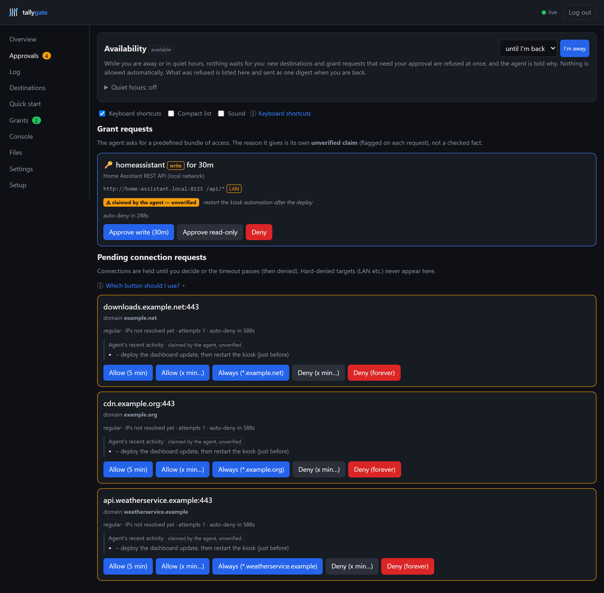
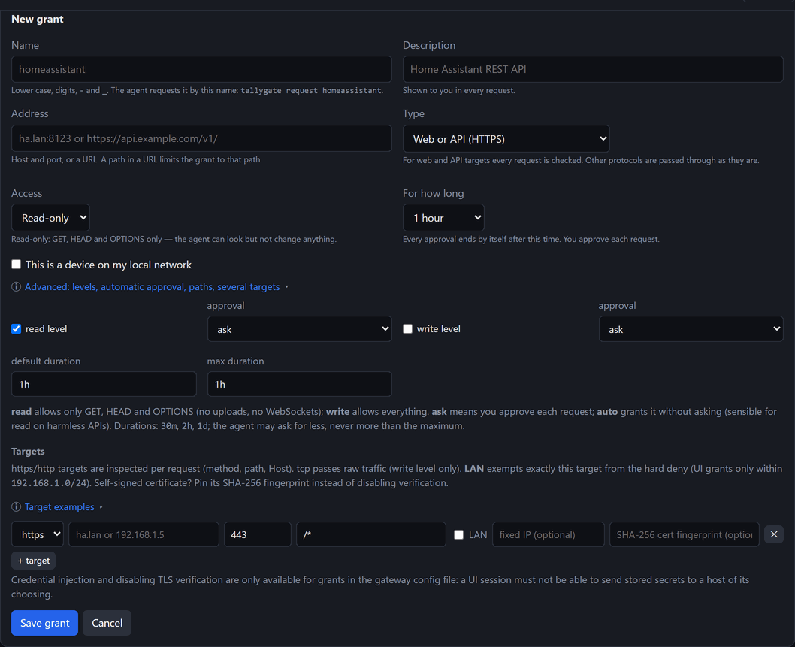
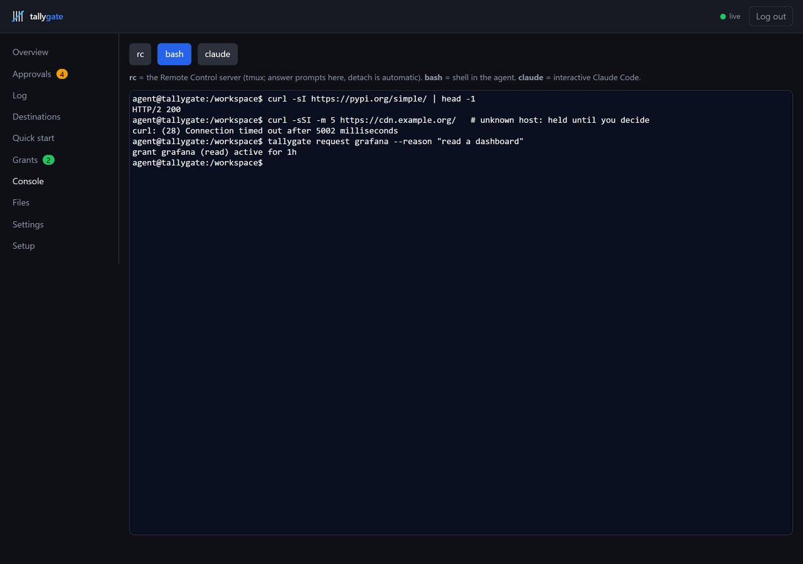

# Screenshots

The control UI, one picture per surface. All shots use neutral demo data (example hosts, no real
tokens or addresses). Retake them after a UI change with a clean stack and the same demo data, then
check each still matches its caption.

| Picture | Shows |
|---|---|
|  | The login page. The first-start password is printed to the control log. |
|  | The Approvals tab: pending connection and grant requests, each with the destination and *allow / ask / deny* (or the grant level) and a live countdown. |
|  | The Log tab: every connection and decision, searchable and filterable, with *allow / deny from here* and CSV/JSON export. |
|  | The **Destinations** tab (ADR-0014): every destination in one place — access rules (add / edit / delete / group), on-request grants, read-only hosts, credentials and repository scope — plus the mode, shortcuts and templates, *Test a destination*, the never-reachable list, the raw-policy editor and the policy history. The former *Rules* tab was folded in here. |
|  | The grant editor (on the Destinations tab): name, address, type, access level, duration, and *Advanced* for several targets, paths, LAN, pinned TLS and automatic approval. |
|  | The slim **Grants** tab: the active grants (with *Revoke*) and the write-only secrets used for credential injection. |
|  | The Console tab: a terminal into the agent container. |
|  | The guided Setup wizard for a first start. |

To regenerate: start the control stack with demo data, log in, open each tab at a desktop width and a
phone width, and capture it. Keep the data neutral — no real tokens, hostnames, or personal paths
(see the private-data guidance). `rules.png` was renamed to `destinations.png` when the Rules tab was
folded into Destinations.
