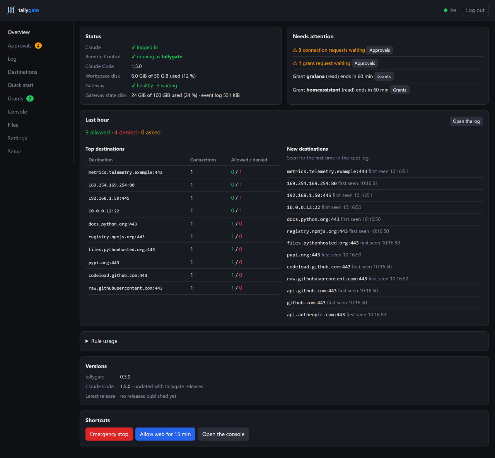
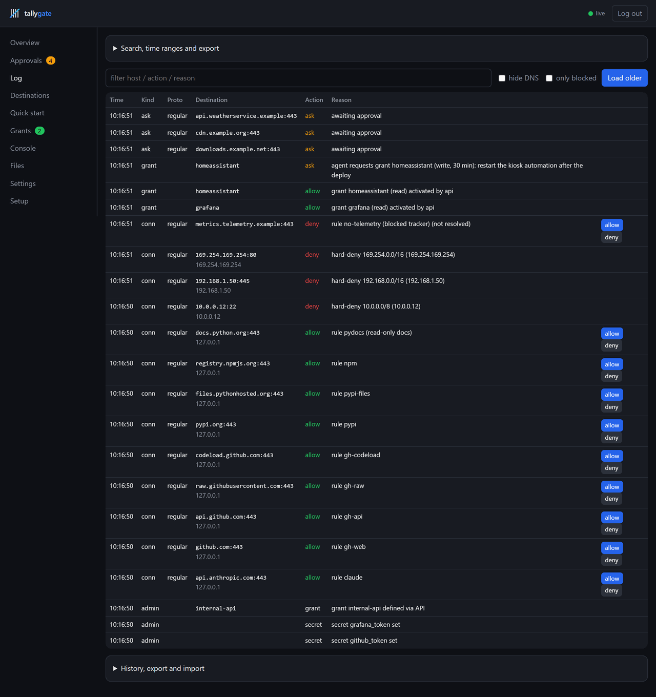
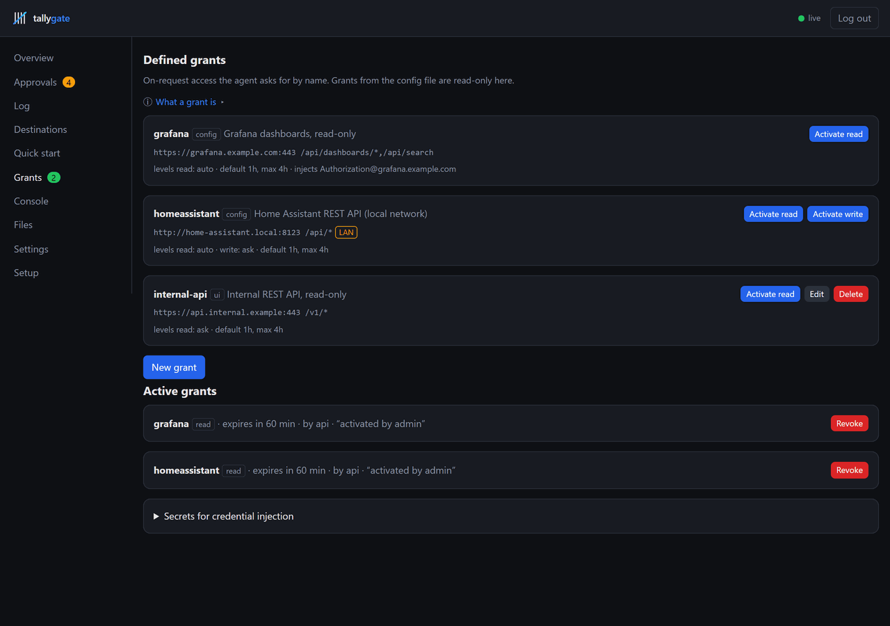

# Screenshots

The control UI, one picture per surface. All shots use neutral demo data (example hosts, no real
tokens or addresses). Retake them after a UI change with a clean stack and the same demo data, then
check each still matches its caption. The pictures are retaken separately (#209): until then some of them
show the UI from before the ordered rule list (ADR-0019) and the reordered menu; the captions describe the
UI as it is now.

| Picture | Shows |
|---|---|
|  | The login page. The first-start password is printed to the control log. |
|  | The **Overview** tab: status of Claude, Remote Control, the gateway and disk; what needs attention (waiting requests, grants ending soon, the GitHub token); the last hour's allows / denies and top destinations; versions; and the shortcuts. |
|  | The **Approvals** tab: pending connection and grant requests, each with the destination, the buttons (*Allow for 5 min*, *Allow for … min*, *Allow host permanently* or *Allow \*.domain permanently*, *Deny for … min*, *Deny permanently*; for a grant its level), a live countdown, and the agent's own reason flagged as an unverified claim. |
|  | The Log tab: every connection and decision, searchable and filterable, with *allow / deny from here* and CSV/JSON export. |
|  | The **Destinations** tab (ADR-0019): *Test a destination*, and the one rule list in the order it is checked — rules with *Move up / Move down / Edit / Delete* and grouping, the built-in blocks as ordinary `deny` rules at the bottom with *Restore built-in blocks*, the read-only properties from the config file, the locked ranges as the last rows, and the default as the last line. |
|  | The **Quick settings** tab: learning mode, then the three boxes *Internet* (allow the web or all ports for a while, *Emergency stop*), *Local network* (a grant for one device by IP address) and *Tool ecosystems* (containers, Debian/Ubuntu, Go, Hugging Face, Node.js, Python, Rust). |
|  | The slim **Grants** tab: the defined grants (config-file ones read-only, UI ones editable), the active grants (with *Revoke*) and the write-only secrets used for credential injection. |
|  | The grant editor: name, address, type, access level, duration, and *Advanced options* for several targets, paths, a fixed IP, pinned TLS and automatic approval. |
|  | The Console tab: a terminal into the agent (rc / bash / claude). |
|  | The **Settings** tab: *Mode* (the default action for unmatched destinations and the approval timeout), *Menu* (hide Setup and Quick settings), the behaviour settings (log retention, learning, suggestions, request limits) and the raw-policy editor. |
|  | The guided Setup wizard for a first start. |

To regenerate: start the control stack with neutral demo data, log in, and capture each tab at a desktop
width (1280 px). Keep the data neutral — no real tokens, hostnames, or personal paths (see the
private-data guidance). `rules.png` was renamed to `destinations.png` when the former rules page became
*Destinations*; `quickstart.png` shows *Quick settings* (the file kept its name).
