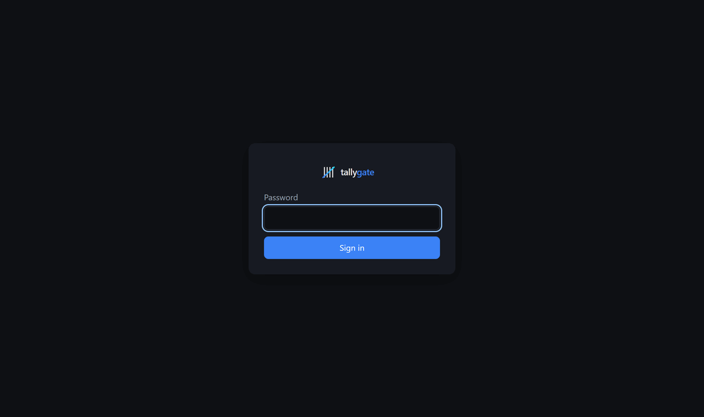
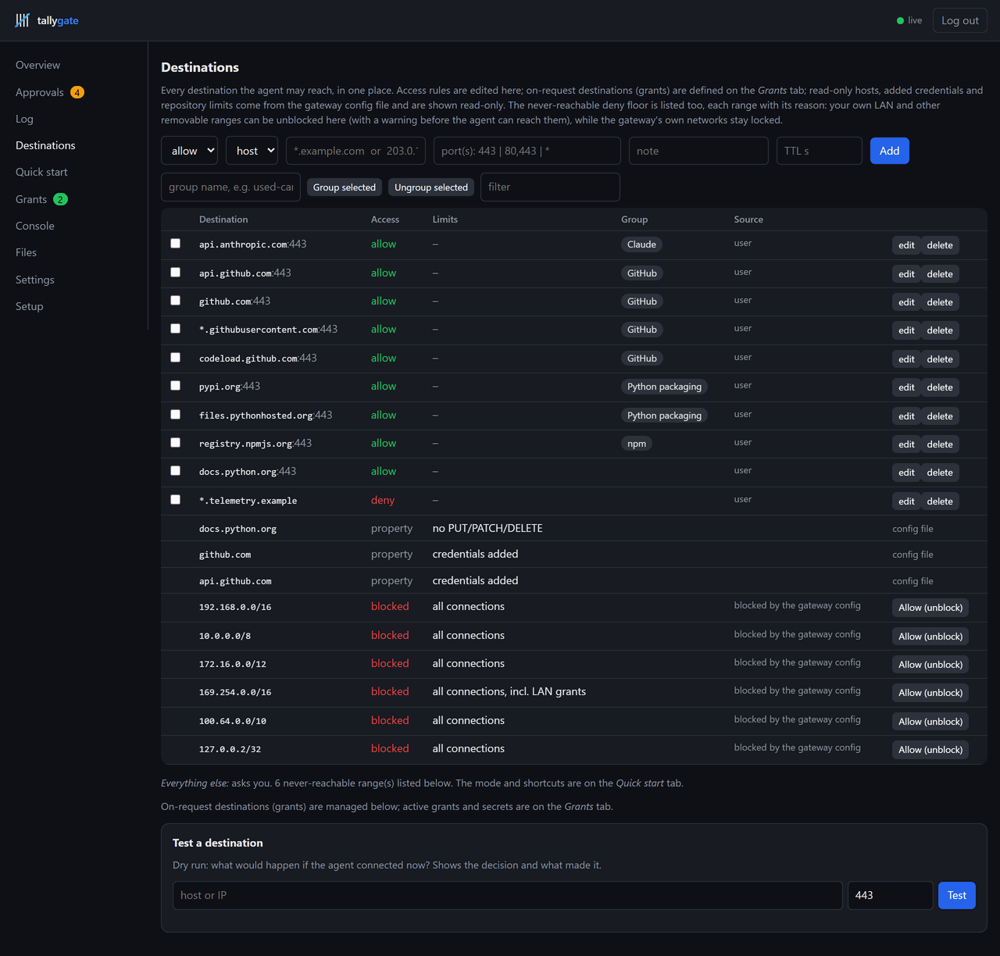
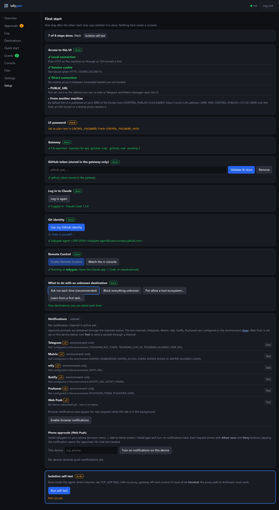

# Screenshots

The control UI, one picture per surface. All shots use neutral demo data (example hosts, no real
tokens or addresses). Retake them after a UI change with a clean stack and the same demo data, then
check each still matches its caption.

| Picture | Shows |
|---|---|
|  | The login page. The first-start password is printed to the control log. |
|  | The **Overview** tab: status of Claude, Remote Control, the gateway and disk; what needs attention (waiting requests, grants ending soon, the GitHub token); the last hour's allows / denies and top destinations; versions; and the shortcuts. |
|  | The Approvals tab: pending connection and grant requests, each with the destination and *allow / ask / deny* (or the grant level), a live countdown, and the agent's own reason flagged as an unverified claim. |
|  | The Log tab: every connection and decision, searchable and filterable, with *allow / deny from here* and CSV/JSON export. |
|  | The **Destinations** tab (ADR-0014): every destination in one place — access rules (add / edit / delete / group), on-request grants, read-only hosts, credentials and repository scope — plus the config-file properties, the never-reachable deny floor with *Allow (unblock)*, and *Test a destination*. The former *Rules* tab was folded in here. |
|  | The **Quick settings** tab: one-click internet shortcuts, the unknown-destination mode, per-ecosystem templates (containers, Debian/Ubuntu, Go, Hugging Face, Node.js, Python, Rust) and learning mode. |
|  | The slim **Grants** tab: the defined grants (config-file ones read-only, UI ones editable), the active grants (with *Revoke*) and the write-only secrets used for credential injection. |
|  | The grant editor: name, address, type, access level, duration, and *Advanced* for several targets, paths, LAN, pinned TLS and automatic approval. |
|  | The Console tab: a terminal into the agent (rc / bash / claude). |
|  | The **Settings** tab: the default action for unmatched destinations and the approval timeout, the gateway behaviour tunables (log retention, learning, suggestions, grant limits) and the raw-policy editor. |
|  | The guided Setup wizard for a first start. |

To regenerate: start the control stack with neutral demo data, log in, and capture each tab at a desktop
width (1280 px). Keep the data neutral — no real tokens, hostnames, or personal paths (see the
private-data guidance). `rules.png` was renamed to `destinations.png` when the Rules tab was folded into
Destinations.
