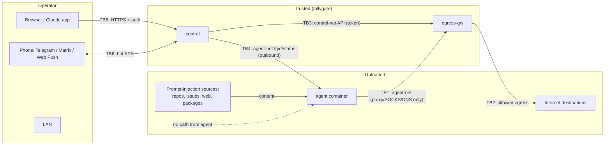

# Threat model

## Scope and assumptions

tallygate protects the operator's network, accounts and secrets from an AI coding agent that runs with
broad autonomy (`bypassPermissions`). The agent is treated as **potentially hostile**: a prompt injection in
a repository, issue, web page or dependency can take full control of what it executes.

Assumptions:
- The Docker host, the Docker daemon and the kernel are trusted and patched.
- The operator's reverse proxy (TLS, authentication) and devices are trusted.
- Anthropic's and GitHub's services behave as documented.

## Assets

| Asset | Where it lives | Why it matters |
|---|---|---|
| Home/office LAN (NAS, router, Home Assistant, hypervisor) | outside the stack | Lateral movement, data theft, sabotage |
| GitHub token | gateway `secrets.json` | Repository access; must not be exfiltrated |
| Claude login (OAuth) | agent home | Account misuse; required in the agent for Remote Control |
| Workspace contents / source code | agent volume | Confidentiality and integrity of your code |
| Gateway policy & API token | gateway / control env | Control over what the agent may reach |
| Control UI session / password | browser / control env | Full control over policy and consoles |
| Audit log | gateway `events.db` | Detection and forensics |

## Trust boundaries

## Threats and mitigations

STRIDE categories: **S**poofing, **T**ampering, **R**epudiation, **I**nformation disclosure, **D**enial of
service, **E**levation of privilege.

| # | Threat | STRIDE | Mitigation | Verified by |
|---|---|---|---|---|
| T1 | Agent connects directly to the internet, bypassing the proxy | E, I | `agent-net` is `internal` (no route); agent attached to no other network | `bypass.sh` (direct IP/name), structure checks |
| T1a | Agent connects directly to services on the Docker host through the host's address on `agent-net` | E, I | The bridge gets no IPv4 address (`com.docker.network.bridge.inhibit_ipv4`), so the host is not a peer on `agent-net` | `bypass.sh` (listener in the host namespace, #7) |
| T2 | Agent reaches LAN/host/metadata through the proxy (incl. via public names resolving to private IPs) | E, I | *Changed by ADR-0019.* The built-in blocks: `deny` rules for the private, loopback, link-local/metadata, CGNAT, multicast and special ranges (incl. NAT64/6to4/Teredo), seeded at the bottom of the one rule list. An IP literal is decided by the first address rule that contains it; a name must be allowed by name **and every resolved** address must be open, and the most restrictive result wins; a blocked address is denied without a prompt. A name rule never opens a block, wherever it stands (T45). The blocks are ordinary rules: an authenticated operator may add an address allow above one or delete one (T27, residual risks). An upgrade never opens a range that was blocked: blocks that an old address rule overlaps are placed above it. The stack itself is locked whatever the list says (T46). Service exceptions only on their own port | unit (`test_gw_rule_list.py`, `test_policy.py`) + e2e (`test_floor.py`, `test_rules.py`), `bypass.sh` |
| T3 | DNS rebinding between check and connect | E | Upstream address pinned to the checked IP (for what a name may resolve to at all, see T45) | design + e2e (pinned connections) |
| T4 | Data exfiltration via DNS queries (agent's own lookups **or** names it asks the proxy for) | I | Agent DNS → gateway → NXDOMAIN, logged; the gateway resolves a name only after it is allowed/approved, without exception (ADR-0011): a `deny` or `ask` for a name is acted on before the lookup, and no address rule can change it ([rules.md](rules.md#when-a-name-is-resolved)) | e2e DNS + "denied names are never resolved" |
| T5 | IPv6 side channel (incl. link-local on internal networks) | E, I | IPv6 disabled on all networks and by sysctl in every container; IPv6 targets are decided by the same rule list (IPv6 built-in blocks, IPv4-mapped addresses normalised) | `bypass.sh`, self-test |
| T6 | Agent steals the GitHub token | I | Token only in gateway; injected in flight; never returned by API; placeholders in agent | e2e (secrets write-only, no token in logs) |
| T7 | Agent obtains injected token by spoofing SNI/Host towards another server | S, I | Injection requires CONNECT target = Host = configured host; TLS to inject/read-only hosts is always intercepted (no SNI-based passthrough); plaintext never injected | e2e SNI tests (both directions) |
| T7a | Domain fronting: the agent connects to an allowed name on a shared CDN and sends another site's SNI or `Host`, reaching most of the web through one allowed host | E, I | TLS is passed through only if the SNI equals the checked CONNECT name (missing SNI / ECH outer name refused; for an IP literal an SNI name must be allowed by the rules by itself); every HTTP request whose `Host` is not the checked target gets `403`. An address `allow` (for example an approved IP on a shared CDN) lets no name through by itself: a name that resolves to it still needs a name rule or an approval, and a name `deny` wins wherever it stands (ADR-0013, ADR-0019 amendment) | unit + e2e (SNI mismatch, missing SNI, IP literal, Host plain / tunnelled / SOCKS5 / intercepted, #57) |
| T8 | MITM of intercepted upstream (gateway trusts a bad cert) | S, I | Upstream TLS verified against the configured hostname | e2e bad-cert test |
| T9 | Agent changes policy (calls gateway API or control UI) | E | API bound to control-net only + bearer token; UI bound to mgmt only; agent on neither | `bypass.sh`, self-test |
| T10 | Agent uses the Docker socket to escape | E | No docker.sock in any container | `bypass.sh` structure check |
| T11 | Container breakout via capabilities / setuid | E | `cap_drop: ALL`, `no-new-privileges`, non-root, read-only rootfs, pid/memory limits | `bypass.sh` structure checks |
| T12 | Attacker on the network uses the control UI | S, E | scrypt (N = 2^16) password or trusted-proxy auth (OIDC recommended) honoured only from `TRUSTED_PROXIES`; server-side sessions (logout/idle/absolute expiry), signed HttpOnly SameSite=Strict Secure cookie; per-IP limit + globally serialised checks | e2e auth/session tests |
| T13 | CSRF / cross-origin websocket hijacking against the UI | S, E | Custom header + Origin check for state-changing API calls; Origin check for websockets; strict CSP; frame restrictions | e2e CSRF/origin tests |
| T14 | Someone else approves requests via the bots | S, E | Telegram chat + **mandatory** user-ID allowlist; Matrix user allowlist (bot itself excluded); approvals attributed (`by`) | e2e unauthorised-user / no-allowlist tests |
| T15 | Approval fatigue / notification storm | D | One prompt per host:port; at most `max_pending` open prompts; negative cache after timeout; scoped approvals | e2e dedupe + cap tests |
| T16 | Operator cannot reconstruct what happened | R | Every decision, DNS query, admin change and approval (with actor) logged in the gateway, outside the agent's reach | e2e log assertions |
| T17 | Spoofed `by` attribution through the UI | R | Control overwrites `by` with the authenticated user | e2e (`by` cannot be spoofed) |
| T18 | Compromised dependency in the agent image | T, E | Minimal image, pinned versions, gh from signed repo, ttyd checksum-verified, no bundled third-party plugins | review, CI builds |
| T19 | In-agent self-test lies | R | Authoritative test runs from an independent probe container on the host | `bypass.sh` |
| T20 | Login brute force with spoofed `X-Forwarded-For` | S | Forwarded headers only trusted with `TRUST_FORWARDED_FOR=1` **and** from `TRUSTED_PROXIES` | e2e forged-header test |
| T21 | Agent runs script in the operator's browser (console content) and drives the UI | E, T | Console page + xterm.js served by control; WebSocket filtered both ways; no agent HTML on the UI origin; strict CSP (`script-src 'self'`); OSC 8 links inert | e2e console tests (TG-01) |
| T22 | Agent tricks the operator with look-alike names (`github.com.evil.example`, homographs) | S | Strict hostname syntax; prompts show the registrable domain and flag punycode | unit + e2e (TG-10) |
| T23 | One "Always (*.domain)" click opens a shared suffix (`*.github.io`, `*.ngrok-free.app`) | E, I | Public Suffix List incl. private section; widening refused for suffixes; exact pattern shown on the button | unit (TG-04) |
| T24 | Agent uses its *own* account on an allowed credential host (token/cookie) to exfiltrate | I | Agent `Authorization`/`Cookie` stripped on inject hosts, also before a secret is set | e2e (TG-05) |
| T25 | Exfiltration by publishing to a package registry (`npm publish`, `cargo publish`, image push, Hugging Face upload) | I | `readonly` hosts (npm, Yarn, crates.io, Docker Hub, GHCR, Quay, Hugging Face by default): PUT/PATCH/DELETE refused, POST too where it writes (`post_is_write`, with `read_posts` exceptions). Residual: chunk uploads to Hugging Face storage (`*.hf.co`) | e2e (TG-11, #58) |
| T25a | A request body over 1 MB is streamed upstream before the per-request checks run (read-only, credential stripping, grant method/path/Host) | I, E | The checks run on the request headers (`requestheaders`), before anything is forwarded; streamed or chunked bodies of refused requests are cut | e2e with 2 MB bodies (#56) |
| T26 | Disk/log flood by a looping or hostile agent | D | Identical events coalesced; hard row cap; retention | e2e (TG-09) |
| T27 | A compromised control plane (or UI session) removes LAN protection | E | *Changed by ADR-0019 (which supersedes ADR-0017).* Not prevented, by decision: the blocked ranges are rules, and whoever holds an authenticated UI session or the gateway API token can add an allow rule for a local address, delete a built-in block or define a grant for a local device. Mitigations: the UI login (T12, T13) and the agent having no path to the API or the UI (T9); deleting a block is a confirmed danger action that names the range; every change is a policy version with its author and can be restored (T38); *Restore built-in blocks*. **Invariant:** the locked ranges (T46) are not rules and cannot be opened from there, so the agent still cannot reach the control plane or the gateway, and the isolation self-test is unchanged. Credential injection and `tls_verify: false` stay file-only | unit (`test_gw_locked.py`, `test_gw_rule_list.py`) + e2e (`test_floor.py`), `bypass.sh` |
| T27a | The agent names a destination for itself to shed its checked target's limits: an absolute-form `https://` request over the plain proxy (no CONNECT, so no verdict and no interception), or a blocked range reached by an IP literal below a `*` allow | E, I | An https request with no connection verdict is refused (it must use CONNECT). *Second half changed by ADR-0019:* a `*` rule is a name rule, so for an IP literal it cannot open an address `deny` further down either; between address rules position decides (an address `allow` above a block opens it, by intent) | e2e (#137), unit (`test_gw_rule_list.py`) |
| T28 | Agent abuses an approved grant beyond its intent (other paths, other vhosts on the same IP, writes on read, WebSocket, raw TCP on an HTTP port) | E, T | Per-request checks: Host == granted host, canonical path match (no `..`, `//`, encoded separators), safe methods + no upgrade on read, non-HTTP cut; pinned IP | unit + e2e grants tests |
| T29 | Agent talks the human into a broad grant (misleading reason, request flooding) | S | Only operator-defined grants can be requested; reason sanitised and labelled unverified; write can be downgraded to read; max 3 pending, rate-limited API | e2e grants + notification tests |
| T30 | UI compromise defines a grant to arbitrary LAN hosts | E | *Superseded by ADR-0019:* `grants_lan_allow`, `lan` and `grants_never` are gone. A UI session can define a grant whose target names a local address, exactly as it can add an allow rule for it (T27, accepted). A target that names an address (an IP, or a fixed `address`) is not subject to the blocks or to `deny` rules, which includes loopback, cloud metadata and the `never` entries of the gateway config (residual risks). What remains enforced: a target that is only a name cannot open a blocked range (T45), the locked ranges apply to every grant (T30a, T46), UI grants cannot inject credentials or disable TLS verification (T34), and a grant defined in the UI with `approval: ask` is still approved per use | unit (`test_grants.py`, `test_gw_grants.py`) + e2e (`test_grants.py`) |
| T30a | A grant for a local address points at the stack itself: the gateway management API, the control UI or the Docker host on the egress network | E | The locked ranges (T46): the stack's own networks (`GW_INTERNAL_NETS`, set in `compose.yaml`) and the gateway's own listeners are refused for every grant, whatever the rule list says; UI grants whose target names such an address are rejected when saved | unit (`test_gw_locked.py`) + e2e (#112) |
| T31 | Self-signed LAN service impersonated on the path | S, I | Leaf certificate pinned by SHA-256 (`tls_fingerprint`); disabling verification needs an explicit setting and UI confirmation | e2e pinned/badpin |
| T32 | Access outlives the task | E | Grants expire (≤ 7 days, capped per grant), are revocable from UI/Telegram/Matrix, end on restart; open HTTP connections are re-checked per request | e2e revoke test |
| T33 | An internal error (broken config entry, full disk, locked event log) lets a connection through unchecked | E, I | Every mitmproxy hook fails closed: an exception refuses the connection/flow; the error is set before the event is recorded; CIDRs are validated at startup (the gateway does not start otherwise) | e2e (`test_fail_closed.py`) |
| T34 | A compromised UI session or API token defines a grant that injects a stored secret into requests to a host of its choosing | I | `inject` and `tls_verify: false` only in config-file grants; UI/API grants with them are rejected | unit + e2e (#12) |
| T35 | Rule bypass through odd notation: IPv4-mapped IPv6 literals (`[::ffff:127.0.0.1]`) or a null/garbled port that matches every port | E | Mapped addresses normalised in rules (the built-in blocks among them), locked ranges, approvals and grants; ports validated strictly in the API and the UI | unit + e2e (#13) |
| T36 | A compromised agent abuses the setup wizard: a phishing link instead of Claude's login page, script in the status text, a huge answer | S, E | The setup actions only do what the agent user can do in its own container; control shows a login link only for `https://` Anthropic login hosts with the `/oauth/authorize` path, passes on nothing else as a link, caps agent answers at 1 MiB and the UI escapes all agent text | unit + e2e (`test_setup_wizard.py`, #75) |
| T37 | Workspace files in the UI: the agent plants a file that runs in the operator's browser (HTML/SVG), or uses the upload/download path to reach files outside the workspace | E, I | Downloads only as `application/octet-stream` attachments with `nosniff` and `Content-Security-Policy: sandbox`, never rendered on the UI origin; relative paths only, no `..`, checked in control and the agent, symlinks resolved and refused outside `/workspace`, `O_NOFOLLOW`, regular files only; uploads CSRF-protected, size-limited, never written through a link; deleting (#199) is CSRF-protected, logged with the user, refuses the workspace itself and removes a link rather than following it; the status server runs as the agent user | unit + e2e (`test_workspace_files.py`, #76, #199) |
| T38 | A compromised UI session hides a policy change, or uses import or rollback to lower the protection | R, E | Every policy write is a version with its author (control sets it from the session); restore and import are validated like `PUT /policy`; *changed by ADR-0019:* the blocked ranges are rules and part of every version, so a restore or import can remove one like any other policy write (T27), shown in the diff before it is applied; every replacement of the whole policy (PUT, restore, import) records in the log which built-in and config blocks are not in force afterwards, and an import lists them as warnings before it is applied; a version or export from before ADR-0019 is migrated so that nothing that was blocked opens; the locked ranges are not part of a policy and cannot be touched; imported grants pass the same checks as the grant editor (no injection, no name-only target into a blocked range); exports and versions contain no secrets | unit + e2e (#71) |
| T39 | Learning mode is used to open broad access, or outlives the task | E, I | Only replaces the default decision for host names on `learning_ports` (static config); every rule (the built-in blocks among them, checked on the resolved addresses), grants, the locked ranges and name-first decisions stay in force; IP literals not covered; at most `learning_max_minutes`, in memory only (ends on restart and on the emergency stop), checked per connection; shown in the header; started only through the management API; saved rules are exact hosts or `*.<registrable domain>`, added below existing rules | unit + e2e (#69) |
| T40 | Approval fatigue at night or while busy: the operator taps *Allow* on a prompt without reading it, or the agent waits on prompts nobody answers | S, D | Away mode and quiet hours turn *ask* into an immediate *deny* with a message to the agent, never into *allow*; what was refused is reviewed later (digest, *Allow 1 h*); an unreadable state file means away (#73) | unit + e2e (`test_availability.py`) |
| T41 | Someone approves through a push notification: a forged, replayed or leaked notification button, a cross-site request to the action endpoint, or a subscription that points control at the LAN | S, E | Buttons carry action tokens (HMAC with a key derived from the session secret) bound to one request, one decision and one device, single use, ≤ 10 min; sent end-to-end encrypted (RFC 8291) to the subscribed browser only; `/api/push/act` requires `POST`, `X-Tallygate` and a same-origin `Origin`; write grants cannot be approved from a notification; subscriptions only to known push service hosts (`PUSH_ALLOWED_HOSTS`), https only; ntfy/Gotify/Pushover get no buttons | unit (RFC 8291 vector, tokens) + e2e (`test_push.py`) |
| T42 | The agent misleads the operator with the context next to an approval ("about to run `npm install`" while it exfiltrates), floods it, or the context leaks a secret it typed into a command | S, I, D | Context is agent-written and labelled *claimed by the agent, unverified*; never used for a decision; printable single line, 200 characters per field, at most 3 entries from the last 2 minutes; HTML-escaped in the UI; obvious secrets redacted in the hook and again in the gateway; own rate limit (`activity_rate`); not sent to third-party chat services; the hook sends no environment or file contents and never blocks Claude Code (0.5 s timeout, no output) | unit (`test_gw_activity.py`, `test_agent_hook.py`) + e2e (`test_context.py`) |
| T43 | Agent uses the injected GitHub token on repositories other than the ones it works on (push to an attacker's repository it can reach, read private repositories, create repositories) | I, E | `github_repos`: TLS to the GitHub hosts intercepted, every request must name an allowed repository in a canonical path (`/repos/<o>/<r>/…`, `/<o>/<r>[.git]/…`); other API endpoints refused except a few `GET`s; GraphQL refused unless `github_graphql`; checked before credentials are added, also for requests through grants | unit (`test_gw_github.py`) + e2e (`test_github_repos.py`) |
| T44 | Notification credentials stored by the control plane (ADR-0018): a UI session reads the bot tokens back, redirects them to its own server, or enables approvals for everyone in a chat; the agent or the gateway gets at them | I, E | Tokens are write-only: the API returns only set / source, never a value, and they are redacted from errors and never logged; a changed server URL needs the token entered again (stored or from the environment); Telegram/Matrix are refused without their allowlist, in the store and again in the notifier; routes need a session and the CSRF header; `notify.json` is mode 0600 in the control data volume, which neither the agent nor the gateway mounts | unit (`test_ctl_notifyconfig.py`, `test_ctl_notify.py`, `test_ctl_main.py`) |
| T45 | DNS rebinding through a name rule: the agent (or whoever controls a zone) points an allowed name, e.g. one covered by `allow *.example.com` or by the *Allow web* shortcut, at an address inside a blocked range and reaches the LAN, the host or cloud metadata by name | E, I | ADR-0019 (amended): a name passes two checks. The name must be allowed by a name rule, an approval or the default; then for every resolved address the first address rule with `allow` or `deny` that contains it says whether the address is open, and a `deny` wins whatever the name rule said and wherever it stands. The most restrictive result over all addresses decides, and the connection is pinned to the checked address (T3). Only a rule or grant target that names the **address** opens it. The same holds for approvals of a name, for learning mode and for grant targets that are only a name (saving one that resolves into a blocked range is refused). The denial says why, in the log, in *Test a destination* and to the agent; the table marks the rule *blocked by a range rule*, with the warning that the name may have been redirected | unit (`test_gw_rule_list.py`, `test_grants.py`) + e2e (`test_rules.py`, `test_name_first.py`, `test_floor.py`) |
| T46 | The agent reaches the stack itself (gateway management API, proxy and grant API listeners, control UI) through the proxy because a rule, an approval, a grant, an import or a deleted block allows the address | E | **The invariant of ADR-0019:** the stack's own networks (`GW_INTERNAL_NETS`) and the gateway's own listeners are *locked*: denied before the rule list is walked, for every literal and resolved address, on every path (proxy, SOCKS, service ports, grants). They are not rules, are not stored in `policy.yaml`, and no API call changes them; an invalid `GW_INTERNAL_NETS` stops the gateway, and an empty one is logged as an error at start (then only the listeners are locked; `compose.yaml` sets it). An IPv6 address that carries a locked IPv4 address (NAT64, 6to4, IPv4-compatible) is locked too. A listener bound to every address is locked on loopback too. The self-test probes the management endpoints through the proxy | unit (`test_gw_locked.py`) + e2e (`test_floor.py`), self-test, `bypass.sh` |

## Residual risks

| Risk | Why it remains | Recommendation |
|---|---|---|
| **Learning mode** | While it runs, every host name on its ports that no rule covers is reachable (like the `open` preset), so data can leave through any of them. The built-in blocks still apply to what the names resolve to. | Use it for a short time on a task you watch; prefer 443 only; review the proposed rules. |
| **Exfiltration via allowed destinations** | Any allowed host can carry data out — notably the Anthropic API with an API key of the attacker's choosing (the agent needs its own Claude credentials, so these cannot be stripped), GitHub within the injected token's permissions, and reads that encode data in URLs. | Keep allowlists tight; prefer `ask`; fine-grained PATs; review the log. |
| **Grant semantics** | `read` trusts that the target does not change state on GET; `tcp` grants cannot see inside the stream, and established sessions survive expiry. | Narrow paths, short `max_ttl` for tcp, dedicated restricted accounts/keys on targets. |
| **Agent-supplied terminal output** | xterm.js parses escape sequences from the agent. | Vendored, pinned xterm.js; no clipboard/link addons; CSP limits impact. |
| **Abuse of the injected token's permissions** | The agent can *use* the token through the gateway, on every repository it can reach unless `github_repos` limits it; with `github_graphql: true` GraphQL is not limited. | Fine-grained PAT, only needed repos and permissions; `github_repos`; branch protection on important repos. |
| **Shared kernel** | Containers share the host kernel; a kernel exploit escapes all isolation. | Keep the host patched; run the stack in a dedicated VM; optionally `runtime: runsc` (gVisor) for the agent. |
| **Claude OAuth credentials in the agent** | Remote Control requires a full-scope login on the machine. | Treat as exposed to the agent; revoke via claude.ai if compromise is suspected. |
| **Compromised control plane** | Holds the gateway API token; can change policy, and since ADR-0019 that includes allowing local addresses and deleting built-in blocks (T27). It cannot open the locked ranges (T46), read secrets back or add credential injection. | Strong auth in front (OIDC), not internet-exposed, keep updated; review *Log → Policy history*. |
| **A deleted or narrowed built-in block** | The built-in blocks are ordinary rules so that one device can be opened without a file edit. An operator who deletes one (say `192.168.0.0/16`) removes the protection for the whole range: every name rule, the *Allow web* shortcut, learning mode and the default `allow` then reach whatever a name resolves to there, and DNS rebinding into that range works again (T45 relies on the block). A deleted block stays deleted across restarts and upgrades. | Do not delete blocks; add an allow rule for the one address and port above the block, or a grant. Deleting asks for confirmation and names the range. *Destinations → Restore built-in blocks* adds missing ones back; the line under the table counts the blocks in the list. |
| **Address allow rules** | An address `allow` above a block opens that address for connections to the IP, and for every name that is allowed by name and resolves there; with a broad name rule (`allow *.example.com`, the *Allow web* shortcut, default `allow`, learning mode) whoever controls such a name can point it at the opened address. It lets no name through by itself and does not change when names are resolved. *Allow* on a log line for an IP adds such a rule at the top (second click required); *Restore built-in blocks* does not remove it and reports what is still open. | Give address rules a port and keep them few; prefer a grant for a local device when the agent should ask; let temporary ones expire. |
| **Grant targets that name an address** | By decision (ADR-0019, amendment), a grant target with an IP or a fixed `address` is not subject to the built-in blocks, the `never` entries of the gateway config or `deny` rules, only to the locked ranges. A grant can therefore reach loopback in the gateway container, the cloud metadata address or a `never` range, which earlier releases closed to every grant, and a UI session can define one (T30). A target of that kind stored before the upgrade without `lan` was always refused and works after it; the migration log names each one, and whether a level is approved automatically. | Read the address of a target before saving or approving a grant; keep `approval: ask` for such targets; check the `NOTE grant …` lines after the upgrade and delete targets you do not want. |
| **Matrix room not end-to-end encrypted** | Bot does not implement E2EE. | Use your own homeserver; consider Telegram or web-only approvals. |
| **Telegram metadata** | Destinations in approval prompts pass through Telegram. | Use Matrix on your homeserver or web-only if that matters. |
| **ntfy / Gotify / Pushover** | The same text in plain form on those services; an ntfy topic on a public server is readable by anyone who knows its name. | Self-host ntfy/Gotify, set `NTFY_TOKEN`, or use Web Push (end-to-end encrypted). |
| **Web Push metadata** | The browser's push service (Google, Mozilla, Apple, Microsoft) sees when and how much is sent, not the content. A stolen unlocked phone can press the buttons of current notifications. | Lock the phone; remove lost devices under *Setup → Notifications*. |

## Out of scope

Physical attacks, a malicious operator, vulnerabilities in Anthropic/GitHub services, and denial of
service by the agent against allowed destinations (rate limits are not enforced).
