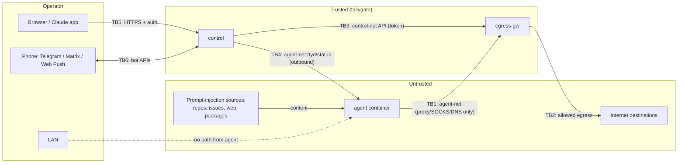

# Threat model

## Scope and assumptions

tallygate protects the operator's network, accounts and secrets from an AI coding agent that runs with
broad autonomy (`bypassPermissions`). The agent is treated as **potentially hostile**: a prompt injection in
a repository, issue, web page or dependency can take full control of what it executes.

Assumptions:
- The Docker host, the Docker daemon and the kernel are trusted and patched.
- The operator's reverse proxy (TLS, authentication) and devices are trusted.
- Anthropic's and GitHub's services behave as documented.

## Assets

| Asset | Where it lives | Why it matters |
|---|---|---|
| Home/office LAN (NAS, router, Home Assistant, hypervisor) | outside the stack | Lateral movement, data theft, sabotage |
| GitHub token | gateway `secrets.json` | Repository access; must not be exfiltrated |
| Claude login (OAuth) | agent home | Account misuse; required in the agent for Remote Control |
| Workspace contents / source code | agent volume | Confidentiality and integrity of your code |
| Gateway policy & API token | gateway / control env | Control over what the agent may reach |
| Control UI session / password | browser / control env | Full control over policy and consoles |
| Audit log | gateway `events.db` | Detection and forensics |

## Trust boundaries

## Threats and mitigations

STRIDE categories: **S**poofing, **T**ampering, **R**epudiation, **I**nformation disclosure, **D**enial of
service, **E**levation of privilege.

| # | Threat | STRIDE | Mitigation | Verified by |
|---|---|---|---|---|
| T1 | Agent connects directly to the internet, bypassing the proxy | E, I | `agent-net` is `internal` (no route); agent attached to no other network | `bypass.sh` (direct IP/name), structure checks |
| T1a | Agent connects directly to services on the Docker host through the host's address on `agent-net` | E, I | The bridge gets no IPv4 address (`com.docker.network.bridge.inhibit_ipv4`), so the host is not a peer on `agent-net` | `bypass.sh` (listener in the host namespace, #7) |
| T2 | Agent reaches LAN/host/metadata through the proxy (incl. via public names resolving to private IPs) | E, I | *Changed by ADR-0019.* The built-in blocks: `deny` rules for the private, loopback, link-local/metadata, CGNAT, multicast and special ranges (incl. NAT64/6to4/Teredo), seeded at the bottom of the one rule list. An IP literal is decided by the first address rule that contains it; a name must be allowed by name **and every resolved** address must be open, and the most restrictive result wins; a blocked address is denied without a prompt. An IPv4 address written like a name (a host that ends in a number: `192.168.1.1.`, `127.1`, `2130706433`, `0x7f.1`) is refused as an invalid host name and never asked about, and an approval is refused when its rule would be an allow for an address inside a blocked range, so no answer to a prompt opens a block. A name rule never opens a block, wherever it stands (T45). The blocks are ordinary rules: an authenticated operator may add an address allow above one or delete one (T27, residual risks). An upgrade never opens a range that was blocked: blocks that an old address rule overlaps are placed above it. The stack itself is locked whatever the list says (T46). Service exceptions only on their own port | unit (`test_gw_rule_list.py`, `test_policy.py`, `test_gw_second_review.py`) + e2e (`test_floor.py`, `test_rules.py`, `test_ip_as_name.py`), `bypass.sh` |
| T3 | DNS rebinding between check and connect | E | Upstream address pinned to the checked IP (for what a name may resolve to at all, see T45) | design + e2e (pinned connections) |
| T4 | Data exfiltration via DNS queries (agent's own lookups **or** names it asks the proxy for) | I | Agent DNS → gateway → NXDOMAIN, logged; the gateway resolves a name only after it is allowed/approved, without exception (ADR-0011): a `deny` or `ask` for a name is acted on before the lookup, and no address rule can change it ([rules.md](rules.md#when-a-name-is-resolved)) | e2e DNS + "denied names are never resolved" |
| T5 | IPv6 side channel (incl. link-local on internal networks) | E, I | IPv6 disabled on all networks and by sysctl in every container; IPv6 targets are decided by the same rule list (IPv6 built-in blocks, IPv4-mapped addresses normalised) | `bypass.sh`, self-test |
| T6 | Agent steals the GitHub token | I | Token only in gateway; injected in flight; never returned by API; placeholders in agent | e2e (secrets write-only, no token in logs) |
| T7 | Agent obtains injected token by spoofing SNI/Host towards another server | S, I | Injection requires CONNECT target = Host = configured host; TLS to inject/read-only hosts is always intercepted (no SNI-based passthrough); plaintext never injected | e2e SNI tests (both directions) |
| T7a | Domain fronting: the agent connects to an allowed name on a shared CDN and sends another site's SNI or `Host`, reaching most of the web through one allowed host | E, I | TLS is passed through only if the SNI equals the checked CONNECT name (missing SNI / ECH outer name refused; for an IP literal an SNI name must be allowed by the rules by itself); every HTTP request whose `Host` is not the checked target gets `403`, and so does an HTTP/1 request whose request line names another server (absolute-form inside a tunnel: a server uses that before the `Host`; #236). An address `allow` (for example an approved IP on a shared CDN) lets no name through by itself: a name that resolves to it still needs a name rule or an approval, and a name `deny` wins wherever it stands (ADR-0013, ADR-0019 amendment) | unit + e2e (SNI mismatch, missing SNI, IP literal, Host plain / tunnelled / SOCKS5 / intercepted, #57) |
| T8 | MITM of intercepted upstream (gateway trusts a bad cert) | S, I | Upstream TLS verified against the configured hostname | e2e bad-cert test |
| T9 | Agent changes policy (calls gateway API or control UI) | E | API bound to control-net only + bearer token; UI bound to mgmt only; agent on neither | `bypass.sh`, self-test |
| T10 | Agent uses the Docker socket to escape | E | No docker.sock in any container | `bypass.sh` structure check |
| T11 | Container breakout via capabilities / setuid | E | `cap_drop: ALL`, `no-new-privileges`, non-root, read-only rootfs, pid/memory limits | `bypass.sh` structure checks |
| T12 | Attacker on the network uses the control UI | S, E | scrypt (N = 2^16) password or trusted-proxy auth (OIDC recommended) honoured only from `TRUSTED_PROXIES`; server-side sessions (logout/idle/absolute expiry), signed HttpOnly SameSite=Strict Secure cookie; per-IP limit + globally serialised checks | e2e auth/session tests |
| T13 | CSRF / cross-origin websocket hijacking against the UI | S, E | Custom header + Origin check for state-changing API calls; Origin check for websockets; strict CSP; frame restrictions | e2e CSRF/origin tests |
| T14 | Someone else approves requests via the bots, or the bot approves them itself: the homeserver echoes the bot's own prompts and pre-seeded reactions (👍 first) back to it, and they count as an allowed user's decision if the bot's account is an allowed user and control does not know its own account (#238: `whoami` failed once at start) | S, E | Telegram chat + **mandatory** user-ID allowlist (Telegram delivers a bot neither its own messages nor button presses of its own; only `callback_query` updates are read). Matrix user allowlist, and the bot never decides: (1) fail closed: no event from the room counts as a decision, and none is read, until `whoami` has succeeded; it is retried (5 s doubling to 5 min) and the channel status says *approvals paused*; what happened in the room meanwhile is skipped, not replayed (the prompt stays open for the UI or a new reaction); (2) a bot account that is an allowed user switches Matrix approvals off, on every path: at start, after a late `whoami`, and when an event control sent itself comes back with an allowed user as sender; (3) independently of `whoami`, control remembers the ids of the events it sent (prompts, reactions, notices; the last 2000) and never takes them, or anything else by their sender, as a decision. Approvals attributed (`by`) | unit (`test_ctl_notify.py`, `test_ctl_matrix_self.py`: whoami fails then succeeds / fails forever / bot is an allowed user, own event ids) + e2e unauthorised-user / no-allowlist / bot-approves-itself tests |
| T15 | Approval fatigue / notification storm | D | One prompt per host:port; at most `max_pending` open prompts; negative cache after timeout; scoped approvals | e2e dedupe + cap tests |
| T16 | Operator cannot reconstruct what happened | R | Every decision, DNS query, admin change and approval (with actor) logged in the gateway, outside the agent's reach | e2e log assertions |
| T17 | Spoofed `by` attribution through the UI | R | Control overwrites `by` with the authenticated user; for a revoked grant it is the only query parameter sent, encoded by control (T53) | e2e (`by` cannot be spoofed) |
| T18 | Compromised dependency in the agent image | T, E | Minimal image, pinned versions, gh from signed repo, ttyd checksum-verified, no bundled third-party plugins | review, CI builds |
| T19 | In-agent self-test lies | R | Authoritative test runs from an independent probe container on the host | `bypass.sh` |
| T20 | Login brute force with spoofed `X-Forwarded-For` | S | Forwarded headers only trusted with `TRUST_FORWARDED_FOR=1` **and** from `TRUSTED_PROXIES` | e2e forged-header test |
| T21 | Agent runs script in the operator's browser (console content) and drives the UI | E, T | Console page + xterm.js served by control; WebSocket filtered both ways; no agent HTML on the UI origin; strict CSP (`script-src 'self'`); OSC 8 links inert | e2e console tests (TG-01) |
| T22 | Agent tricks the operator with look-alike names (`github.com.evil.example`, homographs) | S | Strict hostname syntax; prompts show the registrable domain and flag punycode | unit + e2e (TG-10) |
| T23 | One "Allow *.domain permanently" click opens a shared suffix (`*.github.io`, `*.ngrok-free.app`) | E, I | Public Suffix List incl. private section; widening refused for suffixes; exact pattern shown on the button | unit (TG-04) |
| T24 | Agent uses its *own* account on an allowed credential host (token/cookie) to exfiltrate | I | Agent `Authorization`/`Cookie` stripped on inject hosts, also before a secret is set | e2e (TG-05) |
| T25 | Exfiltration by publishing to a package registry (`npm publish`, `cargo publish`, image push, Hugging Face upload) | I | `readonly` hosts (npm, Yarn, crates.io, Docker Hub, GHCR, Quay, Hugging Face by default): PUT/PATCH/DELETE refused, POST too where it writes (`post_is_write`, with `read_posts` exceptions). Residual: chunk uploads to Hugging Face storage (`*.hf.co`) | e2e (TG-11, #58) |
| T25a | A request body over 1 MB is streamed upstream before the per-request checks run (read-only, credential stripping, grant method/path/Host) | I, E | The checks run on the request headers (`requestheaders`), before anything is forwarded; streamed or chunked bodies of refused requests are cut | e2e with 2 MB bodies (#56) |
| T26 | Disk/log flood by a looping or hostile agent | D | Identical events coalesced; hard row cap; retention | e2e (TG-09) |
| T27 | A compromised control plane (or UI session) removes LAN protection | E | *Changed by ADR-0019 (which supersedes ADR-0017).* Not prevented, by decision: the blocked ranges are rules, and whoever holds an authenticated UI session or the gateway API token can add an allow rule for a local address, delete a built-in block or define a grant for a local device. Mitigations: the UI login (T12, T13) and the agent having no path to the API or the UI (T9); deleting a block is a confirmed danger action that names the range; every change is a policy version with its author and can be restored (T38); *Restore built-in blocks*. **Invariant:** the locked ranges (T46) are not rules and cannot be opened from there, so the agent still cannot reach the control plane or the gateway, and the isolation self-test is unchanged. Credential injection and `tls_verify: false` stay file-only | unit (`test_gw_locked.py`, `test_gw_rule_list.py`) + e2e (`test_floor.py`), `bypass.sh` |
| T27a | The agent names a destination for itself to shed its checked target's limits: an absolute-form `https://` request over the plain proxy (no CONNECT, so no verdict and no interception), or a blocked range reached by an IP literal below a `*` allow, or a request on an open connection that names the pinned address (T50) | E, I | An https request with no connection verdict is refused (it must use CONNECT). *Second half changed by ADR-0019:* a `*` rule is a name rule, so for an IP literal it cannot open an address `deny` further down either; between address rules position decides (an address `allow` above a block opens it, by intent). A plain-HTTP request with no connection verdict is decided on its own destination with the policy and bound to the connection that carries it (T50) | e2e (#137, `test_connection_reuse_236.py`), unit (`test_gw_rule_list.py`, `test_gw_request_gate.py`) |
| T28 | Agent abuses an approved grant beyond its intent (other paths, other vhosts on the same IP, writes on read, WebSocket, raw TCP on an HTTP port) | E, T | Per-request checks: Host == granted host, the authority of an HTTP/1 request line == granted target, canonical path match (no `..`, `//`, encoded separators), safe methods + no upgrade on read, non-HTTP cut; pinned IP. They hold for **every** request, also the second one on a keep-alive connection: a request is only sent on a connection that was checked for the destination it names (T50), and the fixed address of an active grant's target is not opened by the grant (by IP literal it is decided by the rule list, refused without a prompt unless a rule allows it) | unit (`test_gw_core.py`, `test_gw_request_gate.py`) + e2e (`test_grants.py`, `test_grant_gaps.py`, `test_connection_reuse_236.py`) |
| T29 | Agent talks the human into a broad grant (misleading reason, request flooding) | S | Only operator-defined grants can be requested; reason sanitised and labelled unverified; write can be downgraded to read; max 3 pending, rate-limited API | e2e grants + notification tests |
| T30 | UI compromise defines a grant to arbitrary LAN hosts | E | *Superseded by ADR-0019:* `grants_lan_allow`, `lan` and `grants_never` are gone. A UI session can define a grant whose target names a local address, exactly as it can add an allow rule for it (T27, accepted). A target that names an address (an IP, or a fixed `address`) is not subject to the blocks or to `deny` rules, which includes loopback, cloud metadata and the `never` entries of the gateway config (residual risks). What remains enforced: a target that is only a name is checked like a name rule and cannot open a blocked range (T45), the locked ranges apply to every grant (T30a, T46), UI grants cannot inject credentials or disable TLS verification (T34), and a grant defined in the UI with `approval: ask` is still approved per use | unit (`test_grants.py`, `test_gw_grants.py`) + e2e (`test_grants.py`) |
| T30a | A grant for a local address points at the stack itself: the gateway management API, the control UI or the Docker host on the egress network | E | The locked ranges (T46): the stack's own networks (`GW_INTERNAL_NETS`, set in `compose.yaml`) and the gateway's own listeners are refused for every grant, whatever the rule list says; UI grants whose target names such an address are rejected when saved | unit (`test_gw_locked.py`) + e2e (#112) |
| T31 | Self-signed LAN service impersonated on the path | S, I | Leaf certificate pinned by SHA-256 (`tls_fingerprint`); disabling verification needs an explicit setting and UI confirmation | e2e pinned/badpin |
| T32 | Access outlives the task | E | Grants expire (≤ 7 days, capped per grant), are revocable from UI/Telegram/Matrix, end on restart; open HTTP connections are re-checked per request, also a pooled plain-HTTP connection that is reused (T50); raw tunnels and WebSockets are cut on their next message | e2e revoke tests (`test_grants.py`, `test_grant_teardown_137.py`, `test_connection_reuse_236.py`) |
| T33 | An internal error (broken config entry, full disk, locked event log) lets a connection through unchecked | E, I | Every mitmproxy hook fails closed: an exception refuses the connection/flow; the error is set before the event is recorded; CIDRs are validated at startup (the gateway does not start otherwise) | e2e (`test_fail_closed.py`) |
| T34 | A compromised UI session or API token defines a grant that injects a stored secret into requests to a host of its choosing | I | `inject` and `tls_verify: false` only in config-file grants; UI/API grants with them are rejected | unit + e2e (#12) |
| T35 | Rule bypass through odd notation: IPv4-mapped IPv6 literals (`[::ffff:127.0.0.1]`) or a null/garbled port that matches every port | E | Mapped destination addresses are normalised before the rules (the built-in blocks among them), the locked ranges, approvals and grants are applied; an IPv4 address in a spelling that only resolvers accept (trailing dot, short, decimal, hex, octal) is refused as an invalid host name (T2); ports validated strictly in the API and the UI. A rule *range* written in the mapped form is not normalised and never matches ([rules.md](rules.md#ip-addresses-and-ranges)) | unit + e2e (#13) |
| T36 | A compromised agent abuses the setup wizard: a phishing link instead of Claude's login page, script in the status text, a huge answer | S, E | The setup actions only do what the agent user can do in its own container; control shows a login link only for `https://` Anthropic login hosts with the `/oauth/authorize` path, passes on nothing else as a link, caps agent answers at 1 MiB and the UI escapes all agent text | unit + e2e (`test_setup_wizard.py`, #75) |
| T37 | Workspace files in the UI: the agent plants a file that runs in the operator's browser (HTML/SVG), or uses the upload/download path to reach files outside the workspace | E, I | Downloads only as `application/octet-stream` attachments with `nosniff` and `Content-Security-Policy: sandbox`, never rendered on the UI origin; relative paths only, no `..`, checked in control and the agent, symlinks resolved and refused outside `/workspace`, `O_NOFOLLOW`, regular files only; uploads CSRF-protected, size-limited, never written through a link; deleting (#199) is CSRF-protected, logged with the user, refuses the workspace itself and removes a link rather than following it; the status server runs as the agent user | unit + e2e (`test_workspace_files.py`, #76, #199) |
| T38 | A compromised UI session hides a policy change, or uses import or rollback to lower the protection | R, E | Every policy write is a version with its author (control sets it from the session); restore and import are validated like `PUT /policy`; *changed by ADR-0019:* the blocked ranges are rules and part of every version, so a restore or import can remove one like any other policy write (T27), shown in the diff before it is applied; every replacement of the whole policy (PUT, restore, import) records in the log which built-in and config blocks are not in force afterwards and which address rules stand above a block and are open inside it, an import lists both as warnings before it is applied, and the gateway logs the open address rules at every start; a rule's `expires` must be a finite number, so a write cannot be refused after it took effect for that reason (the replacement is still put in force before it is saved: if saving fails, for example on a full disk, the request fails, and the new policy is in force without a version until the next restart); a version or export from before ADR-0019 is migrated so that nothing that was blocked opens; the locked ranges are not part of a policy and cannot be touched; imported grants pass the same checks as the grant editor (no injection, no name-only target into a blocked range); exports and versions contain no secrets | unit + e2e (#71) |
| T39 | Learning mode is used to open broad access, or outlives the task | E, I | Only replaces the default decision for host names on `learning_ports` (static config); every rule (the built-in blocks among them, checked on the resolved addresses), grants, the locked ranges and name-first decisions stay in force; IP literals not covered, in whatever spelling (T2); at most `learning_max_minutes`, in memory only (ends on restart and on the emergency stop), checked per connection; shown in the header; started only through the management API; saved rules are exact hosts or `*.<registrable domain>`, added below existing rules | unit + e2e (#69) |
| T40 | Approval fatigue at night or while busy: the operator taps *Allow* on a prompt without reading it, or the agent waits on prompts nobody answers | S, D | Away mode and quiet hours turn *ask* into an immediate *deny* with a message to the agent, never into *allow*; what was refused is reviewed later (digest, *Allow 1 h*); an unreadable state file means away (#73). **Exempt by design: grant levels with `approval: auto`** are still activated while away or in quiet hours, because the operator authorised them beforehand and no person is asked (#237). They are not silent: each activation is listed in the availability list and the digest as *activated automatically* (grant name, level, count and time only, never the agent's reason; not offered as something to allow, and kept even when refused destinations fill the list). To stop them as well, use the emergency stop, which suspends automatic approval, or set the level to `ask` | unit (`test_gw_availability.py`, `test_ctl_notify.py`) + e2e (`test_availability.py`) |
| T41 | Someone approves through a push notification: a forged, replayed or leaked notification button, a cross-site request to the action endpoint, or a subscription that points control at the LAN | S, E | Buttons carry action tokens (HMAC with a key derived from the session secret) bound to one request, one decision and one device, single use, ≤ 10 min (which decisions exist as buttons: T47). The device binding is checked when the button is pressed (#241): a token whose subscription is gone is refused, so *Remove* ends a device's open notifications at once. The used-token list is in memory, so every token carries the boot id of the control process that minted it and no other process takes it: a restart cannot make a used token good again (and ends all open buttons; the UI still decides). Sent end-to-end encrypted (RFC 8291) to the subscribed browser only; `/api/push/act` requires `POST`, `X-Tallygate` and an `Origin` header that is the UI's own (a request without `Origin` is refused, unlike the session-authenticated API); write grants cannot be approved from a notification; subscriptions only to known push service hosts (`PUSH_ALLOWED_HOSTS`), https only; ntfy/Gotify/Pushover get no buttons; where the free-text URLs of ntfy, Gotify and Matrix may point: T54 | unit (RFC 8291 vector, tokens, removed device, restart) + e2e (`test_push.py`) |
| T42 | The agent misleads the operator with the context next to an approval ("about to run `npm install`" while it exfiltrates), floods it, or the context leaks a secret it typed into a command | S, I, D | Context is agent-written and labelled *claimed by the agent, unverified*; never used for a decision; printable single line, 200 characters per field, at most 3 entries from the last 2 minutes; HTML-escaped in the UI; obvious secrets redacted in the hook and again in the gateway; own rate limit (`activity_rate`); not sent to third-party chat services; the hook sends no environment or file contents and never blocks Claude Code (0.5 s timeout, no output) | unit (`test_gw_activity.py`, `test_agent_hook.py`) + e2e (`test_context.py`) |
| T43 | Agent uses the injected GitHub token on repositories other than the ones it works on (push to an attacker's repository it can reach, read private repositories, create repositories) | I, E | `github_repos`: TLS to the GitHub hosts intercepted, every request must name an allowed repository in a canonical path (`/repos/<o>/<r>/…`, `/<o>/<r>[.git]/…`); other API endpoints refused except a few `GET`s; GraphQL refused unless `github_graphql`; checked before credentials are added, also for requests through grants | unit (`test_gw_github.py`) + e2e (`test_github_repos.py`) |
| T44 | Notification credentials stored by the control plane (ADR-0018): a UI session reads the bot tokens back, redirects them to its own server, or enables approvals for everyone in a chat; the agent or the gateway gets at them | I, E | Tokens are write-only: the API returns only set / source, never a value, and they are redacted from errors and never logged; a changed server URL needs the token entered again (stored or from the environment); where a channel URL may point at all, and what **Test** gives back: T54; Telegram/Matrix are refused without their allowlist, in the store and again in the notifier; routes need a session and the CSRF header; `notify.json` is mode 0600 in the control data volume, which neither the agent nor the gateway mounts | unit (`test_ctl_notifyconfig.py`, `test_ctl_notify.py`, `test_ctl_main.py`) |
| T45 | DNS rebinding through a name rule: the agent (or whoever controls a zone) points an allowed name, e.g. one covered by `allow *.example.com` or by the *Allow web* shortcut, at an address inside a blocked range and reaches the LAN, the host or cloud metadata by name | E, I | ADR-0019 (amended): a name passes two checks. The name must be allowed by a name rule, an approval or the default; then for every resolved address the first address rule with `allow` or `deny` that contains it says whether the address is open, and a `deny` wins whatever the name rule said and wherever it stands. The most restrictive result over all addresses decides, and the connection is pinned to the checked address (T3). Only a rule or grant target that names the **address** opens it. The same holds for approvals of a name, for learning mode and for grant targets that are only a name (saving one that resolves into a blocked range is refused). The denial says why, in the log, in *Test a destination* and to the agent; the table marks the rule *blocked by a range rule*, with the warning that the name may have been redirected | unit (`test_gw_rule_list.py`, `test_grants.py`) + e2e (`test_rules.py`, `test_name_first.py`, `test_floor.py`) |
| T46 | The agent reaches the stack itself (gateway management API, proxy and grant API listeners, control UI) through the proxy because a rule, an approval, a grant, an import or a deleted block allows the address | E | **The invariant of ADR-0019:** the stack's own networks (`GW_INTERNAL_NETS`) and the gateway's own listeners are *locked*: denied before the rule list is walked, for every literal and resolved address, on every path (proxy, SOCKS, service ports, grants). They are not rules, are not stored in `policy.yaml`, and no API call changes them; an invalid **or empty** `GW_INTERNAL_NETS` stops the gateway (fail closed: every connection is refused and the process exits), so new images under a compose file that lacks the setting do not run unprotected; `compose.yaml` always sets it, and only the test switch `GW_TEST_NO_INTERNAL_NETS=1` starts a gateway without it (then only the listeners are locked; logged as a warning). An IPv6 address that carries a locked IPv4 address is locked too: NAT64 (`64:ff9b::/96`, `64:ff9b:1::/48`), IPv4-translated (`::ffff:0:a.b.c.d`), 6to4 and IPv4-compatible. Not recognised: ISATAP, Teredo and a NAT64 prefix of the operator's own, which only matter on a gateway host with such a translator and IPv6 egress (the Compose stack has neither). A listener bound to every address is locked on loopback too. The self-test probes the management endpoints through the proxy | unit (`test_gw_locked.py`, `test_grants.py`) + e2e (`test_floor.py`, `test_fail_closed.py`), self-test, `bypass.sh` |
| T47 | The notification buttons are configurable (#212): a tap on a lock-screen notification now can add a **permanent** rule. Someone holding the unlocked or button-showing phone, a mis-tap, or an agent that times its requests gets more than *Allow once*; a token for one button is turned into another; a stolen UI session switches the widest buttons on | E, S | Opt-in: the default stays *Allow once* / *Deny*, and switching on a permanent allow is confirmed in the UI. The choice is limited server-side to the gateway's six fixed scopes (1 to 4, no free duration), stored in `notify.json`, changed only with a session and the CSRF header, and logged. The token rules of T41 are unchanged, and the decision is part of the signed claims: a *Deny* token cannot allow, `/api/push/act` reads nothing but the token, and a token is minted only for a button that is offered. A token for a button that was switched off since is refused. *Allow \*.domain permanently* is offered only when the gateway names a registrable domain (T23) and shows the pattern on the button. An IP-literal destination gets no allow button in Web Push at all (its approval is an address rule on top that opens the address even inside a blocked range), only *Deny* and the link to the approvals. Button labels are fixed texts; the agent's claim stays below the destination, marked *Agent says (unverified)* (T42). Write grants still cannot be approved from a notification. A stolen UI session gains nothing: it can approve everything directly (T27, T44). Telegram and Matrix authenticate the user and offered every scope before; for them the setting only orders the buttons | unit (`test_ctl_notifyconfig.py`, `test_ctl_webpush.py`, `test_ctl_notify.py`, `test_ctl_main.py`) + e2e (`test_push.py`) |
| T48 | The agent fakes a network outage of the gateway (#218) to hide behind it ("the refusals are the network"), or to spam banners and notifications: it asks for many names that do not resolve, or for hosts that refuse connections | S, R, D | The hint reads only the gateway's own lookup and connect results. A failure is never an outage by itself: it needs at least 5 failures over at least 2 different names, none answered in between, the oldest at least 2 minutes old, **and** a control probe fails too. The probe resolves and connects to a fixed name that only the operator chooses (`connectivity_probe_hosts`, default `api.anthropic.com`) through the same resolver, at most once per 30 s whatever the agent does, so a flood of made-up names while the network is fine runs into a successful probe, clears the run and starts nothing. A name that does not exist (NXDOMAIN, no data) is an answer, not a failure. It ends at the first success; a flapping network needs the whole pattern again, so there is at most one start and one end notification per real outage. State is memory plus a numbers-only file (`connectivity.json`); it is read-only: no agent route or management route writes it, the agent sees only `{down, since}` on its existing grant API port (nothing it did not already infer from its refusals). The text, the events, the stream message and the notifications hold times, counts and the kinds of errors, never a host name or an error text; the UI sets it as text. Refusals stay refusals (`deny`, fail closed): the tag `no connection:` only changes how they are counted and shown, never what is allowed. The probe is an outbound connection by the gateway itself to the configured name (no payload), made only while failures look like an outage | unit (`test_gw_connectivity.py`, `test_gw_api.py`, `test_ctl_notify.py`, `test_ui_conventions.py`) + e2e (`test_connectivity.py`) |
| T49 | The agent answers control with a redirect (#230). The status server (7680) and ttyd run as the agent user, so a hostile agent can replace them and answer any call of control (status every 30 s while *Overview* is open, version, setup, files, console) with `30x Location: <any URL>`. Control is on `mgmt` with a route to the LAN and the internet: following it would be a path around the gateway (requests and exfiltration in URLs without policy, approval or log; with 307/308 also POST/PUT/DELETE bodies) | E, I | Control never follows a redirect and never passes one on. Every client session is created in one place with a hook that refuses any 3xx before a second request is built, for HTTP and the ttyd WebSocket alike; the browser gets `502` with a fixed text, nothing of the answer (status, `Location`, body). The same holds for calls to the gateway, GitHub and the notification services (ntfy, Gotify, Pushover, Telegram, Matrix, Web Push): a configured URL is the final URL. In addition the client for the agent connects only to `AGENT_HOST` on the status and ttyd ports and the client for the gateway only to `GW_URL`: any other destination is refused before a name is resolved or a socket is opened, so a later bug cannot turn them into general clients. No cookies are kept. A redirect to another path on the agent itself is refused like any other | unit (`test_ctl_redirects.py`: 301/302/303/307/308 and other 3xx for status, self-test, version, setup, files list/download/upload/delete, console, gateway, GitHub, every notification channel; peer pinning) + e2e (`test_workspace_files.py`) |
| T50 | A request rides an upstream connection that was checked for another destination (#236). mitmproxy keeps the upstream connections of a client connection and reuses the one whose address equals the host and port a plain-HTTP proxy request names, without `server_connect`. A connection is pinned to the checked address, so after one allowed request to a name (a grant target, a name rule), a request naming that address went out on it with no check: any method and path on a read-only, path-limited grant, and into a blocked range the grant target named | E, T | Three lines. **(1) The request is decided on its own destination** with the policy (locked ranges, the rule list, grants), never trusted. **(2) It is bound to the connection that carries it:** a pooled connection that was checked for another destination never carries it (`403`); one that was checked for the same destination (only possible for an IP literal) carries it with that connection's verdict and limits, and only while the policy still allows the destination by itself: no prompt is asked for a request, so `ask` is a refusal there; in every other case mitmproxy opens a new connection, which `server_connect` decides in full, prompt included. What the request gate assumed is handed to `server_connect` (a grant that started or ended in between refuses the connection) and compared with the connection that really carried the request when its response arrives (a mismatch withholds the response and is logged; it cannot occur while mitmproxy pools as it does today). **(3) No reuse across destinations:** follows from (2); mitmproxy has no switch for it. On the other paths a connection has one verdict from the start and every request on it is checked against it: CONNECT tunnels, SOCKS5, intercepted TLS and each HTTP/2 stream by `Host`/`:authority` and, for HTTP/1, by the authority in the request line. Service ports are raw TCP to one fixed target. Not covered: TLS that is passed through is not seen (T7a binds its SNI), and a rule that is removed does not close a tunnel that is already open (grants do, T32) | unit (`test_gw_request_gate.py`) + e2e (`test_connection_reuse_236.py`: the three proofs of concept of the review, streamed body, WebSocket upgrade, two names on one address, CONNECT, SOCKS5, intercepted TLS, HTTP/2, revoked grants) |
| T51 | Someone on the local network (or the internet, on a host with a public address) reads the UI password or the session from the plain-HTTP port, or attacks the login directly; a host firewall does not help, because Docker publishes ports before ufw/firewalld rules | I, S, E | The UI is published on the Docker host's loopback address by default (`CONTROL_PUBLISH=127.0.0.1:8080`); other machines use a TLS reverse proxy or an SSH tunnel. Publishing on other interfaces is an explicit setting, documented with its consequences; the UI warns on every plain-HTTP session from another machine; login rate limit. | unit (`test_tools_pin_compose.py`: the default in `compose.yaml`, no other published port), review |
| T52 | The images change under an installation: a tag in the registry is moved or replaced (compromised registry account or CI), or `docker compose pull` moves the images while the compose file with the isolation settings stays at an older release | T, E | The `compose.yaml` attached to a release defaults to that release's version, and `compose.digests.yaml` pins the three images by digest (`tools/pin_compose.py` in the release job). Pushed images are signed by digest with cosign (keyless, identity = this repository's `ci.yml` at the tag or `main`); provenance and SBOM attached. A gateway without `GW_INTERNAL_NETS` does not start (T46). Verification is a documented manual step: Docker does not check signatures. | unit (`test_tools_pin_compose.py`), CI release job |
| T53 | A caller of the control plane names another gateway route than the one its action stands for (#239, #244). The ids in a gateway API path come from outside: Telegram callback data (whatever a client sends, not only the bot's buttons), the ids of open prompts, a push token, the browser's path. The HTTP client normalised `..`, and a `?` cut off the rest of the path, so `d:../../emergency-stop?x=:once` from an allowed chat user was `POST /emergency-stop`, and `DELETE /api/gw/destinations/..` was the gateway's `DELETE /`. A chat approver's authority (decide the prompts shown) became any `POST`/`DELETE` on the gateway API with the gateway token | E, T | Three layers, each on its own. **(1) Chat input:** Telegram callback data is accepted only as `kind:id[:choice]` with an id `[a-f0-9]{1,32}`, a scope from the known set for connection requests and `approve`/`read`/`deny` for grant requests; anything else is dropped without an answer, with one log line that quotes nothing of the data. The functions that hand a decision to the gateway check the same again for every channel (Matrix reactions and replies refer to prompts by event id or short number, never by gateway id; an open prompt whose id had another shape is refused with a notice). Push tokens are signed and their id is checked the same way. **(2) The relay's allow-list:** an id in `/api/gw/destinations/{id}` starts with a letter or digit and contains no `..`. **(3) `gw()`**, the one function that calls the gateway API: the path must consist of non-empty segments of `[A-Za-z0-9_:.-]` without `..` (so no `?`, `#`, `%`, space), and it is sent byte for byte (`yarl.URL(..., encoded=True)`); a query string is passed separately and encoded there. A refused path is no request | unit (`test_ctl_gw_paths.py`: the reviewer's reproductions through the real app with a fake Bot API and a raw socket; `test_ctl_notify.py`: every channel's decision functions) |
| T54 | A UI session (a stolen or borrowed one) uses a notification channel as a request forwarder (#240). The URLs of Matrix, ntfy and Gotify are free text, and control sends to them from its own place in the network, next to the gateway's management API and the agent that nothing else may reach (T46), with a token the writer of the URL chooses. A `?` in a base URL turned control's fixed path into a query, so the writer chose the path; **Test** returned the other side's error text, a status oracle and a partial read; the Matrix sync loop repeated the request | I, E | **Where a URL may point:** no `?query` and no `#fragment`; not this machine (loopback, `localhost`, the unspecified address), not a link-local address (which includes the cloud metadata address `169.254.169.254`), not the stack: the hosts control reaches the gateway and the agent at (`GW_URL`, `AGENT_HOST`), its own listen address and host name, and every address in `GW_INTERNAL_NETS` if control is given that variable. **By decision, private LAN addresses stay allowed:** a self-hosted ntfy, Gotify or Matrix server on the local network is a supported setup, so a UI session can still make control send a notification-shaped request to a LAN device (residual; T27 and T44 already give such a session the policy). **Checked three times:** when the URL is saved (`400`); when the notifier loads it, also from the environment or an older `notify.json` (the channel is off and says why); and for every connection: these channels use their own HTTP client whose resolver refuses a name if any of its addresses is a refused one, and the connection goes to exactly the addresses that were checked (no second lookup), so a name cannot be re-pointed after saving (DNS rebinding). Redirects are never followed (T49). **Test** returns a fixed text with the class of the HTTP status (`4xx`); what the service said is only in control's log, tokens redacted. Telegram, Pushover and Web Push have fixed or allow-listed hosts (T41) | unit (`test_ctl_channel_urls.py`: the reviewer's reproduction, fake DNS, the rules) + e2e (`test_notify_config.py`, control without the test switch) |
| T55 | A crashing process in a container hands its memory to the Docker host (#233). `core_pattern` is not namespaced: on most hosts it pipes a core dump to a handler that runs as root in the host's namespaces (`systemd-coredump`, `apport`). The agent can crash a process on purpose, with content it chose: credentials (the Claude login) land in the host's journal, the disk fills up to the handler's quota, and a root-run parser reads agent-chosen data | I, D, E | `ulimits: core: 0` for all three services through the hardening anchor of `compose.yaml`: no core dump is produced. With no capabilities and `no-new-privileges` the agent cannot raise the limit again | unit (`test_tools_pin_compose.py`), `bypass.sh` (the limit as Docker applied it; no crash is triggered) |
| T56 | A second path next to the proxy on the network layer (#233): the gateway and control each have a leg on `agent-net` and one on a network with a way out, and a new network namespace inherits `ip_forward=1` from a Docker host, so they would route for whoever can address a packet to them; or UDP datagrams (broadcast, multicast, or sent from a socket bound to the interface, which needs no capability and skips the routing table) reach a service of the Docker host that listens on `0.0.0.0`, a one-way channel that needs no answer | E, I | Forwarding is switched off in all three containers (`net.ipv4.ip_forward`, `conf.all/default.forwarding`, `proxy_arp`, `send_redirects`, `accept_source_route` = 0); the gateway forwards at the application layer only. The agent cannot pick a next hop (no `CAP_NET_ADMIN`, no raw or packet sockets). `agent-net` gives the host no IPv4 address (T1). Not covered: UDP between containers on `agent-net` (only the gateway and control are there), and hosts whose kernel settings differ from the tested one, see the residual risks | unit (`test_tools_pin_compose.py`); `bypass.sh` reads the sysctls inside the gateway and control, and sends broadcast, multicast, device-bound and next-hop-routed datagrams from probe containers on `agent-net` to a UDP listener in the host's network namespace |
| T57 | What an image is built from changes between review and build (#234): a transitive Python dependency floats, a package is replaced on PyPI or npm under the same version, the GitHub CLI apt keyring gains a second key, or a tag or branch name is pasted into a CI script. A release ships with a known critical vulnerability because the scan only reports | T, E | Python: lock files with every package, version and hash, installed with `pip --require-hashes` (images, CI, `make dev-setup`). Claude Code: `npm ci` from a lock file with sha512 integrity for the package and its platform packages. GitHub CLI keyring: pinned by SHA-256 and by the exact list of primary key fingerprints. Base images by digest, ttyd by checksum, actions by commit (as before). No `${{ }}` expression inside a workflow script. The image scan fails on a CRITICAL finding with a fix and the release job needs it (`.trivyignore` lists accepted findings). Not covered: build dependencies of source distributions (pip does not hash-check them), apt packages (signed, not pinned by version), install scripts of the pinned npm package running as root in the build, a from-source build with `CLAUDE_VERSION` set, and the trust in the registry at the moment a pin is created or bumped | unit (`test_supply_chain.py`), the image builds and the `image-scan` job in CI |

## Residual risks

| Risk | Why it remains | Recommendation |
|---|---|---|
| **Learning mode** | While it runs, every host name on its ports that no rule covers is reachable (like the `open` preset), so data can leave through any of them. The built-in blocks still apply to what the names resolve to. | Use it for a short time on a task you watch; prefer 443 only; review the proposed rules. |
| **Exfiltration via allowed destinations** | Any allowed host can carry data out — notably the Anthropic API with an API key of the attacker's choosing (the agent needs its own Claude credentials, so these cannot be stripped), GitHub within the injected token's permissions, and reads that encode data in URLs. | Keep allowlists tight; prefer `ask`; fine-grained PATs; review the log. |
| **Grant semantics** | `read` trusts that the target does not change state on GET; `tcp` grants cannot see inside the stream, and established sessions survive expiry. | Narrow paths, short `max_ttl` for tcp, dedicated restricted accounts/keys on targets. |
| **Agent-supplied terminal output** | xterm.js parses escape sequences from the agent. | Vendored, pinned xterm.js; no clipboard/link addons; CSP limits impact. |
| **Abuse of the injected token's permissions** | The agent can *use* the token through the gateway, on every repository it can reach unless `github_repos` limits it; with `github_graphql: true` GraphQL is not limited. | Fine-grained PAT, only needed repos and permissions; `github_repos`; branch protection on important repos. |
| **Shared kernel** | Containers share the host kernel; a kernel exploit escapes all isolation. | Keep the host patched; run the stack in a dedicated VM; optionally `runtime: runsc` (gVisor) for the agent. |
| **A compromise persists in the agent** | The home volume and the workspace belong to the agent user and outlive restarts and image upgrades: a planted program or library on `PATH` (`tallygate install`, `pip --user`), Claude Code hooks, settings and memory, git config, shell profiles, repository hooks. One injection can make itself permanent, and your *bash* console runs in that environment. No boundary is crossed (same user), so it is not prevented. | After a suspected compromise delete `agent-home` (and the workspace unless verified), rotate the Claude login and the GitHub token, run Setup again: [Resetting the agent after a compromise](operations.md#resetting-the-agent-after-a-compromise). |
| **UDP from `agent-net` to the Docker host** | The agent may send UDP broadcast, multicast and device-bound datagrams on its network; whether the host's network stack hands them to a service listening on `0.0.0.0` depends on the host (reverse-path filter, firewall, Docker version). On the tested host (`bypass.sh` in CI) none arrive. Nothing comes back either way. | Run `bypass.sh` on your host: it fails if a datagram arrives. If it does: a host firewall rule that drops input from the `agent-net` bridge, or `rp_filter=1`. |
| **Activity context is redacted on a best-effort basis** | The hook and the gateway recognise secrets by a keyword, a known prefix or their length; a short secret as a bare argument (`mysql -pSECRET`) passes into the approval prompt, the activity list and the event log. | It only reaches the operator. Keep secrets out of command lines (environment, files); treat the event log as sensitive. |
| **Claude OAuth credentials in the agent** | Remote Control requires a full-scope login on the machine. | Treat as exposed to the agent; revoke via claude.ai if compromise is suspected. |
| **Compromised control plane** | Holds the gateway API token; can change policy, and since ADR-0019 that includes allowing local addresses and deleting built-in blocks (T27). It cannot open the locked ranges (T46), read secrets back or add credential injection. | Strong auth in front (OIDC), not internet-exposed, keep updated; review *Log → Policy history*. |
| **A deleted or narrowed built-in block** | The built-in blocks are ordinary rules so that one device can be opened without a file edit. An operator who deletes one (say `192.168.0.0/16`) removes the protection for the whole range: every name rule, the *Allow web* shortcut, learning mode and the default `allow` then reach whatever a name resolves to there, and DNS rebinding into that range works again (T45 relies on the block). A deleted block stays deleted across restarts and upgrades. | Do not delete blocks; add an allow rule for the one address and port above the block, or a grant. Deleting asks for confirmation and names the range. *Destinations → Restore built-in blocks* adds missing ones back; the line under the table counts the blocks in the list. |
| **Address allow rules** | An address `allow` above a block opens that address for connections to the IP, and for every name that is allowed by name and resolves there; with a broad name rule (`allow *.example.com`, the *Allow web* shortcut, default `allow`, learning mode) whoever controls such a name can point it at the opened address. It lets no name through by itself and does not change when names are resolved. *Allow* on a log line or *Allow for 1 h* in the away digest for an IP adds such a rule at the top (second click required); *Restore built-in blocks* does not remove it and reports what is still open, as do every replacement of the whole policy and every start of the gateway (T38). | Give address rules a port and keep them few; prefer a grant for a local device when the agent should ask; let temporary ones expire. |
| **Grant targets that name an address** | By decision (ADR-0019, amendment), a grant target with an IP or a fixed `address` is not subject to the built-in blocks, the `never` entries of the gateway config or `deny` rules, only to the locked ranges. A grant can therefore reach loopback in the gateway container, the cloud metadata address or a `never` range, which earlier releases closed to every grant, and a UI session can define one (T30). A target of that kind stored before the upgrade without `lan` was always refused and works after it; the migration log names each one, and whether a level is approved automatically. | Read the address of a target before saving or approving a grant; keep `approval: ask` for such targets; check the `NOTE grant …` lines after the upgrade and delete targets you do not want. |
| **Matrix room not end-to-end encrypted** | Bot does not implement E2EE. | Use your own homeserver; consider Telegram or web-only approvals. |
| **Telegram metadata** | Destinations in approval prompts pass through Telegram. | Use Matrix on your homeserver or web-only if that matters. |
| **ntfy / Gotify / Pushover** | The same text in plain form on those services; an ntfy topic on a public server is readable by anyone who knows its name. | Self-host ntfy/Gotify, set `NTFY_TOKEN`, or use Web Push (end-to-end encrypted). |
| **Web Push metadata** | The browser's push service (Google, Mozilla, Apple, Microsoft) sees when and how much is sent, not the content. A stolen unlocked phone can press the buttons of current notifications, and so can anyone who holds a locked phone whose lock screen shows notification buttons. With the default buttons that is *Allow once* (2 min) or *Deny*; with a permanent allow among the [chosen buttons](user-guide.md#notification-buttons) it is a permanent rule for that destination or its domain (T47). | Lock the phone and hide notification content on the lock screen; choose a permanent allow button only if that is acceptable, and not in the first two positions if you tap quickly; remove lost devices under *Setup → Notifications*; review *Log → Policy history* (every approval is a version with the device name). |

## Out of scope

Physical attacks, a malicious operator, vulnerabilities in Anthropic/GitHub services, and denial of
service by the agent against allowed destinations (rate limits are not enforced).
