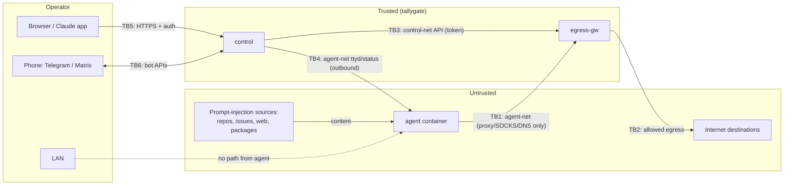

# Threat model

## Scope and assumptions

tallygate protects the operator's network, accounts and secrets from an AI coding agent that runs with
broad autonomy (`bypassPermissions`). The agent is treated as **potentially hostile**: a prompt injection in
a repository, issue, web page or dependency can take full control of what it executes.

Assumptions:
- The Docker host, the Docker daemon and the kernel are trusted and patched.
- The operator's reverse proxy (TLS, authentication) and devices are trusted.
- Anthropic's and GitHub's services behave as documented.

## Assets

| Asset | Where it lives | Why it matters |
|---|---|---|
| Home/office LAN (NAS, router, Home Assistant, hypervisor) | outside the stack | Lateral movement, data theft, sabotage |
| GitHub token | gateway `secrets.json` | Repository access; must not be exfiltrated |
| Claude login (OAuth) | agent home | Account misuse; required in the agent for Remote Control |
| Workspace contents / source code | agent volume | Confidentiality and integrity of your code |
| Gateway policy & API token | gateway / control env | Control over what the agent may reach |
| Control UI session / password | browser / control env | Full control over policy and consoles |
| Audit log | gateway `events.db` | Detection and forensics |

## Trust boundaries

## Threats and mitigations

STRIDE categories: **S**poofing, **T**ampering, **R**epudiation, **I**nformation disclosure, **D**enial of
service, **E**levation of privilege.

| # | Threat | STRIDE | Mitigation | Verified by |
|---|---|---|---|---|
| T1 | Agent connects directly to the internet, bypassing the proxy | E, I | `agent-net` is `internal` (no route); agent attached to no other network | `bypass.sh` (direct IP/name), structure checks |
| T1a | Agent connects directly to services on the Docker host through the host's address on `agent-net` | E, I | The bridge gets no IPv4 address (`com.docker.network.bridge.inhibit_ipv4`), so the host is not a peer on `agent-net` | `bypass.sh` (listener in the host namespace, #7) |
| T2 | Agent reaches LAN/host/metadata through the proxy (incl. via public names resolving to private IPs) | E, I | Hard deny on literal **and resolved** IPs, before rules, not approvable; immutable floor (incl. NAT64/6to4/Teredo); service exceptions only on their own port | unit + e2e (`lan.test`, floor), `bypass.sh` |
| T3 | DNS rebinding between check and connect | E | Upstream address pinned to the checked IP | design + e2e (pinned connections) |
| T4 | Data exfiltration via DNS queries (agent's own lookups **or** names it asks the proxy for) | I | Agent DNS → gateway → NXDOMAIN, logged; the gateway resolves a name only after it is allowed/approved | e2e DNS + "denied names are never resolved" |
| T5 | IPv6 side channel (incl. link-local on internal networks) | E, I | IPv6 disabled on all networks and by sysctl in every container; IPv6 targets subject to hard deny/policy | `bypass.sh`, self-test |
| T6 | Agent steals the GitHub token | I | Token only in gateway; injected in flight; never returned by API; placeholders in agent | e2e (secrets write-only, no token in logs) |
| T7 | Agent obtains injected token by spoofing SNI/Host towards another server | S, I | Injection requires CONNECT target = SNI = Host = configured host; plaintext never injected | e2e SNI-spoofing test |
| T8 | MITM of intercepted upstream (gateway trusts a bad cert) | S, I | Upstream TLS verified against the configured hostname | e2e bad-cert test |
| T9 | Agent changes policy (calls gateway API or control UI) | E | API bound to control-net only + bearer token; UI bound to mgmt only; agent on neither | `bypass.sh`, self-test |
| T10 | Agent uses the Docker socket to escape | E | No docker.sock in any container | `bypass.sh` structure check |
| T11 | Container breakout via capabilities / setuid | E | `cap_drop: ALL`, `no-new-privileges`, non-root, read-only rootfs, pid/memory limits | `bypass.sh` structure checks |
| T12 | Attacker on the network uses the control UI | S, E | scrypt (N = 2^16) password or trusted-proxy auth (OIDC recommended) honoured only from `TRUSTED_PROXIES`; server-side sessions (logout/idle/absolute expiry), signed HttpOnly SameSite=Strict Secure cookie; per-IP limit + globally serialised checks | e2e auth/session tests |
| T13 | CSRF / cross-origin websocket hijacking against the UI | S, E | Custom header + Origin check for state-changing API calls; Origin check for websockets; strict CSP; frame restrictions | e2e CSRF/origin tests |
| T14 | Someone else approves requests via the bots | S, E | Telegram chat + **mandatory** user-ID allowlist; Matrix user allowlist (bot itself excluded); approvals attributed (`by`) | e2e unauthorised-user / no-allowlist tests |
| T15 | Approval fatigue / notification storm | D | One prompt per host:port; at most `max_pending` open prompts; negative cache after timeout; scoped approvals | e2e dedupe + cap tests |
| T16 | Operator cannot reconstruct what happened | R | Every decision, DNS query, admin change and approval (with actor) logged in the gateway, outside the agent's reach | e2e log assertions |
| T17 | Spoofed `by` attribution through the UI | R | Control overwrites `by` with the authenticated user | e2e (`by` cannot be spoofed) |
| T18 | Compromised dependency in the agent image | T, E | Minimal image, pinned versions, gh from signed repo, ttyd checksum-verified, no bundled third-party plugins | review, CI builds |
| T19 | In-agent self-test lies | R | Authoritative test runs from an independent probe container on the host | `bypass.sh` |
| T20 | Login brute force with spoofed `X-Forwarded-For` | S | Forwarded headers only trusted with `TRUST_FORWARDED_FOR=1` **and** from `TRUSTED_PROXIES` | e2e forged-header test |
| T21 | Agent runs script in the operator's browser (console content) and drives the UI | E, T | Console page + xterm.js served by control; WebSocket filtered both ways; no agent HTML on the UI origin; strict CSP (`script-src 'self'`); OSC 8 links inert | e2e console tests (TG-01) |
| T22 | Agent tricks the operator with look-alike names (`github.com.evil.example`, homographs) | S | Strict hostname syntax; prompts show the registrable domain and flag punycode | unit + e2e (TG-10) |
| T23 | One "Always (*.domain)" click opens a shared suffix (`*.github.io`, `*.ngrok-free.app`) | E, I | Public Suffix List incl. private section; widening refused for suffixes; exact pattern shown on the button | unit (TG-04) |
| T24 | Agent uses its *own* account on an allowed credential host (token/cookie) to exfiltrate | I | Agent `Authorization`/`Cookie` stripped on inject hosts, also before a secret is set | e2e (TG-05) |
| T25 | Exfiltration by publishing to a package registry (`npm publish`) | I | `readonly` hosts: writes (PUT/PATCH/DELETE) refused | e2e (TG-11) |
| T26 | Disk/log flood by a looping or hostile agent | D | Identical events coalesced; hard row cap; retention | e2e (TG-09) |
| T27 | A compromised control plane (or UI session) removes LAN protection | E | Hard-deny floor only in the read-only config file; API can only add | unit + e2e (TG-03) |
| T28 | Agent abuses an approved grant beyond its intent (other paths, other vhosts on the same IP, writes on read, WebSocket, raw TCP on an HTTP port) | E, T | Per-request checks: Host == granted host, canonical path match (no `..`, `//`, encoded separators), safe methods + no upgrade on read, non-HTTP cut; pinned IP | unit + e2e grants tests |
| T29 | Agent talks the human into a broad grant (misleading reason, request flooding) | S | Only operator-defined grants can be requested; reason sanitised and labelled unverified; write can be downgraded to read; max 3 pending, rate-limited API | e2e grants + notification tests |
| T30 | UI compromise defines a grant to arbitrary LAN hosts | E | UI grants may use `lan` only inside `grants_lan_allow` (config file); `grants_never` always applies | unit + e2e |
| T31 | Self-signed LAN service impersonated on the path | S, I | Leaf certificate pinned by SHA-256 (`tls_fingerprint`); disabling verification needs an explicit setting and UI confirmation | e2e pinned/badpin |
| T32 | Access outlives the task | E | Grants expire (≤ 7 days, capped per grant), are revocable from UI/Telegram/Matrix, end on restart; open HTTP connections are re-checked per request | e2e revoke test |
| T33 | An internal error (broken config entry, full disk, locked event log) lets a connection through unchecked | E, I | Every mitmproxy hook fails closed: an exception refuses the connection/flow; the error is set before the event is recorded; CIDRs are validated at startup (the gateway does not start otherwise) | e2e (`test_fail_closed.py`) |

## Residual risks

| Risk | Why it remains | Recommendation |
|---|---|---|
| **Exfiltration via allowed destinations** | Any allowed host can carry data out — notably the Anthropic API with an API key of the attacker's choosing (the agent needs its own Claude credentials, so these cannot be stripped), GitHub within the injected token's permissions, and reads that encode data in URLs. | Keep allowlists tight; prefer `ask`; fine-grained PATs; review the log. |
| **Grant semantics** | `read` trusts that the target does not change state on GET; `tcp` grants cannot see inside the stream, and established sessions survive expiry. | Narrow paths, short `max_ttl` for tcp, dedicated restricted accounts/keys on targets. |
| **Agent-supplied terminal output** | xterm.js parses escape sequences from the agent. | Vendored, pinned xterm.js; no clipboard/link addons; CSP limits impact. |
| **Abuse of the injected token's permissions** | The agent can *use* the token through the gateway. | Fine-grained PAT, only needed repos and permissions; branch protection on important repos. |
| **Shared kernel** | Containers share the host kernel; a kernel exploit escapes all isolation. | Keep the host patched; run the stack in a dedicated VM; optionally `runtime: runsc` (gVisor) for the agent. |
| **Claude OAuth credentials in the agent** | Remote Control requires a full-scope login on the machine. | Treat as exposed to the agent; revoke via claude.ai if compromise is suspected. |
| **Compromised control plane** | Holds the gateway API token; can change policy. | Strong auth in front (OIDC), not internet-exposed, keep updated. |
| **Matrix room not end-to-end encrypted** | Bot does not implement E2EE. | Use your own homeserver; consider Telegram or web-only approvals. |
| **Telegram metadata** | Destinations in approval prompts pass through Telegram. | Use Matrix on your homeserver or web-only if that matters. |

## Out of scope

Physical attacks, a malicious operator, vulnerabilities in Anthropic/GitHub services, and denial of
service by the agent against allowed destinations (rate limits are not enforced).
