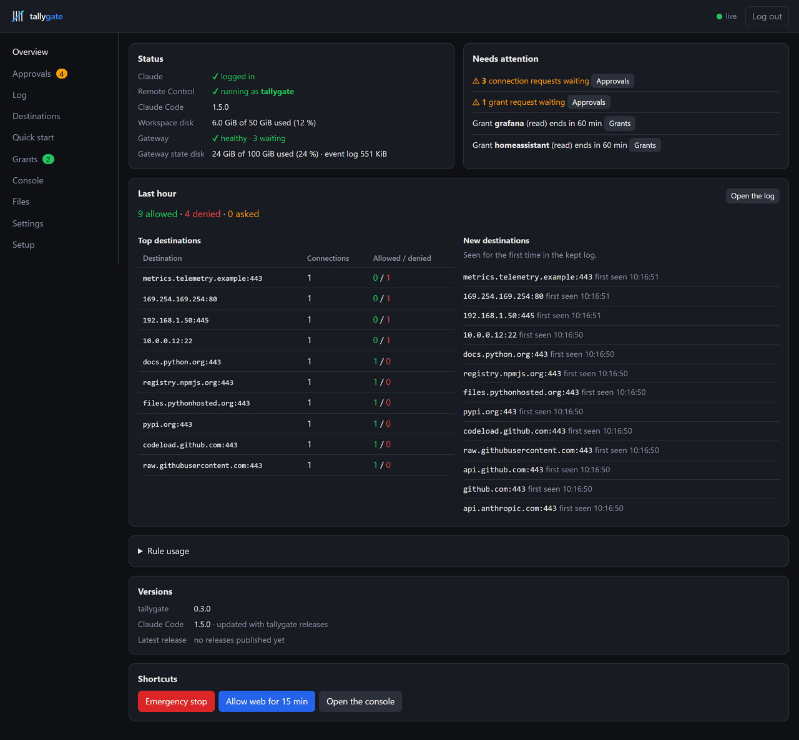
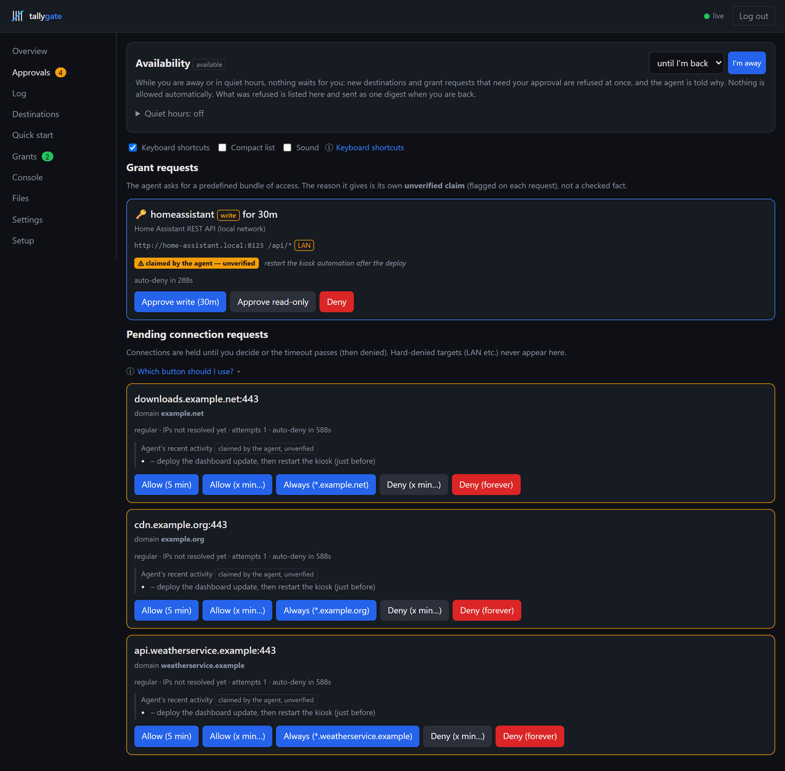
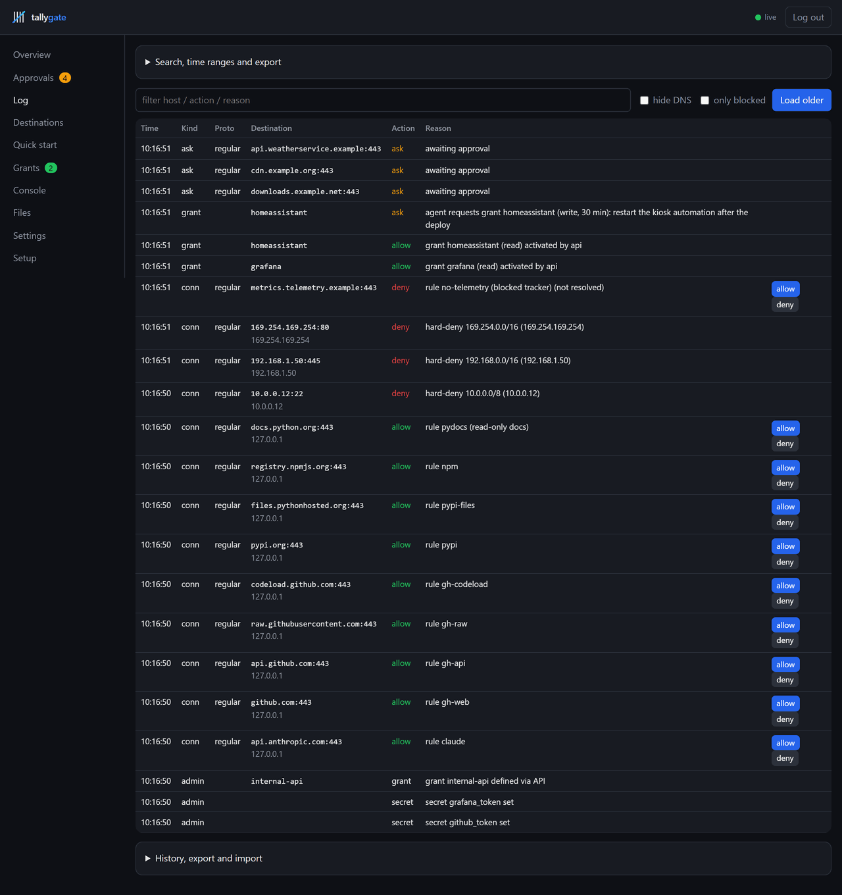
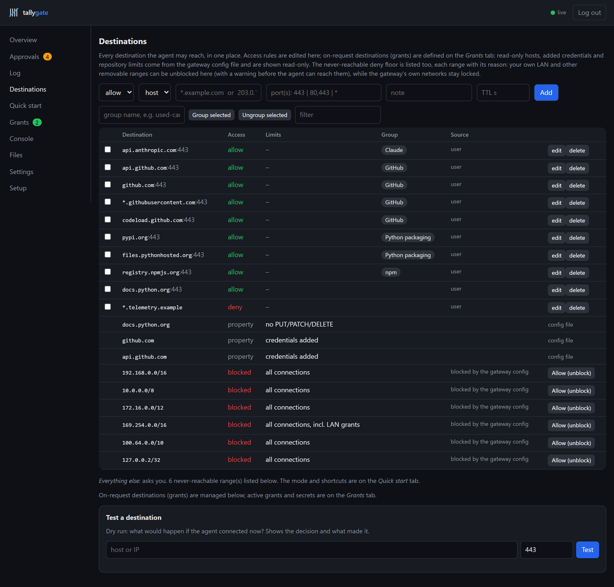
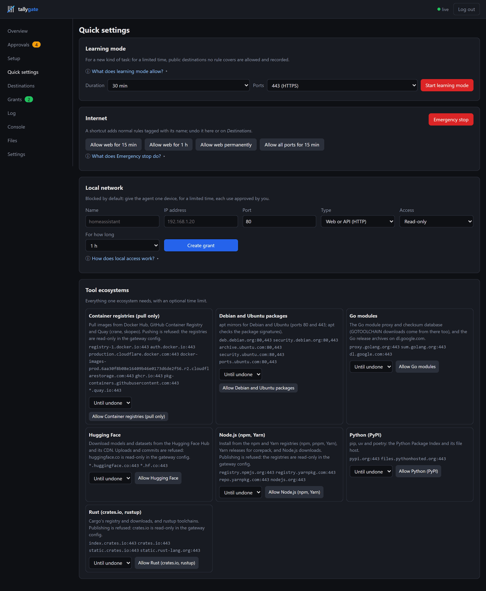
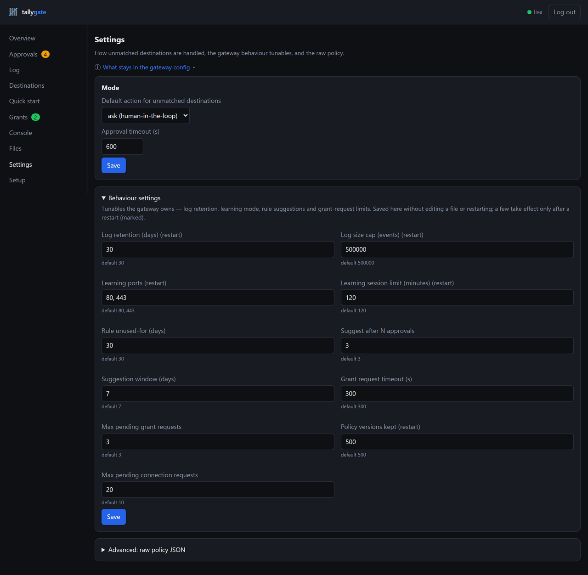
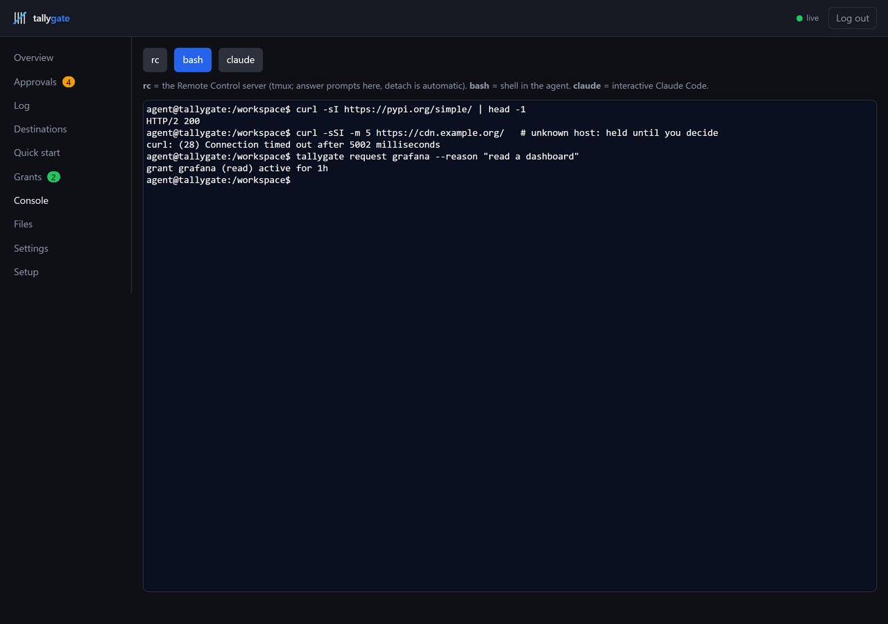
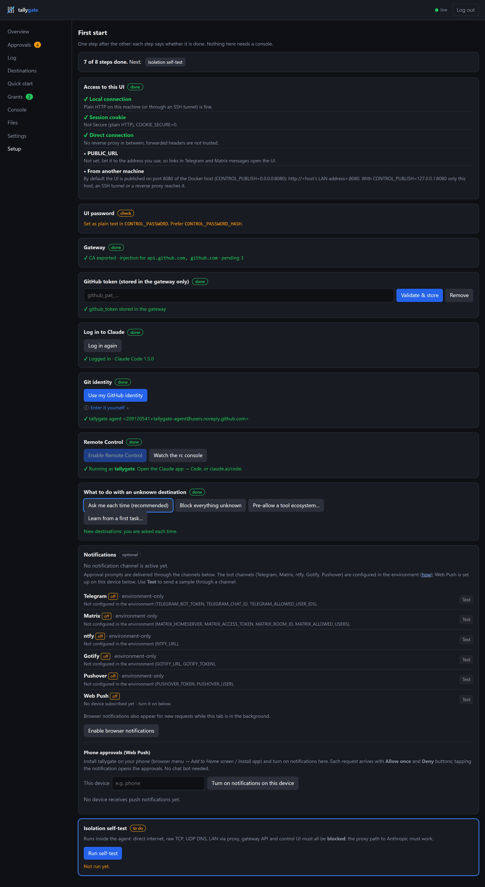

# User guide

The control UI is the operator's cockpit: approve connections, watch traffic, edit the policy, open
consoles into the agent, and run the setup wizard. Remote Control itself is used from the
[Claude app](https://claude.ai/download) or [claude.ai/code](https://claude.ai/code) as usual.

New here? [How access works](access.md) explains the model on one page: the one rule list that decides
every connection, what the agent has to ask for, and where each is changed.

The menu, in order: Overview, Approvals, Setup, Quick settings, Destinations, Grants, Log, Console, Files,
Settings.

- [Overview](#overview)
- [Approvals](#approvals)
- [Away mode and quiet hours](#away-mode-and-quiet-hours)
- [Grants](#grants)
- [Log](#log)
- [Destinations](#destinations)
- [Quick settings](#quick-settings)
- [Settings](#settings)
- [Console](#console)
- [Files](#files)
- [Setup wizard](#setup-wizard)
- [Telegram approvals](#telegram-approvals)
- [Matrix approvals](#matrix-approvals)
- [Notification channels in the web UI](#notification-channels-in-the-web-ui)
- [Phone approvals without a chat bot](#phone-approvals-without-a-chat-bot)
- [Rule cookbook](#rule-cookbook)
- [Working with the agent](#working-with-the-agent)

## Overview

The start page: what the agent is doing and whether anything needs you soon. It refreshes every 30 seconds
while it is open and at once when a request arrives or is decided.

| Part | Shows |
|---|---|
| Status | Claude logged in; Remote Control running, with the session name (or the question it waits for); Claude Code version; disk use of the workspace's file system; gateway health and the disk use of its state, with the size of the event log. 90 % or more is marked. |
| No connection | A warning above the cards while the gateway itself has no connection: *No connection from the gateway since 08:35 (52 min): lookups and connections fail. This is a problem of the host's network, not a policy decision.* The *Log* tab shows the same line. It clears when a lookup or connection works again. See [No connection](#no-connection-from-the-gateway). |
| Needs attention | Waiting connection and grant requests; rules and grants that end within the hour; a missing GitHub token, one GitHub refuses, or one that expires within 7 days (checked once per page load through the agent, so it appears in the log). |
| Last hour | Connections allowed, denied and asked; the 10 most frequent destinations; destinations seen for the first time in the kept log (`log_keep_days`). |
| Versions | tallygate (the release the gateway runs) and Claude Code, and the latest tallygate release. When a newer one exists, the header shows **Update: X.Y.Z**; the card links to the changelog and the release and shows the upgrade command (click to copy): it keeps the current `compose.yaml` as `compose.yaml.previous`, downloads the one of the new release, pulls and starts ([upgrading and rolling back](operations.md#upgrading-and-rolling-back)). Claude Code has no auto-updater in the agent: new versions come with tallygate releases. Control asks GitHub itself, at most every 6 hours; `UPDATE_CHECK=0` switches it off ([configuration](configuration.md)). |
| Rule usage | How often each rule matched, unused rules to clean up, and permanent rules suggested for destinations you keep approving for a limited time. See [Rule usage](#rule-usage). |
| Shortcuts | *Emergency stop* (click twice), *Allow web for 15 min* (the `open` preset), *Open rc console*. |

### No connection from the gateway

When the host's network is down, every upstream lookup and connection of the gateway fails, and the agent
only sees *proxy refused the connection*. The gateway recognises this from its own results and says so:

- **When it starts.** At least 5 lookups or connections failed (`dns failure`, a connect error or a timeout,
  not a policy decision) over at least 2 different names, none worked in between, the oldest failure is at
  least 2 minutes old, **and** a control probe fails too: the gateway resolves a fixed name
  (`api.anthropic.com` unless you set `connectivity_probe_hosts`) and opens a connection to it, at most once
  every 30 seconds. A name that does not exist (*Name or service not known*, *No address associated*) is an
  answer, not an outage, and one failing name is never one.
- **What you see.** The warning on *Overview* and *Log*; one event in the Log when it starts and one when it
  ends, with the duration; a notification on each channel when it starts and when it ends (once per change).
  Refusals during it say `no connection: dns failure: …`, are not counted as denies on *Overview*, and the
  agent's `tallygate grants` says that the gateway has no connection.
- **When it ends.** At the first lookup that is answered, upstream connection that is made or probe that
  works. The gateway checks every 15 seconds while an outage is on, so it also ends when nobody is using it.
  It survives a restart of the gateway and then ends with the whole duration.

The hint names no host: only times, counts and the kinds of errors (dns, connect, timeout). What it cannot
see: an outage that only some destinations feel (it then needs the probe to fail as well), and a host whose
resolver answers from a cache while connections fail (the cached answers count as working).

### Rule usage

*Overview → Rule usage* shows, for every rule, how many connections it decided and when it last
matched. The counts are kept in the gateway's memory and written to the event log every 15 seconds, so they
cost nothing noticeable per connection. Click a column header to sort (again to reverse), type to filter, or
show only unused or only matched rules.

- **Suggested permanent rules.** When you allowed the same destination for a limited time at least
  `suggest_min_approvals` (3) times in `suggest_window_days` (7) days, and no permanent rule covers it, the card
  offers a permanent allow rule. Several hosts of one domain on the same port become one `*.domain` rule (the
  domain comes from the Public Suffix List, like *Allow \*.domain permanently*). *Dismiss* hides a suggestion
  for `log_keep_days`.
- **Unused rules**: permanent rules that did not match anything for `rule_stale_days` (30) days, counted from
  when the gateway first saw the rule. Rules with a time limit are never offered, they end by themselves, and
  neither are the built-in and config blocks or any other `deny` rule for an address or range: a block that
  never matched is doing its job. Tick the ones to
  remove and click *Delete selected rules*; the gateway checks again that each one is still unused, and the
  policy history keeps them in case you need one back.

## Approvals

When the agent connects somewhere that no rule covers (and the default is `ask`), the connection is **held**
and appears here, on Telegram/Matrix if configured, and as a desktop notification while the tab is in the
background (turn these on once with **Request notification permission** in the Setup tab), and as a push
notification on your phone ([without a chat bot](#phone-approvals-without-a-chat-bot)). The countdown shows
when it will be denied automatically.

In the web UI each card offers, in the words of the [UX concept](ux-concept.md): **Allow for 5 min** (the
one filled button), **Allow for … min**, **Allow host permanently** or **Allow \*.domain permanently**,
**Deny for … min** and **Deny permanently**; a grant request offers **Allow read / write for …**,
**Allow read-only** and **Deny**. The help under the page title says when to use which.

Notifications offer the decisions that need no input. Which of them a notification shows, and in which
order, is a setting: [Notification buttons](#notification-buttons). Without it, Web Push shows **Allow once**
and **Deny**; Telegram and Matrix show **Allow once**, **Allow host permanently** and **Deny**, and the others
behind **More**.

| Button | Effect |
|---|---|
| Allow once | This host:port for 2 minutes (covers the follow-up connections of one operation) |
| Allow for 1 h | This host:port for one hour |
| Allow host permanently | Permanent allow rule for exactly this host:port |
| Allow \*.example.com permanently | Permanent allow rule for the registrable domain and all subdomains. The button shows the exact pattern; it is not offered when the name has no registrable domain of its own (e.g. `github.io`, IPs). |
| Deny | Deny for 2 minutes (the tool gets an error now; asking again later is possible) |
| Deny permanently | Permanent deny rule |

**Why does the agent want this?** A card can show the agent's recent activity: the command or URL Claude
Code was about to run when the connection started (`Bash curl … – Fetch the data`), or a note the agent
wrote with `tallygate note "…"`. A hook in the agent image reports it, with obvious secrets (tokens,
passwords, credentials in URLs) redacted. It is written by the agent, so it is labelled *claimed by the
agent, unverified*: a prompt injection can lie here like anywhere else. Judge the destination, not the story.
The activity appears in the UI, in Web Push notifications (end-to-end encrypted) and in the log, never in
Telegram, Matrix, ntfy, Gotify or Pushover.

Every decision becomes a normal rule (source `approval`), added at the top of the list, that you can review,
move or delete under **Destinations**.
Before you click, check the **domain** line: the host is chosen by the agent, so `github.com.evil.example`
has the domain `evil.example`. Punycode names (`xn--…`) are flagged. Names are not resolved before your
approval, so IPs show as "not resolved yet". A name you approve can still be refused afterwards: approving a
name adds a rule for the name, and a rule for a name never opens a blocked range (the local network, the
host, metadata…). The log then says which address and which range
([why, and what to do](rules.md#why-a-name-rule-cannot-open-a-blocked-range)). An IP address inside a blocked
range is denied without a prompt, and so is an IP address written like a name (`192.168.1.1.`, `127.1`): no
answer to a prompt opens a blocked range ([details](rules.md#order-of-the-list)). At most `max_pending` (10) requests wait at once; further unknown
destinations are denied immediately until you have answered.

### Keyboard shortcuts, compact list and sound

For approving a lot. The switches above the list are kept in this browser.

| Key | Effect (Approvals tab, outside text fields) |
|---|---|
| `j` / `k` | Select the next / previous request |
| `a` | Allow once; approve a grant request |
| `h` | Allow 1 h (also while it is hidden behind *More*) |
| `d` | Deny |
| `?` | List the keys (anywhere; `Esc` closes) |

`a`, `h` and `d` act on the selected request; without a selection the first press selects the first request,
so a stray key never decides anything. After a decision the next request is selected. Single-key shortcuts
can be switched off with **Keyboard shortcuts** (for screen readers and voice control). The **Keys (?)**
button next to the switches shows the same list.

**Compact list** shows one line per connection request: destination, the registrable domain when it differs,
the punycode warning and the buttons (the countdown and IPs are hidden). Grant requests keep their full card,
because the agent's reason matters. **Sound** plays a short tone when a request arrives while the tab is in
the background; turn it on with a click, as browsers allow sound only after one.

## Away mode and quiet hours

When you cannot answer, the agent should not wait 60 seconds for every new destination, and your phone
should not buzz at night. The **Availability** card at the end of **Approvals** has two controls:

- **Start away mode** (until you end it, for 1 h, 4 h or until 08:00): new destinations and grant requests that
  need your approval are refused at once. The agent gets a clear message (`operator away until 14:00:
  unknown destinations are refused without asking …`) instead of a held connection. Whatever was waiting
  for you when you switch it on is denied too.
- **Quiet hours** (e.g. 22:00–07:00, on the days you pick): the same, every day, without notifications.

Nothing is ever allowed automatically because you are away: away mode only turns *ask* into *deny*. Rules
that allow a destination keep working.
What happened is listed under **While you were away**: every refused request is marked *refused*, with
*Allow for 1 h* per destination (for an IP address it takes a second click, because the rule is added at
the top and opens the address). The list is sent as one **digest** to Telegram/Matrix: when quiet hours
end, when you are back, and while away every `digest_minutes` (30). *Dismiss list* clears the list. The
header shows *away* or *quiet hours* on every tab.

**Automatic grants are the exception.** A grant level with `approval: auto` is still activated while you
are away or in quiet hours: you allowed it beforehand, and away mode is about requests that need a person.
It does not happen unnoticed: the list and the digest show it as *activated automatically*, with the name
of the grant, the level, how often and when last (`grant nas (read), 3 times, last at 14:30`), and without
an *Allow* button, because nothing was refused. If you do not want this while you are away, set the level
to `ask`. The **emergency stop** suspends automatic approval as well (it also revokes what is active and sets the mode to
`deny`, see [Quick settings](#quick-settings)), until you set the mode again.
The agent sees the state in `tallygate grants`.

Quiet hours use the gateway's time zone: set `TZ` (e.g. `TZ=Europe/Berlin` in `.env`) or `tz` in
`quiet_hours`. They can be preset in the gateway config (`quiet_hours`, see
[configuration](configuration.md#availability)); a change in the UI is stored and wins over the file.

## Grants

For access the agent should ask for each time, especially services on your home network, define **grants**:
named bundles of destinations with read/write levels, paths, credentials and a duration. The agent requests
them (`tallygate request homeassistant --write --reason "…"`). Grant requests appear at the top of
**Approvals** and in Telegram/Matrix, where you can approve, approve read-only, or deny. The **Grants** tab
lists definitions and active grants (with *Revoke*), has an editor for UI-defined grants, and holds the
write-only secrets used for credential injection. *Activate read* / *Activate write* on a definition
activates the grant yourself for its default duration, without a request from the agent. Full guide:
[grants.md](grants.md).

## Log

Live view of every decision: connections (`conn`), approval requests (`ask`), blocked DNS lookups (`dns`), and
admin changes. Filter by text, hide DNS noise, or show only blocked entries. The **allow / deny** buttons
create a rule for exactly that host:port. The table starts with the latest 200 events and keeps up to 2000
while it follows the live stream; *Load older* fetches 200 more.

### Search, time ranges and export

The live view filters only the rows it has loaded. **Search, time ranges and export** (above the table)
searches the whole event log on the gateway, which keeps `log_keep_days` (30) days:

- **Show** *events*, *destinations* (every host:port with its number of events, allowed, denied and asked,
  first seen and last seen) or *new destinations* (first seen inside the time range).
- **Host**: an exact name or IP, or `*.example.com` for the domain and all its subdomains. **Kind** and
  **Action** narrow it further, **Text** searches host, action and reason.
- **Time**: the last hour, 24 hours, today, 7 or 30 days, everything, or a custom range.
- **Filters**: one click for *Denied today*, *New destinations (24 h)*, *Approvals asked (7 days)* and
  *Admin changes (7 days)*. *Save filter* keeps the current one in this browser (under the text or host you
  searched for); ✕ deletes it.
- **A destination** (click it) shows what the policy decides for it now and which rule decides, its counts
  and its latest events. The decision is made on the name, without resolving it: when the agent connects,
  the list is checked again with the resolved addresses, and a blocked range still applies to them.
- **Export CSV / JSON** downloads every matching row (up to 50,000 events) for an audit. Cells that a
  spreadsheet would run as a formula are prefixed with `'`.

### History and rollback

Every change to the policy is kept as a version, whoever made it: the UI (`web:<user>`), the API (`api`),
an approval on Telegram or Matrix (`telegram:<user>`), a shortcut, the emergency stop, or the gateway itself
when temporary rules expire (`gateway`). *Log → Policy history, export and import* lists the versions with
time, author and what changed. The built-in blocks are rules, so they are part of every version, in their
place in the list.

- **Show changes** shows what changed from that version to the current policy: the default and the timeout,
  rules added, removed or changed (compared by rule id), and whether the order of the rules changed. Pick any
  two versions with *From* and *To* and *Compare versions*.
- **Restore version** replaces the current policy with that version (it asks for confirmation). The restore is
  a new version itself, so it can be undone the same way. Rules of an old version whose time limit has passed
  are ignored and removed, as always. A restore replaces the whole list, blocks included: a version in which
  a built-in block was deleted brings the policy back without it.
- **Export policy** downloads the policy and the grants defined in the UI as one file, for a new host or as a
  template to share. Secrets are not in it (they cannot be read back at all), and neither are grants from the
  gateway config file.
- **Import policy…** checks the file like a normal policy change and every grant like the grant editor,
  then shows what would change. *Import* replaces the policy and adds or replaces the UI grants in the file;
  grants that are not in the file stay.
- A version or an export from before the ordered rule list is translated when it is restored or imported, as
  at an upgrade ([operations](operations.md#upgrade-to-the-ordered-rule-list)); the preview shows the policy
  as it will be in force.

The gateway keeps the last `policy_history_keep` (500) versions in `policy-history.db` in its data volume.

## Destinations

The rule list, in the order the gateway checks it. How the list decides (the first matching rule wins, what
a rule for a name and a rule for an address do, the built-in blocks, the locked ranges) is explained in one
place, [Rules by example](rules.md). This section is the tour of the tab.

**Test a destination** (top of the tab) is a dry run. Enter a host or an IP and a port; the answer is the
decision (`ALLOW`, `DENY`, `ASK`) with the reason in the words of the log, what decided it (`Decided by rule
#4 (…)`, the default, or a locked range) and the resolved IPs. When a rule allows the name but the address
is inside a blocked range, it names both rules and says what to do. A name that would be denied or asked
about is decided without resolving it, as for a real connection
([details](rules.md#checking-a-rule-before-relying-on-it)).

**Rules and blocked ranges** is one table, read from the top:

| Rows | What they are | Actions |
|---|---|---|
| Rules | Your rules, approvals, shortcut rules and rules saved from learning mode, each with its access (*allow*, *ask*, *deny*), ports, time limit, group and source | **Move up**, **Move down**, **Edit**, **Delete** |
| Built-in blocks | `deny` rules for your local network, loopback, cloud metadata and other special ranges (source *built-in block*), and the `never` entries of the gateway config (source *never (config file)*). They start at the bottom of the list | the same: they are ordinary rules, except that a block takes no time limit. Deleting one asks for confirmation and names the range |
| Read-only hosts, credentials, repository limits | Limits from the gateway config file, tagged *config file* | none here |
| Locked ranges | The tallygate stack's own networks and the gateway's own ports, marked *locked*: checked before the list | none: nothing opens them |
| Everything else | The default: *ask*, *deny* or *allow* | changed under [Settings](#settings) |

- **Add rule** (above the table): *allow*, *deny* or *ask*; a host pattern or a CIDR; ports; a note; an
  optional time limit in seconds. A new rule is added **at the top**. An IP address in the host field is
  stored as a rule for that address.
- **How the table decides, in short:** a destination given as an IP is decided by the first rule for an
  address that contains it. A destination given by name passes two checks: the first rule for a name that
  matches decides (deny and ask before the name is looked up), and every address it resolves to must not be
  blocked. An allow rule for an address lets no name through by itself.
- **Move up / Move down** change the place of a rule by one. The order matters among rules for addresses
  (an allow opens an address only above the block of its range) and among rules for names; where a name
  rule stands relative to an address rule does not ([rules.md](rules.md#order-of-the-list)).
- **Edit** changes the access, ports, note, time limit and group of a rule in place. What a rule matches is
  not editable: add a new rule and delete the old one.
- **Group selected / Ungroup selected** put ticked rules in a named set, to keep related rules together.
- **Filter** narrows the table to rows whose host or range contains the text.
- **Restore built-in blocks** adds back the built-in and config blocks that are missing from the list, at
  the bottom. It does not close what an address rule above the blocks opens, and says which ranges are still
  open ([operations](operations.md#restoring-the-built-in-blocks)).
- The line under the table counts the built-in and config blocks in the list and the locked ranges.

Two marks tell you when a rule cannot do what it says: **blocked by a range rule** on a rule for a name
whose address was inside a blocked range (with the last address, the range, the warning that somebody may
be redirecting the name, and what to do if the address is right), and
**never reached** on an address rule that an earlier one covers completely
([rules.md](rules.md#marks-in-the-table)).

**To let the agent reach one device on your local network**, add an allow rule for its address and port
here (it lands above the block of its range). To reach it by name, allow the name as well: both rules are
needed. Or create a grant when the agent should ask each time
([worked examples](rules.md#the-local-network-worked-examples)). Do not delete the block of the whole range
for it.

Grants are defined and edited on the **Grants** tab. The policy's versions are under
[Log](#history-and-rollback), how often each rule matched under [Overview](#rule-usage).

## Quick settings

Learning mode and the shortcuts: the fast ways to a working rule set. Everything here ends up as normal
rules or grants that you see on *Destinations* and *Grants*. The tab can be hidden under
*Settings → Menu*.

| Card | What it does | Undo |
|---|---|---|
| Learning mode | Records what a new task needs for a limited time, then saves the rules in one go. See [Learning mode](#learning-mode). | *Stop learning mode* |
| Internet: *Allow web for 15 min* / *for 1 h* / *permanently* | Adds the `open` preset (any public host, ports 80 and 443), with that time limit | *Undo* in the list of active shortcuts, or wait |
| Internet: *Allow all ports for 15 min* | Adds the `internet` preset (any public host and port: SSH, databases, ...) | the same |
| Internet: *Emergency stop* | Revokes all active grants, denies everything waiting for approval (connections and grant requests), undoes the internet shortcuts, ends learning mode, sets the default to `deny` and suspends automatic grant approval | set the default again under *Settings → Mode* |
| Local network | A form for one device: name, IP address, port, type, read-only or full access, duration. *Create grant* defines a [grant](grants.md#in-the-ui) for exactly that address and port; you approve each use | edit or delete the grant on the *Grants* tab |
| Tool ecosystems | One shortcut for what a tool ecosystem needs: Python, Node.js, Go, Rust, Debian/Ubuntu apt, container registries, Hugging Face. *Until undone*, *For 1 h* or *For 1 day* | *Undo* on the shortcut |

Actions that are hard to take back (*Start learning mode*, *Emergency stop*, deleting a rule, a grant or a
secret) ask for confirmation in the page: the first click arms the button (*Confirm: …*) and says what will
happen, a second click within 8 seconds runs it. Escape or moving the focus elsewhere cancels.

The **emergency stop** runs on the gateway, most important step first, and carries on when a step fails.
The card lists every step with a ✔ or ✖, so you can see what did not work. Until you change the default
again, grants with automatic approval need your approval like any other: the agent cannot switch its access
back on right after the stop. The Grants tab shows when this is in effect.

Shortcuts create normal rules at the top of the list, with ids like `python:pypi` and tagged
`preset:<name>` in the table, so you can see what a shortcut added. *Undo* removes exactly those rules; rules
you added yourself are never touched. Because they stand at the top, **shortcut rules win over your own
rules while they are active, `deny` rules for a name included**: a shortcut that allows `*.quay.io` opens it
even if you deny that name further down. What they cannot do is open a blocked range: they are rules for
names ([rules.md](rules.md#order-of-the-list)). Undo them, or pick a time limit. *Allow … again* replaces the
shortcut's rules with the new time limit; the message shows the time the gateway actually set.

**The local network** (private ranges, the Docker host, cloud metadata) is closed by the built-in blocks, and
no shortcut, approval of a name or learning mode opens it. An agent with broad access to your network is the
main risk tallygate exists for. The *Local network* card gives the agent one device on request: enter the
device's **IP address**. A name such as `ha.lan` is refused when it resolves to a local address, with the
address to enter instead, because a name can be pointed anywhere
([grants.md](grants.md#local-targets-and-name-only-targets)). To allow a device without a request each time,
add an allow rule for its address on *Destinations*.

### Learning mode

Building an allowlist one prompt at a time is slow when you start a new kind of task. *Quick settings →
Learning mode* lets the task run for a while and shows afterwards what it used:

1. Pick a duration (up to `learning_max_minutes`, 120) and the ports (`443`, or `80 and 443`; the choice comes
   from `learning_ports`) and click *Start learning mode* twice (it asks for
   confirmation). The header shows **Learning mode · N min left** on every tab while it runs; click it to come
   back here.
2. While it runs, a connection to a host name on those ports that **no rule matches** is allowed instead of
   asked or denied, and logged with the reason `learning mode`.
3. When the time is up (or you click *Stop learning mode*), the card lists every destination used during the
   session, grouped by registrable domain, with the number of connections. Destinations only learning mode
   allowed are ticked, with a proposed rule: the exact host, or `*.domain` when several hosts of one domain
   were used. Untick what you do not want and click *Add selected rules*. Earlier sessions stay
   available: pick one under *Session* and click *Show session*.

What stays in force while learning mode runs:

- **every rule**, the built-in blocks among them, checked on the resolved addresses: the local network, the
  Docker host and metadata stay unreachable, and a name that resolves there is denied;
- the **locked ranges** and **grants** (a name that a grant is defined for is not learned);
- **name-first decisions**: a name your rules deny or ask about is not resolved first; IP literals are not
  covered at all;
- the **SNI/Host binding** and the read-only and credential checks.

Learning mode is never stored in the policy. It ends when its time is up, when you stop it, on the
**emergency stop**, and when the gateway restarts. Saved rules are added **below your rules** (above the
built-in blocks), so a deny or ask rule you already have keeps winning over a learned `*.domain` rule. The
rules you save are tagged `learning` and are permanent; check them in the table like any other rule.

## Settings

| Card | What it holds |
|---|---|
| Mode | The **default action** for destinations no rule matches: `ask` (you decide each time), `deny` (strict allowlist) or `allow` (blocklist; the built-in blocks still apply), and the approval timeout. *Save mode* changes only these two, never the rules. |
| Menu | Hide **Setup** and **Quick settings** in the menu once you no longer need them. Kept in this browser; hidden pages stay reachable from links on *Overview*. |
| Behaviour settings | Log retention, learning mode, rule suggestions and request limits ([configuration](configuration.md#configgatewayyaml)). Saved without a restart, except where marked. |
| Raw policy (JSON) | The whole policy as the gateway API returns it: the default, the timeout and every rule in order, the built-in blocks among them. Validated by the gateway. *Save policy* replaces every rule **and their order**. It refuses to save when the policy was changed elsewhere after the text was loaded (another tab, a Telegram approval): it keeps your text and marks it; *Reload policy* fetches the current policy, a second *Save policy* overwrites on purpose. |

Settings that could hand out secrets (which hosts get credentials, switching off certificate checks) are not
here: they stay in the gateway config file ([why](access.md#why-some-settings-are-only-in-a-file)).

## Console

| Console | Purpose |
|---|---|
| **rc** | The Remote Control server (tmux session). Answer first-start prompts here and watch connection status. |
| **bash** | A persistent shell in the agent (tmux), e.g. for `claude auth login`, `gh repo clone`, `git config`. |
| **claude** | An interactive Claude Code session in the terminal. |

Sessions persist when you close the tab. tmux basics: `Ctrl-b d` detaches, scroll with `Ctrl-b [`.

## Files

The agent's `/workspace` in the browser: open folders, upload files into the open folder (a spec, a dataset,
a patch) and download results, without `docker cp` or a shell.

- Uploads go into the folder you are in. An existing file is only replaced with **replace existing files**;
  folders and links are never replaced. Up to `FILES_MAX_UPLOAD` (default 50 MiB) per file.
- **Download** saves the file (up to `FILES_MAX_DOWNLOAD`, default 200 MiB; a larger file is marked *too
  large* instead). A folder shows at most its first 2000 entries. Files are always sent as
  downloads (`application/octet-stream`, `Content-Disposition: attachment`), never shown in the UI, so a
  file the agent wrote (HTML, SVG, a script) cannot run on the UI's address.
- **Delete** removes a file, or a folder with everything in it, after a second click to confirm. There is no
  undo. A link is removed itself, never what it points to; the workspace folder itself cannot be deleted.
- Everything stays inside `/workspace`: no `..`, no absolute paths, and links that point outside are refused
  (they are listed as *link*, but cannot be opened or written through).
- Uploads are logged by control (`workspace upload: <path> (<bytes>) by <user>`).

## Setup wizard

The **Setup** tab is the first start in one flow. Every step shows *done*, *to do*, *check* or *optional*; the
summary at the top counts the steps and its *Next* button jumps to the first one still to do. The states are
checked again whenever you open the tab or finish a step. No step needs a console in the agent; only the
password change runs on the Docker host.

| Step | What it does |
|---|---|
| Access to this UI | Checks how your browser reaches the UI: HTTPS (or localhost), the session cookie's `Secure` flag, whether a reverse proxy sends forwarded headers and whether they are trusted, whether `PUBLIC_URL` matches the address you use, and how other machines reach the UI. Each line says what to change. Over plain HTTP from another machine, a *Not encrypted* banner is also shown at the top of every tab. |
| UI password | *To do* while it is still the password generated on first start; change it with `docker compose exec control python -m app.passwd`. |
| Gateway | The gateway's CA is exported and which hosts get credentials injected. |
| GitHub token | *Save token* checks a token against GitHub (from control) and stores it in the gateway only. *Delete token* deletes the stored token (it asks for confirmation). |
| Log in to Claude | *Start login* runs `claude auth login` in the agent (tmux session `tg-login`) and shows the link to Anthropic's login page. Sign in there and paste the code it shows. Only links to Anthropic's login pages are shown. Once logged in, the button reads *Log in again*. |
| Git identity | *Use my GitHub identity* asks GitHub, through the gateway with the stored token, who you are (`gh api user`) and shows the name and the noreply address `<id>+<login>@users.noreply.github.com`; *Save identity* sets them. Without a stored token, or when GitHub refuses it or cannot be reached, it says so and links to the token step. *Enter it yourself* is the fallback. Empty values are never written; a name or address that is set but empty (for example from a `git config` whose `$(…)` failed) is reported as such. |
| Remote Control | *Enable Remote Control* answers Claude Code's one-time question `Enable Remote Control? (y/n)` with yes, trusts `/workspace` and restarts Remote Control. The step is done when it runs; it also tells you when Remote Control waits for an answer in the *rc* console. Switched off with `RC_ENABLE=0`. |
| Notifications | One section for every channel (Telegram, Matrix, ntfy, Gotify, Pushover, Web Push). Each row says whether the channel is active, where its settings come from (*web UI* or *environment*) and, when it is off, why. **Configure** on a bot channel opens its settings ([details](#notification-channels-in-the-web-ui)); a **Test** button on each active channel sends a sample notification through just that channel and reports the result. **Notification buttons** chooses the decisions a notification offers ([details](#notification-buttons)). Web Push devices and the [browser-notification permission](#browser-notifications) are set up in the same section. |
| Isolation self-test | Runs the in-agent self-test. Optional: it is a spot check whose result is not stored, so it shows *optional* when the page is loaded and does not count among the steps you have to do. A failed run shows *check*. |

## Telegram approvals

1. Create a bot: talk to [@BotFather](https://t.me/BotFather), `/newbot`, copy the token.
2. Send any message to your bot, then get your chat ID:
   `curl https://api.telegram.org/bot<TOKEN>/getUpdates` → `message.chat.id` (and `message.from.id`).
3. **Setup → Notifications → Telegram → Configure**: enter the bot token, the chat id and the allowed user ids
   (your `from.id`), then **Save**. It works at once; **Test** sends a sample.
   Or in `.env`: `TELEGRAM_BOT_TOKEN`, `TELEGRAM_CHAT_ID`, `TELEGRAM_ALLOWED_USER_IDS=<your from.id>`, then
   `docker compose up -d control`.

Each request arrives with **Allow once**, **Allow host permanently**, **Deny** and **More…** (or with the
[buttons you chose](#notification-buttons)); *More…* shows every decision on the same message: also
*Allow for 1 h*, *Allow \*.domain permanently* (when the name has a registrable domain) and *Deny permanently*. After a
decision the message is edited to show the outcome and who decided. Taps from users not in the allowlist are answered with "Not authorised".

## Matrix approvals

1. Create a dedicated bot user on your homeserver (e.g. `@tallygate:example.org`) and get an access token
   (log in once with any client and copy the token, or use the login API).
2. Create an **unencrypted** room, invite the bot and join with the bot user.
3. **Setup → Notifications → Matrix → Configure**: enter the homeserver URL, the access token, the room id
   (`!…:example.org`) and the allowed users (`@you:example.org`), then **Save**.
   Or in `.env`: `MATRIX_HOMESERVER`, `MATRIX_ACCESS_TOKEN`, `MATRIX_ROOM_ID`, `MATRIX_ALLOWED_USERS`, then
   `docker compose up -d control`.

Each request is posted as `🔐 #3 Agent wants to connect: host:port …` with three pre-seeded reactions: tap
👍 allow once, ✅ allow host permanently or 👎 deny (or the reactions of the
[buttons you chose](#notification-buttons)). The message lists the others, which you add yourself: ⏰ 1 h,
🌐 domain, ⛔ deny permanently. Or reply `allow 3`, `hour 3`, `always 3`, `domain 3`, `deny 3` or `block 3`. The bot
confirms the outcome in a reply.

**The bot never decides itself.** The bot account must be a separate account, not one of the allowed users:
your homeserver sends the bot's own prompts and reactions back to it, and they must not count as your
decision. The control plane checks this by asking the homeserver which account the token belongs to
(`whoami`):

- If the bot's account is one of the allowed users (for example because you used your own account's token),
  Matrix approvals are switched off and **Setup → Notifications** says *Matrix approvals off: the bot's own
  account … is in the allowed users*. Messages are still posted; decide in the UI, or create a bot account.
- If the homeserver cannot be asked (not reachable when the control plane starts, or an error), the row says
  *Matrix approvals paused: cannot verify the bot's own account*. Prompts are still posted, but no reaction or
  reply is read. The check is repeated (after 5 s, then with growing pauses up to 5 minutes) and approvals
  resume by themselves once it succeeds.
- A reaction or reply you sent **while approvals were paused is not applied later**. The request stays open
  until it times out: answer it in the UI, or react or reply again once the row no longer says *paused*.

## Notification channels in the web UI

Telegram, Matrix, ntfy, Gotify and Pushover can be set up in **Setup → Notifications** instead of the
environment. Each of them has a **Configure** disclosure with the same fields as its environment variables,
**Save**, **Remove override** and the **Test** button.

- **Saving applies at once.** No restart: the notifier takes the new values, and the Telegram or Matrix
  connection is restarted only when that channel changed. Requests that are waiting for an answer stay open.
- **Tokens are write-only.** A token you save is stored by the control plane (in its data volume, file
  `notify.json`, readable only by the control container) and is never shown again, not in the UI, not through
  the API and not in the log. The token fields are therefore always empty: *stored – leave empty to keep*.
  URLs, chat and room ids and allowed users are shown.
- **The web UI wins over the environment, field by field.** A field you fill in overrides its environment
  variable; a field you leave empty uses the environment variable (it is shown as the placeholder). Each
  channel and field says where its value comes from. **Remove override** deletes what the UI saved for that
  channel: it then uses the environment again, or is off when nothing is set there.
- **Changing the server needs the token again.** When you change the Matrix homeserver, the ntfy topic URL or
  the Gotify server, enter the token too. A stored token is never sent to a different server than the one it
  was saved for.
- **Telegram and Matrix need their allowed users.** They are refused without them, because otherwise everyone
  in the chat could approve.
- If the control data volume is not writable, the section says so and the channels can only be configured in
  the environment.

The decision behind this is recorded in [ADR-0018](adr/0018-notification-credentials-stored-by-the-control-plane.md).

### Notification buttons

**Setup → Notifications → Notification buttons** chooses which decisions a connection request offers in a
notification. Pick one to four of the [six decisions](#approvals) in *Button 1* to *Button 4*, then **Save
buttons**; the order is the order they are shown in. **Remove override** returns to the default.

| Channel | What it shows |
|---|---|
| Web Push | Exactly your buttons. A phone or browser shows as many as it has room for, **two on most platforms**: the first ones in your order. The rest is left out there; tapping the notification opens the approvals with every choice. |
| Telegram | Your buttons first, then **More…** with every decision. |
| Matrix | The reactions of your buttons are pre-seeded; the message lists the others, and the text replies all keep working. |
| ntfy, Gotify, Pushover | No buttons, as before: a link to the UI. |

- **The default is unchanged:** Web Push shows *Allow once* and *Deny*; Telegram and Matrix show *Allow once*,
  *Allow host permanently* and *Deny* first. Once you save a choice, all three follow it.
- **A permanent allow from a notification is a bigger decision than *Allow once*:** one tap, also on a lock
  screen that shows notification buttons, adds a permanent rule. The UI asks before it switches such a button
  on. Put it first only if you read every request; otherwise keep it in position 3 or 4, or leave it out.
- ***Allow \*.domain permanently*** always names the pattern on the button (*Allow \*.example.com
  permanently*) and is left out for a name without a registrable domain of its own.
- **A request for an IP address can only be denied from a Web Push notification.** Allowing an address adds an
  address rule on top of the list, which opens it even inside a [blocked range](rules.md); the notification
  says so and opens the approvals when you tap it. Telegram and Matrix, where only your allowed users can
  decide, keep every decision.
- **Switching a button off ends the buttons already sent:** a notification that still shows it answers
  *Not applied*.
- Grant requests keep their own buttons (see [below](#phone-approvals-without-a-chat-bot)): write access is
  never approved from a Web Push notification.
- The setting is stored with the channel settings (`notify.json` in the control data volume) and has no
  environment variable. If that volume is not writable, the default stays.

What a tap on a notification button can and cannot do is in the [threat model](threat-model.md) (T41, T47).

### Browser notifications

While the UI is open in a background tab, new requests also appear as notifications of the browser itself.
The Notifications section shows what applies to your browser:

| State | What you see |
|---|---|
| Not asked yet | **Request notification permission**: the browser asks you. |
| Allowed | *Browser notifications are on* and **Send a test notification**, which shows one right away. |
| Blocked | The button stays (some browsers ask again when you press it) and the text says where to change it: allow notifications in the site permissions (address bar → site information / permissions), then reload. |
| Plain HTTP | *Browser notifications need HTTPS (or localhost)*: browsers refuse notifications otherwise. Open the UI through your TLS reverse proxy. |

## Phone approvals without a chat bot

**Web Push (installable app).** Open the UI on your phone over HTTPS, install it (*Add to Home screen* /
*Install app*; on iPhone this is required, iOS 16.4 or later), then **Setup → Notifications → Turn on
notifications on this device**. Each request arrives as a notification:

| Request | Buttons in the notification |
|---|---|
| Connection | **Allow once**, **Deny**, or the [buttons you chose](#notification-buttons); for an IP address only the *Deny* buttons |
| Grant, read level | **Approve read**, **Deny** |
| Grant, write level | **Approve read-only** (if the grant offers read), **Deny**. Write access needs the UI or a chat bot. |

Tapping the notification itself opens the approvals. After a decision (from anywhere) the notification is
replaced by the outcome. The buttons work for at most 10 minutes and once, only on the device they were sent
to; they need no login, but they cannot do anything except that one decision (see the
[threat model](threat-model.md), T41). *Remove* stops a device, and a device whose subscription expired is
removed automatically.

Every channel in the **Notifications** section has a **Test** button: it sends a short "tallygate test"
message through that one channel so you can confirm the credentials and the path work, without waiting for a
real approval. The Web Push test goes to the subscribed browsers; the bot-channel test (Telegram, Matrix,
ntfy, Gotify, Pushover) is sent through the notifier's normal sender for that channel. A channel that is not
configured shows its Test button disabled with the reason.

Web Push needs a secure context: HTTPS (your reverse proxy) or `localhost`. On plain HTTP the Setup tab says
so, and everything else keeps working. Control sends the messages to the browser's push service (Google,
Mozilla, Apple or Microsoft); the content is end-to-end encrypted to your device, only the timing and size
are visible to the push service.

**ntfy, Gotify, Pushover.** For a notification on the phone with apps you may already use, configure them
under **Setup → Notifications → Configure**, or set `NTFY_URL` (+ `NTFY_TOKEN`), `GOTIFY_URL` +
`GOTIFY_TOKEN` or `PUSHOVER_TOKEN` + `PUSHOVER_USER` (see [configuration](configuration.md)). They get the same text as Telegram and a link to the UI (`PUBLIC_URL`),
but no decision buttons: an approve link would work for anyone who sees it. These services see the
destinations in plain text, like Telegram does.

For every channel, enter the service's final URL: the control plane does not follow HTTP redirects (for
example from `http://` to `https://` behind a reverse proxy), and a channel that answers with one is shown as
failed ([troubleshooting](operations.md#troubleshooting)).

## Rule cookbook

| Goal | Rule / setting |
|---|---|
| Strict allowlist, no prompts | *Settings → Mode*: `deny`; add allow rules for what you need |
| Everything public allowed, but log it | *Settings → Mode*: `allow` (the built-in blocks still keep the local network closed) |
| Allow a package ecosystem | *Quick settings → Tool ecosystems* (Python, Node.js, Go, Rust, apt, container registries, Hugging Face) |
| Allow docs browsing for an hour | *Quick settings → Internet → Allow web for 1 h* (preset file `open` with TTL `3600`) |
| Let the agent install Go modules today | *Quick settings → Tool ecosystems → Go modules → For 1 day → Allow* |
| Block a noisy telemetry host quietly | `deny` rule for the host (no more prompts) |
| Always allow one device on the local network | *Destinations → Add rule*: `allow`, *CIDR*, its address, its port; to use it by name, also `allow`, *Host*, its name ([example](rules.md#a-allow-one-local-device)) |
| Let the agent use a local device on request | *Quick settings → Local network*, or a grant with paths and levels ([grants.md](grants.md)) |
| Reach a LAN database from a client that cannot use a proxy | `services:` entry with `allow_private: true` in the gateway config (`gateway.yaml`, see [operations](operations.md#with-docker-compose-recommended)) |
| Find out why something is blocked | *Destinations → Test a destination*, or the reason in the *Log* |
| SSH to one external host | Allow `host:22`; add `openssh-client netcat-openbsd` to the agent image (see *Toolchains* below); then `ssh -o ProxyCommand='nc -X connect -x 172.31.10.2:3128 %h %p' host` |

## Working with the agent

- **Repositories**: `gh repo clone owner/repo /workspace/repo`. git uses HTTPS; the gateway injects your token.
  To limit the agent to some repositories, list them in `github_repos` in the gateway config
  ([configuration](configuration.md#github-per-repository)); the Setup tab shows the list.
- **Parallel sessions**: start more sessions on the same environment from the Claude app; set
  `RC_ARGS=--spawn worktree` to give each session its own git worktree.
- **Skills**: put them in `/home/agent/.claude/skills/<name>/SKILL.md` in the agent (the `agent-home` volume, owner uid 1000), e.g. with `docker compose cp`.
- **Toolchains**: with the published images, add Debian packages in an agent image of your own
  ([operations](operations.md#custom-agent-image)); when building from source, set `AGENT_EXTRA_PACKAGES` and
  run `make up`. `pip install --user` and `npm install` work through the proxy if the registries are allowed.
