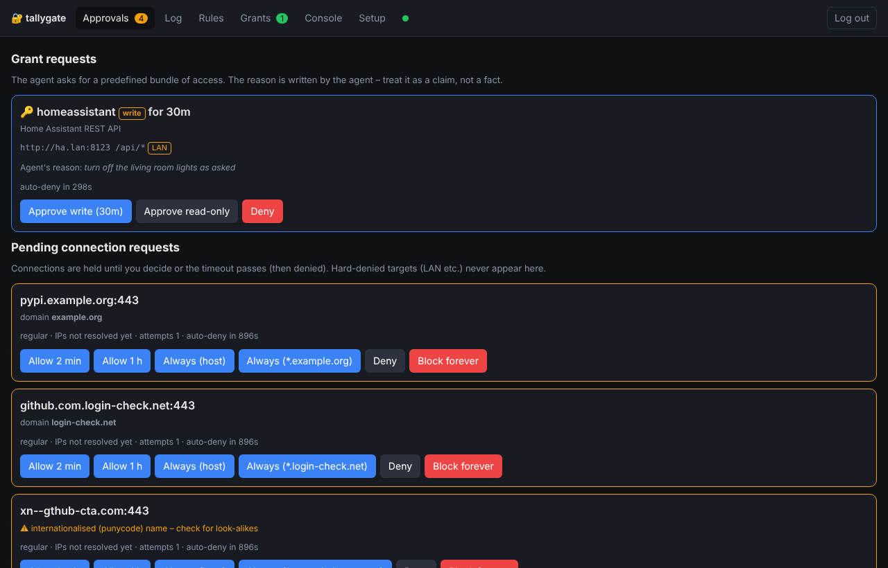
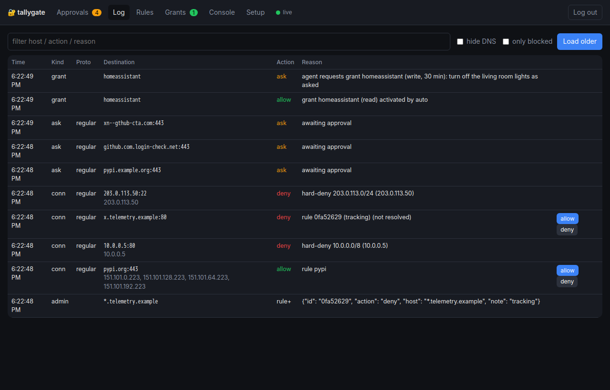
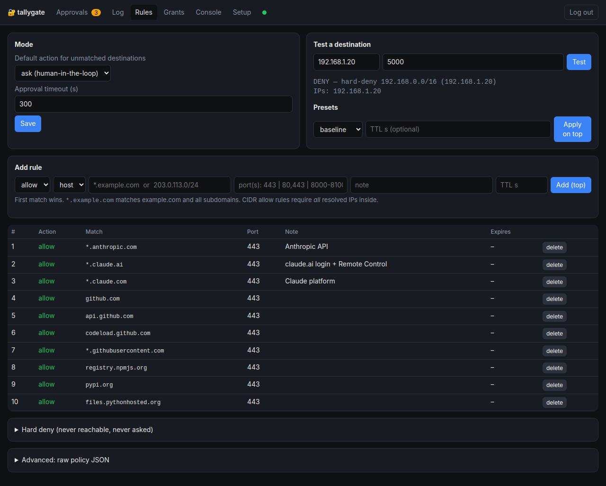
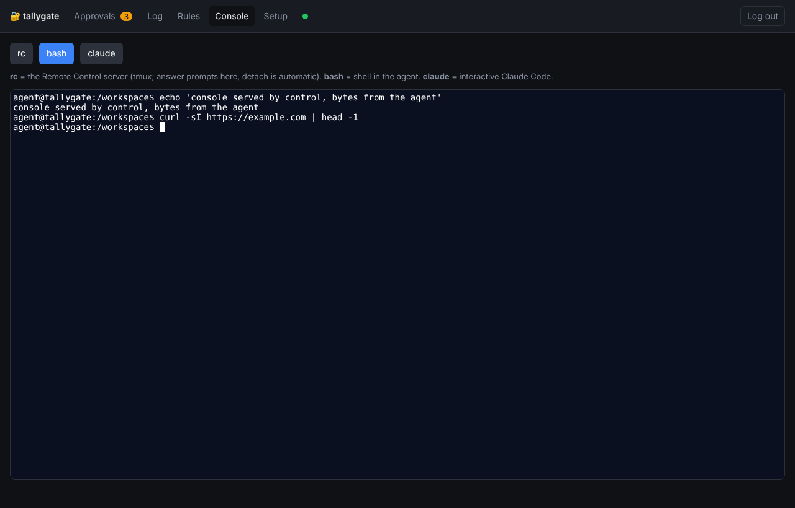
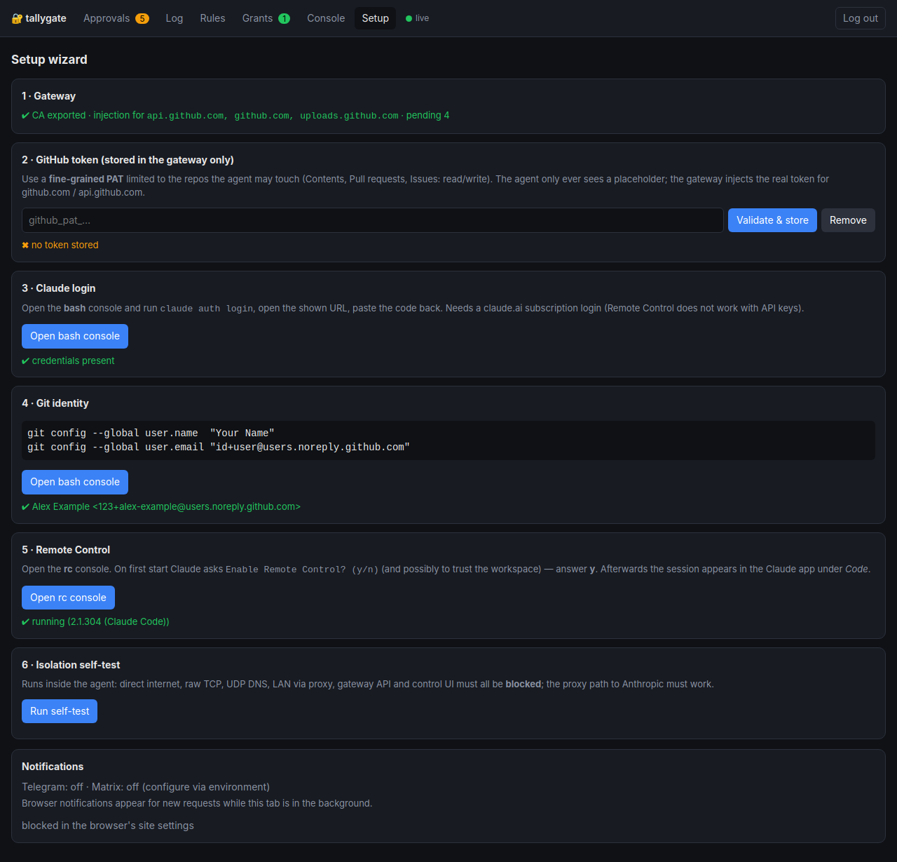

# User guide

The control UI is the operator's cockpit: approve connections, watch traffic, edit the policy, open
consoles into the agent, and run the setup wizard. Remote Control itself is used from the
[Claude app](https://claude.ai/download) or [claude.ai/code](https://claude.ai/code) as usual.

- [Overview](#overview)
- [Approvals](#approvals)
- [Away mode and quiet hours](#away-mode-and-quiet-hours)
- [Grants](#grants)
- [Log](#log)
- [Rules](#rules)
- [Console](#console)
- [Files](#files)
- [Setup wizard](#setup-wizard)
- [Telegram approvals](#telegram-approvals)
- [Matrix approvals](#matrix-approvals)
- [Phone approvals without a chat bot](#phone-approvals-without-a-chat-bot)
- [Rule cookbook](#rule-cookbook)
- [Working with the agent](#working-with-the-agent)

## Overview

The start page: what the agent is doing and whether anything needs you soon. It refreshes every 30 seconds
while it is open and at once when a request arrives or is decided.

| Part | Shows |
|---|---|
| Status | Claude logged in; Remote Control running, with the session name (or the question it waits for); Claude Code version; disk use of the workspace's file system; gateway health and the disk use of its state, with the size of the event log. 90 % or more is marked. |
| Needs attention | Waiting connection and grant requests; rules and grants that end within the hour; a missing GitHub token, one GitHub refuses, or one that expires within 7 days (checked once per page load through the agent, so it appears in the log). |
| Last hour | Connections allowed, denied and asked; the 10 most frequent destinations; destinations seen for the first time in the kept log (`log_keep_days`). |
| Versions | tallygate (the release the gateway runs) and Claude Code, and the latest tallygate release. When a newer one exists, the header shows **Update: X.Y.Z**; the card links to the changelog and the release and shows the upgrade command (click to copy). Claude Code has no auto-updater in the agent: new versions come with tallygate releases. Control asks GitHub itself, at most every 6 hours; `UPDATE_CHECK=0` switches it off ([configuration](configuration.md)). |
| Shortcuts | *Emergency stop* (click twice), *Allow web for 15 min* (the `open` preset), *Open the console* (rc). |

## Approvals

When the agent connects somewhere that no rule covers (and the default is `ask`), the connection is **held**
and appears here, on Telegram/Matrix if configured, and as a desktop notification while the tab is in the
background (turn these on once with **Enable browser notifications** in the Setup tab), and as a push
notification on your phone ([without a chat bot](#phone-approvals-without-a-chat-bot)). The countdown shows
when it will be denied automatically.

Each request offers three choices. **More** shows three further ones on that card.

| Button | Effect |
|---|---|
| Allow once | This host:port for 2 minutes (covers the follow-up connections of one operation) |
| Always allow | Permanent allow rule for exactly this host:port |
| Deny | Deny for 2 minutes (the tool gets an error now; asking again later is possible) |
| *More:* Allow 1 h | This host:port for one hour |
| *More:* Always (*.example.com) | Permanent allow rule for the registrable domain and all subdomains. The button shows the exact pattern; it is not offered when the name has no registrable domain of its own (e.g. `github.io`, IPs). |
| *More:* Block forever | Permanent deny rule |

**Why does the agent want this?** A card can show the agent's recent activity: the command or URL Claude
Code was about to run when the connection started (`Bash curl … – Fetch the data`), or a note the agent
wrote with `tallygate note "…"`. A hook in the agent image reports it, with obvious secrets (tokens,
passwords, credentials in URLs) redacted. It is written by the agent, so it is labelled *claimed by the
agent, unverified*: a prompt injection can lie here like anywhere else. Judge the destination, not the story.
The activity appears in the UI, in Web Push notifications (end-to-end encrypted) and in the log, never in
Telegram, Matrix, ntfy, Gotify or Pushover.

Every decision becomes a normal rule (tagged `[approval]`) that you can review or delete under **Rules**.
Before you click, check the **domain** line: the host is chosen by the agent, so `github.com.evil.example`
has the domain `evil.example`. Punycode names (`xn--…`) are flagged. Names are not resolved before your
approval, so IPs show as "not resolved yet". A destination you approve can still be refused by the hard
deny (LAN, host, metadata…). At most `max_pending` (10) requests wait at once; further unknown destinations
are denied immediately until you have answered.

### Keyboard shortcuts, compact list and sound

For approving a lot. The switches above the list are kept in this browser.

| Key | Effect (Approvals tab, outside text fields) |
|---|---|
| `j` / `k` | Select the next / previous request |
| `a` | Allow once; approve a grant request |
| `h` | Allow 1 h (also while it is hidden behind *More*) |
| `d` | Deny |
| `?` | List the keys (anywhere; `Esc` closes) |

`a`, `h` and `d` act on the selected request; without a selection the first press selects the first request,
so a stray key never decides anything. After a decision the next request is selected. Single-key shortcuts
can be switched off with **Keyboard shortcuts** (for screen readers and voice control). The **Keys (?)**
button next to the switches shows the same list.

**Compact list** shows one line per connection request: destination, the registrable domain when it differs,
the punycode warning and the buttons (the countdown and IPs are hidden). Grant requests keep their full card,
because the agent's reason matters. **Sound** plays a short tone when a request arrives while the tab is in
the background; turn it on with a click, as browsers allow sound only after one.

## Away mode and quiet hours

When you cannot answer, the agent should not wait 60 seconds for every new destination, and your phone
should not buzz at night. The **Availability** card at the top of **Approvals** has two switches:

- **I'm away** (until you are back, for 1 h, 4 h or until 08:00): new destinations and grant requests that
  need your approval are refused at once. The agent gets a clear message (`operator away until 14:00:
  unknown destinations are refused without asking …`) instead of a held connection. Whatever was waiting
  for you when you switch it on is denied too.
- **Quiet hours** (e.g. 22:00–07:00, on the days you pick): the same, every day, without notifications.

Nothing is ever allowed automatically because you are away: away mode only turns *ask* into *deny*. Rules
that allow a destination keep working, and grants with `approval: auto` are still granted (and logged).
What was refused is listed under **Refused while you were away**, with *Allow 1 h* per destination, and sent
as one **digest** to Telegram/Matrix: when quiet hours end, when you are back, and while away every
`digest_minutes` (30). *Dismiss all* clears the list. The header shows *away* or *quiet hours* on every tab.
The agent sees the state in `tallygate grants`.

Quiet hours use the gateway's time zone: set `TZ` (e.g. `TZ=Europe/Berlin` in `.env`) or `tz` in
`quiet_hours`. They can be preset in the gateway config (`quiet_hours`, see
[configuration](configuration.md#availability)); a change in the UI is stored and wins over the file.

## Grants

For access the normal rules would refuse, especially services on your home network, define **grants**:
named bundles with targets, read/write levels, LAN access, credentials and a duration. The agent requests
them (`tallygate request homeassistant --write --reason "…"`). Grant requests appear at the top of
**Approvals** and in Telegram/Matrix, where you can approve, approve read-only, or deny. The **Grants** tab
lists definitions and active grants (with *Revoke*), has an editor for UI-defined grants, and holds the
write-only secrets used for credential injection. *Activate read* / *Activate write* on a definition
activates the grant yourself for its default duration, without a request from the agent. Full guide:
[grants.md](grants.md).

## Log

Live view of every decision: connections (`conn`), approval requests (`ask`), blocked DNS lookups (`dns`), and
admin changes. Filter by text, hide DNS noise, or show only blocked entries. The **allow / deny** buttons
create a rule for exactly that host:port. The table starts with the latest 200 events and keeps up to 2000
while it follows the live stream; *Load older* fetches 200 more.

### Search, time ranges and export

The live view filters only the rows it has loaded. **Search, time ranges and export** (above the table)
searches the whole event log on the gateway, which keeps `log_keep_days` (30) days:

- **Show** *events*, *destinations* (every host:port with its number of events, allowed, denied and asked,
  first seen and last seen) or *new destinations* (first seen inside the time range).
- **Host**: an exact name or IP, or `*.example.com` for the domain and all its subdomains. **Kind** and
  **Action** narrow it further, **Text** searches host, action and reason.
- **Time**: the last hour, 24 hours, today, 7 or 30 days, everything, or a custom range.
- **Filters**: one click for *Denied today*, *New destinations (24 h)*, *Approvals asked (7 days)* and
  *Admin changes (7 days)*. *Save filter* keeps the current one in this browser (under the text or host you
  searched for); ✕ deletes it.
- **A destination** (click it) shows what the policy decides for it now and which rule decides, its counts
  and its latest events. The decision is made on the name, without resolving it: the hard deny on the
  resolved address still applies when the agent connects.
- **Export CSV / JSON** downloads every matching row (up to 50,000 events) for an audit. Cells that a
  spreadsheet would run as a formula are prefixed with `'`.

## Rules

- **Mode**: what happens to unmatched destinations: `ask` (human in the loop), `deny` (strict allowlist) or
  `allow` (blocklist).
- **What the agent can reach** (top of the tab): each destination once, with everything that applies to it:
  allowed, asks you, blocked or only on request (and by which rule), read-only, credentials that are added,
  repository limits, the grants defined for it (and whether one is active), and when it was last used. The
  last line is what happens with everything else. It is a read-only summary; each part is changed where it is
  defined (the rule table, the Grants tab, the gateway config file).
- **Shortcuts**, see below.
- **Learning mode**: record what a new task needs for a limited time, then save the rules in one go. See
  [Learning mode](#learning-mode).
- **Test a destination**: dry run against the current policy. A name that the rules allow is also resolved
  and checked against the hard deny; a name that would be denied or asked is decided without resolving it, as
  for a real connection.
- **Add rule**: host glob or CIDR, ports, note and optional TTL. New rules go to the top (first match wins).
- **Never reachable**: one list of every range that can never be reached, with where each entry comes from
  and where it is changed: the built-in list, `hard_deny_floor` and `grants_never` from the gateway config
  file, the tallygate stack itself, and your own additions, which you edit right there (e.g. your Docker
  host's public IP). *All connections* entries are never asked about and no rule opens them; *Grants*
  entries stay closed for grants too, local-network ones included.
- **Advanced: raw policy JSON**: edit everything at once (validated server-side).
- **Rule usage and suggestions**: how often each rule matched and when it last did (sortable, filterable),
  unused rules to clean up, and permanent rules for destinations you keep approving for a limited time. See
  [Rule usage](#rule-usage).
- **History, export and import**: every version of the policy, a diff between any two, *Restore*, and the
  policy with your UI grants as one YAML file. See [History and rollback](#history-and-rollback).

### Shortcuts

| Action | What it does | Undo |
|---|---|---|
| Allow web (HTTP/HTTPS) for 15 min / Allow web for 1 h | Adds the `open` preset (any public host, ports 80 and 443) with that time limit | *Active → Undo*, or wait |
| Allow all ports for 15 min | Adds the `internet` preset (any public host and port: SSH, databases, ...) | same |
| Unknown destinations: ask me / block / allow | Sets the mode (`ask`, `deny`, `allow`); changes nothing else | click another mode |
| Emergency stop | Revokes all active grants, denies everything waiting for approval (connections and grant requests), undoes the internet shortcuts, ends learning mode, sets the mode `deny` and suspends automatic grant approval | set the mode again |
| Allow a device on the local network | Opens the grant editor with a LAN target (see below) | delete the grant |
| Tool ecosystems | One shortcut for what a tool ecosystem needs: Python, Node.js, Go, Rust, Debian/Ubuntu apt, container registries, Hugging Face. Until undone, for 1 h or for 1 day | *Undo* on the shortcut |

Actions that are hard to take back (*allow (log only)*, *Emergency stop*, deleting a grant or a secret) ask
for confirmation in the page: the first click arms the button (*Confirm: …*) and says what will happen, a
second click within 8 seconds runs it. Escape or moving the focus elsewhere cancels. The panel updates in
place when the policy changes elsewhere, so a duration you picked and the keyboard focus stay where they were.

The **emergency stop** runs on the gateway, most important step first, and carries on when a step fails.
The panel lists every step with a ✔ or ✖, so you can see what did not work. Until you change the mode again,
grants with automatic approval need your approval like any other: the agent cannot switch its access back on
right after the stop. The Grants tab shows when this is in effect.

The mode buttons and *Save* in the Mode card change only the mode and the approval timeout, never the rules.
*Save additional hard deny* starts from the policy as it is on the gateway. *Replace policy* (raw JSON) refuses
to save when the policy was changed elsewhere after the text was loaded (another tab, a Telegram approval): it
keeps your text and marks it; *Reload from the gateway* fetches the current policy, a second *Replace policy*
overwrites on purpose.

All of them create normal rules at the top of the list, with ids like `python:pypi` and tagged `preset:<name>` in
the table, so you can see what a shortcut added. *Undo* removes exactly those rules. Rules you added yourself are
never touched. Because they sit at the top, **shortcut rules win over your own rules while they are
active, deny rules included**: a shortcut that allows `*.quay.io` opens it even if you deny that name further down. The exception is a `deny` rule on a CIDR: it refuses names that resolve into its range wherever it stands. Undo
them, or pick a time limit. *Apply again* replaces the shortcut's rules with the new time limit; the message shows
the time the gateway actually set.

**The local network** (private ranges, the Docker host, cloud metadata) is always blocked by the hard deny, and
no rule or shortcut can open it. This is deliberate: an agent with broad access to your network is the main
risk tallygate exists for. To let the agent reach one device, define a [grant](grants.md): exact host and port,
read or write, a time limit, and your approval each time. Grants created in the UI may only reach addresses
inside `grants_lan_allow` in the gateway config; the button explains what to add when that list is empty.

### Learning mode

Building an allowlist one prompt at a time is slow when you start a new kind of task. *Rules → Learning mode*
lets the task run for a while and shows afterwards what it used:

1. Pick a duration (up to `learning_max_minutes`, 120) and the ports (`443`, or `80 and 443`; the choice comes
   from `learning_ports` in the gateway config) and click *Start learning mode* twice (it asks for
   confirmation). The header shows **Learning mode · N min left** on every tab while it runs; click it to come
   back here.
2. While it runs, a connection to a host name on those ports that **no rule matches** is allowed instead of
   asked or denied, and logged with the reason `learning mode`.
3. When the time is up (or you click *Stop learning mode*), the card lists every destination used during the
   session, grouped by registrable domain, with the number of connections. Destinations only learning mode
   allowed are ticked, with a proposed rule: the exact host, or `*.domain` when several hosts of one domain
   were used. Untick what you do not want and click *Save selected as allow rules*. Earlier sessions stay
   available: pick one under *Session* and click *Show what was used*.

What stays in force while learning mode runs:

- the **hard deny**, also on the resolved addresses: the local network, the Docker host and metadata stay
  unreachable;
- your **deny and ask rules** and **grants** (a name that a grant is defined for is not learned);
- **name-first decisions**: a name is resolved only after it was allowed; IP literals are not covered at all;
- the **SNI/Host binding** and the read-only and credential checks.

Learning mode is never stored in the policy. It ends when its time is up, when you stop it, on the
**emergency stop**, and when the gateway restarts. Saved rules are added at the **bottom** of the list, so a
deny or ask rule you already have keeps winning over a learned `*.domain` rule. The rules you save are tagged
`[learning]` and are permanent; check them in the table like any other rule.

### Rule usage

*Rules → Rule usage and suggestions* shows, for every rule, how many connections it decided and when it last
matched. The counts are kept in the gateway's memory and written to the event log every 15 seconds, so they
cost nothing noticeable per connection. Click a column header to sort (again to reverse), type to filter, or
show only unused or only matched rules.

- **Make it permanent?** When you allowed the same destination for 2 minutes or 1 hour at least
  `suggest_min_approvals` (3) times in `suggest_window_days` (7) days, and no permanent rule covers it, the card
  offers a permanent allow rule. Several hosts of one domain on the same port become one `*.domain` rule (the
  domain comes from the Public Suffix List, like *Always (*.domain)*). *Dismiss* hides a suggestion for
  `log_keep_days`.
- **Unused rules**: permanent rules that did not match anything for `rule_stale_days` (30) days, counted from
  when the gateway first saw the rule. Rules with a time limit are never offered, they end by themselves. Tick
  the ones to remove and click *Remove selected*; the gateway checks again that each one is still unused, and
  the policy history keeps them in case you need one back.

### History and rollback

Every change to the policy is kept as a version, whoever made it: the UI (`web:<user>`), the API (`api`),
an approval on Telegram or Matrix (`telegram:<user>`), a shortcut, the emergency stop, or the gateway itself
when temporary rules expire (`gateway`). *Rules → History, export and import* lists the versions with time,
author and what changed.

- **Changes** shows what changed from that version to the current policy: mode and timeout, additional
  hard-deny ranges, and rules added, removed or changed (compared by rule id). Pick any two versions with
  *From* and *To* to compare them.
- **Restore** replaces the current policy with that version (it asks for confirmation). The restore is a new
  version itself, so it can be undone the same way. Rules of an old version whose time limit has passed are
  ignored and removed, as always.
- **Export (YAML)** downloads the policy and the grants defined in the UI as one file, for a new host or as a
  template to share. Secrets are not in it (they cannot be read back at all), and neither are grants from the
  gateway config file.
- **Import from file** checks the file like a normal policy change and every grant like the grant editor,
  then shows what would change. *Import* replaces the policy and adds or replaces the UI grants in the file;
  grants that are not in the file stay. A `hard_deny_floor` in the file is ignored: the floor comes only from
  the gateway config file.

The gateway keeps the last `policy_history_keep` (500) versions in `policy-history.db` in its data volume.

## Console

| Console | Purpose |
|---|---|
| **rc** | The Remote Control server (tmux session). Answer first-start prompts here and watch connection status. |
| **bash** | A persistent shell in the agent (tmux), e.g. for `claude auth login`, `gh repo clone`, `git config`. |
| **claude** | An interactive Claude Code session in the terminal. |

Sessions persist when you close the tab. tmux basics: `Ctrl-b d` detaches, scroll with `Ctrl-b [`.

## Files

The agent's `/workspace` in the browser: open folders, upload files into the open folder (a spec, a dataset,
a patch) and download results, without `docker cp` or a shell.

- Uploads go into the folder you are in. An existing file is only replaced with **replace existing files**;
  folders and links are never replaced. Up to `FILES_MAX_UPLOAD` (default 50 MiB) per file.
- **Download** saves the file (up to `FILES_MAX_DOWNLOAD`, default 200 MiB; a larger file is marked *too
  large* instead). A folder shows at most its first 2000 entries. Files are always sent as
  downloads (`application/octet-stream`, `Content-Disposition: attachment`), never shown in the UI, so a
  file the agent wrote (HTML, SVG, a script) cannot run on the UI's address.
- Everything stays inside `/workspace`: no `..`, no absolute paths, and links that point outside are refused
  (they are listed as *link*, but cannot be opened or written through).
- Uploads are logged by control (`workspace upload: <path> (<bytes>) by <user>`).

## Setup wizard

The **Setup** tab is the first start in one flow. Every step shows *done*, *to do*, *check* or *optional*; the
summary at the top counts the steps and its *Next* button jumps to the first one still to do. The states are
checked again whenever you open the tab or finish a step. No step needs a console in the agent; only the
password change runs on the Docker host.

| Step | What it does |
|---|---|
| Access to this UI | Checks how your browser reaches the UI: HTTPS (or localhost), the session cookie's `Secure` flag, whether a reverse proxy sends forwarded headers and whether they are trusted, whether `PUBLIC_URL` matches the address you use, and how other machines reach the UI. Each line says what to change. Over plain HTTP from another machine, a *Not encrypted* banner is also shown at the top of every tab. |
| UI password | *To do* while it is still the password generated on first start; change it with `docker compose exec control python -m app.passwd`. |
| Gateway | The gateway's CA is exported and which hosts get credentials injected. |
| GitHub token | *Validate & store* checks a token against GitHub (from control) and stores it in the gateway only. *Remove* deletes the stored token (it asks for confirmation). |
| Log in to Claude | *Start login* runs `claude auth login` in the agent (tmux session `tg-login`) and shows the link to Anthropic's login page. Sign in there and paste the code it shows. Only links to Anthropic's login pages are shown. Once logged in, the button reads *Log in again*. |
| Git identity | *Use my GitHub identity* asks GitHub, through the gateway with the stored token, who you are (`gh api user`) and shows the name and the noreply address `<id>+<login>@users.noreply.github.com`; *Apply* sets them. Without a stored token, or when GitHub refuses it or cannot be reached, it says so and links to the token step. *Enter it yourself* is the fallback. Empty values are never written; a name or address that is set but empty (for example from a `git config` whose `$(…)` failed) is reported as such. |
| Remote Control | *Enable Remote Control* answers Claude Code's one-time question `Enable Remote Control? (y/n)` with yes, trusts `/workspace` and restarts Remote Control. The step is done when it runs; it also tells you when Remote Control waits for an answer in the *rc* console. Switched off with `RC_ENABLE=0`. |
| Starting policy | *Ask me* or *Strict* sets what happens with unknown destinations; *Shortcuts* opens them in the Rules tab. |
| Phone notifications | Status of Telegram, Matrix, Web Push, ntfy, Gotify and Pushover; browser notifications. Web Push devices are managed in the *Notifications* card below the steps. |
| Isolation self-test | Runs the in-agent self-test. |

## Telegram approvals

1. Create a bot: talk to [@BotFather](https://t.me/BotFather), `/newbot`, copy the token.
2. Send any message to your bot, then get your chat ID:
   `curl https://api.telegram.org/bot<TOKEN>/getUpdates` → `message.chat.id` (and `message.from.id`).
3. In `.env`: `TELEGRAM_BOT_TOKEN`, `TELEGRAM_CHAT_ID`, `TELEGRAM_ALLOWED_USER_IDS=<your from.id>`.
4. `docker compose up -d control`.

Each request arrives with **Allow once**, **Always allow**, **Deny** and **More…**; *More…* adds *Allow 1 h*,
*Always (\*.domain)* (when the name has a registrable domain) and *Block forever* to the same message. After a
decision the message is edited to show the outcome and who decided. Taps from users not in the allowlist are answered with "Not authorised".

## Matrix approvals

1. Create a dedicated bot user on your homeserver (e.g. `@tallygate:example.org`) and get an access token
   (log in once with any client and copy the token, or use the login API).
2. Create an **unencrypted** room, invite the bot and join with the bot user.
3. In `.env`: `MATRIX_HOMESERVER`, `MATRIX_ACCESS_TOKEN`, `MATRIX_ROOM_ID` (`!…:example.org`),
   `MATRIX_ALLOWED_USERS=@you:example.org`.
4. `docker compose up -d control`.

Each request is posted as `🔐 #3 Agent wants to connect: host:port …` with three pre-seeded reactions: tap
👍 allow once, ✅ always allow or 👎 deny. The message lists the others, which you add yourself: ⏰ 1 h,
🌐 domain, ⛔ block. Or reply `allow 3`, `hour 3`, `always 3`, `domain 3`, `deny 3` or `block 3`. The bot
confirms the outcome in a reply.

## Phone approvals without a chat bot

**Web Push (installable app).** Open the UI on your phone over HTTPS, install it (*Add to Home screen* /
*Install app*; on iPhone this is required, iOS 16.4 or later), then **Setup → Notifications → Turn on
notifications on this device**. Each request arrives as a notification:

| Request | Buttons in the notification |
|---|---|
| Connection | **Allow once**, **Deny** |
| Grant, read level | **Approve read**, **Deny** |
| Grant, write level | **Approve read-only** (if the grant offers read), **Deny**. Write access needs the UI or a chat bot. |

Tapping the notification itself opens the approvals. After a decision (from anywhere) the notification is
replaced by the outcome. The buttons work for at most 10 minutes and once, only on the device they were sent
to; they need no login, but they cannot do anything except that one decision (see the
[threat model](threat-model.md), T37). *Send a test* checks the path; *Remove* stops a device. A device
whose subscription expired is removed automatically.

Web Push needs a secure context: HTTPS (your reverse proxy) or `localhost`. On plain HTTP the Setup tab says
so, and everything else keeps working. Control sends the messages to the browser's push service (Google,
Mozilla, Apple or Microsoft); the content is end-to-end encrypted to your device, only the timing and size
are visible to the push service.

**ntfy, Gotify, Pushover.** For a notification on the phone with apps you may already use, set `NTFY_URL`
(+ `NTFY_TOKEN`), `GOTIFY_URL` + `GOTIFY_TOKEN` or `PUSHOVER_TOKEN` + `PUSHOVER_USER` (see
[configuration](configuration.md)). They get the same text as Telegram and a link to the UI (`PUBLIC_URL`),
but no decision buttons: an approve link would work for anyone who sees it. These services see the
destinations in plain text, like Telegram does.

## Rule cookbook

| Goal | Rule / setting |
|---|---|
| Strict allowlist, no prompts | Mode `deny`; add allow rules for what you need |
| Everything public allowed, but log it | Mode `allow` (hard deny still protects the LAN) |
| Allow a package ecosystem | *Rules → Shortcuts → Tool ecosystems* (Python, Node.js, Go, Rust, apt, container registries, Hugging Face) |
| Allow docs browsing for an hour | *Rules → Shortcuts → Allow web for 1 h* (preset file `open` with TTL `3600`) |
| Let the agent install Go modules today | *Shortcuts → Tool ecosystems → Go modules → for 1 day → Apply* |
| Block a noisy telemetry host quietly | `deny` rule for the host (no more prompts) |
| Reach a LAN database | `services:` entry with `allow_private: true` in the gateway config (`gateway.yaml`, see [operations](operations.md#with-docker-compose-recommended)) |
| SSH to one external host | Allow `host:22`; add `openssh-client netcat-openbsd` to the agent image (see *Toolchains* below); then `ssh -o ProxyCommand='nc -X connect -x 172.31.10.2:3128 %h %p' host` |

## Working with the agent

- **Repositories**: `gh repo clone owner/repo /workspace/repo`. git uses HTTPS; the gateway injects your token.
  To limit the agent to some repositories, list them in `github_repos` in the gateway config
  ([configuration](configuration.md#github-per-repository)); the Setup tab shows the list.
- **Parallel sessions**: start more sessions on the same environment from the Claude app; set
  `RC_ARGS=--spawn worktree` to give each session its own git worktree.
- **Skills**: put them in `/home/agent/.claude/skills/<name>/SKILL.md` in the agent (the `agent-home` volume, owner uid 1000), e.g. with `docker compose cp`.
- **Toolchains**: with the published images, add Debian packages in an agent image of your own
  ([operations](operations.md#custom-agent-image)); when building from source, set `AGENT_EXTRA_PACKAGES` and
  run `make up`. `pip install --user` and `npm install` work through the proxy if the registries are allowed.
